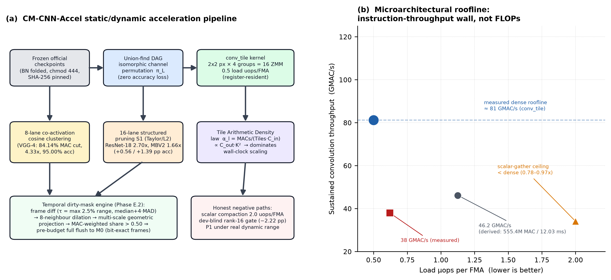
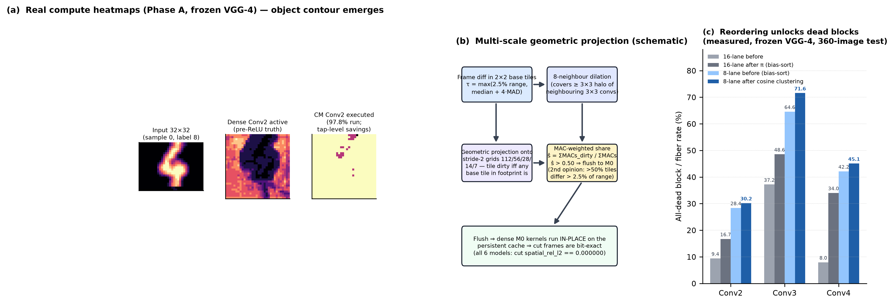
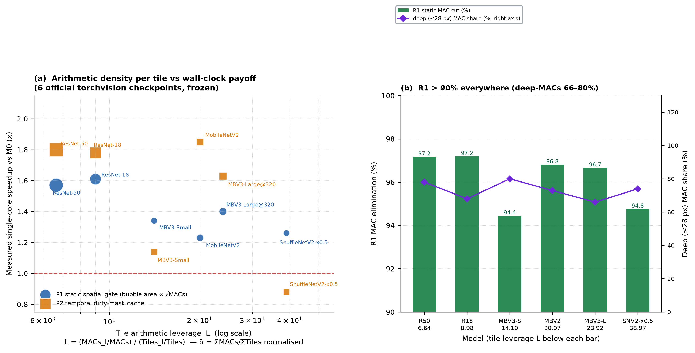
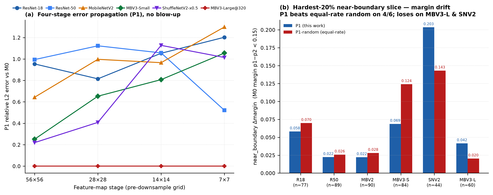
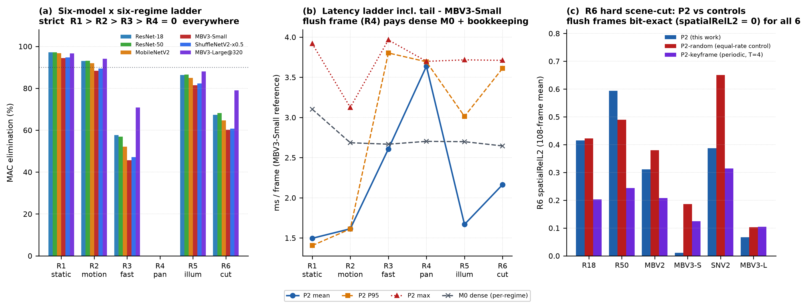
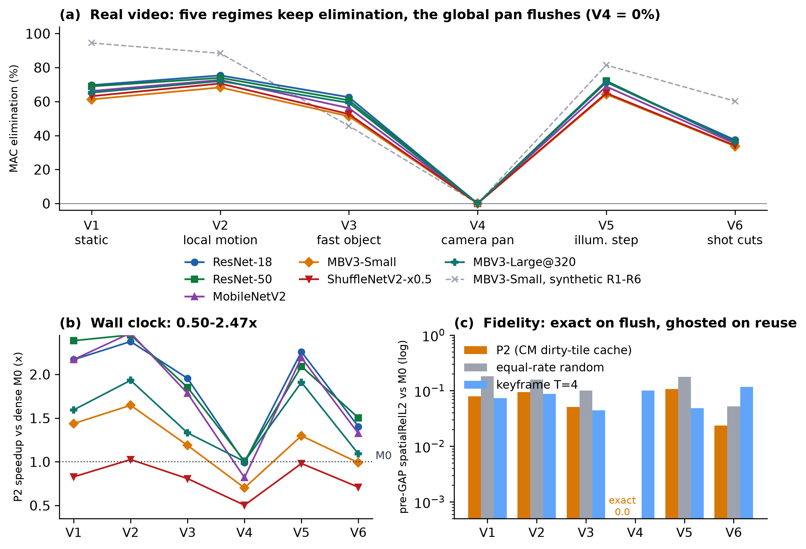
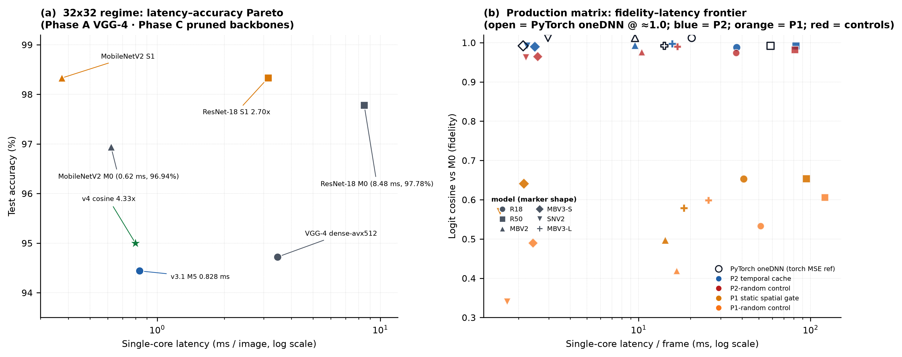

# CM-CNN-Accel: Microarchitecture-Aware Spatial and Temporal Computation Skipping for CNN Inference on AVX-512 CPUs
**Version**: 2.0 · **Date**: November 2026

## Abstract

Theoretical reductions in multiply–accumulate operations (MACs) rarely translate into proportional wall-clock speedups for convolutional neural network (CNN) inference on general-purpose CPUs. In practice, the latency gains from dynamic sparsity are bottlenecked by SIMD execution granularity, instruction load-port throughput, and network topology. We introduce **CM-CNN-Accel**, a microarchitecture-aware inference framework for AVX-512 CPUs that bridges the gap between algorithmic sparsity and hardware execution across inner-loop microkernels, graph-level channel permutations, and cross-frame feature reuse.

At the kernel level, we design `conv_tile`, a dense convolution microkernel that keeps a $2\times2$-pixel by four-output-group tile resident across 16 ZMM registers. Static instruction analysis indicates that `conv_tile` requires only 0.5 load $\mu$ops per FMA (achieving 81 GMAC/s), outperforming fine-grained scalar-gather sparse kernels that require approximately 2.0 load $\mu$ops per FMA. At the graph level, we introduce a functionally isomorphic union-find channel permutation ($\pi$) paired with 16-lane-aligned structured pruning (`S1`), which consolidates inactive channels into contiguous blocks without disrupting SIMD memory access. For streaming video, we develop a temporal skipping mechanism (`P2`) based on $2\times2$ spatial-tile change detection and cross-frame feature caching, safeguarded by an in-place dense fallback (`M0`) triggered when the network-wide MAC-weighted dirty ratio exceeds $\hat{s} > 0.50$, thereby eliminating scene-cut ghosting.

We evaluate CM-CNN-Accel on a single AMD Ryzen 9 9955HX (Zen 5) core across a frozen VGG-4 model, structured-pruned networks, and six official pretrained `torchvision` backbones verified for end-to-end numerical alignment with PyTorch ($\max\lvert\Delta\text{logit}\rvert \le 8.66\times10^{-4}$ on static images and $\le 1.44\times10^{-3}$ across 216 real-video frames, with 0.995–1.000 Top-1 agreement). Our experiments yield four primary findings:

1. **Naturally Sparse Inputs:** On a workload with 78% exact-zero pixels, combining VGG-4 with 8-lane cosine co-activation clustering eliminates 84.14% of MACs and delivers a $4.33\times$ single-core speedup at 95.00% accuracy.
2. **Dense Full-Canvas Inputs:** Fine-grained dynamic scalar skipping underperforms our dense microkernel ($0.61\text{--}0.97\times$ speedup) due to gather overhead, whereas 16-lane-aligned structured pruning (`S1`) achieves $2.70\times$ speedup ($+0.56\text{ pp}$ accuracy) on ResNet-18 and $1.66\text{--}1.70\times$ ($+1.39\text{ pp}$) on MobileNetV2.
3. **Programmatic Temporal Regimes:** Across six controlled temporal stress regimes (`R1–R6`), all six backbones follow a strict monotone MAC-elimination hierarchy ($\text{R1} > \text{R2} > \text{R3} > \text{R4} = 0\%$), while the dense fallback ensures bit-exact outputs (0.000000 spatial relative error) on scene-cut frames.
4. **Real-World Video Streams:** Replicating these six regimes on public real-world videos (`V1–V6`) reveals that temporal speedup is governed by the *spatial connectivity* of inter-frame changes rather than apparent scene stasis. Without spatial filtering, uncorrelated analog tape grain triggers "halo percolation," where 8-neighbor dilation and receptive-field projection amplify scattered noisy tiles into a full-network flush ($1-(1-0.108)^{256} \approx 1$). Applying a pre-dilation $3\times3$ majority filter and a 40% global-change threshold suppresses this noise, preserving 51.3–75.4% MAC elimination ($0.81\text{--}2.47\times$ speedup) on fixed-camera footage (`V1/V2/V3/V5`) and 33.7–37.4% on hard cuts (`V6`), while correctly flushing global camera pans (`V4`) and handheld shake.

Finally, we formulate a **Tile Arithmetic Density Model**, $\alpha_l = \text{MACs}_l / (\text{Tiles}_l \cdot C_{in,l}) \approx 4 C_{out,l} K_l^2 / g_l$, which incorporates the group-convolution factor $g_l$. This model explains why dynamic skipping yields divergent wall-clock returns across architectures—such as ResNet-50 achieving a $1.80\times$ streaming speedup while ShuffleNetV2-x0.5 incurs a $0.88\times$ scheduling slowdown—and defines the operational boundaries imposed by receptive-field dilation, spatial ghosting, and calibration sample size.

**Keywords**: CNN inference acceleration; AVX-512; microarchitectural throughput model; dynamic sparsity; structured pruning; temporal skipping; tile arithmetic density; real-world video validation

---

## 1 Introduction

Deploying convolutional neural networks (CNNs) on edge devices and general-purpose CPUs demands low latency under strict power and compute budgets. While modern architectures reduce theoretical FLOPs through depthwise separable convolutions, channel shuffling, and neural architecture search, practical CPU inference remains bottlenecked by instruction-issue bandwidth, cache hierarchy traffic, and SIMD data-supply limits. Consequently, evaluating an inference optimization requires analyzing both algorithmic MAC reduction and realized wall-clock latency.

Prior work exploits redundancy across several granularities: structured pruning permanently removes channels or branches; dynamic sparse inference conditionally skips spatial blocks or execution paths at runtime; video inference frameworks reuse features across adjacent frames; and microkernel optimizations maximize dense-operator throughput via vectorization, register blocking, and cache tiling. Because these techniques operate at distinct layers of the software-hardware stack—model topology, single-frame scheduling, cross-frame caching, and instruction-level execution—their latency benefits are non-additive and frequently diverge from theoretical MAC savings.

A fundamental question remains: *why does the same theoretical MAC reduction yield substantial speedups in some scenarios, negligible gains in others, and net slowdowns in the worst cases?* On general-purpose CPUs, three coupled factors govern this translation:

1. **SIMD Execution Granularity:** Whether skipping an operation preserves contiguous vector memory accesses or forces expensive scalar gathers.
2. **Load-Port Throughput:** The ratio of memory load micro-operations ($\mu$ops) to fused multiply–add (FMA) instructions relative to hardware port capacity.
3. **Convolution Topology:** How much arithmetic work a single skipping decision controls relative to its runtime bookkeeping overhead.

We present **CM-CNN-Accel**, a unified single-core AVX-512 inference and measurement framework designed to quantify how these three factors interact. CM-CNN-Accel integrates a 16-ZMM register-resident dense microkernel (`conv_tile`), a functionally isomorphic union-find DAG channel permutation ($\pi$), 16-lane-aligned structured pruning (`S1`), and spatial/temporal tile-skipping schedulers (`P1`/`P2`). We evaluate wall-clock latency, task accuracy, numerical alignment, feature-map spatial fidelity, and temporal stress behavior across a frozen VGG-4 network, structured-pruned models, and six official pretrained `torchvision` backbones.

Specifically, we address two research questions:

* **RQ1:** On a general-purpose AVX-512 CPU, which forms of input or structural redundancy translate into wall-clock speedups under explicit accuracy constraints?
* **RQ2:** How do SIMD microkernel throughput and network topology jointly determine the cross-architecture gains of dynamic computation skipping?

This paper makes four verifiable contributions:

1. **Microarchitectural Instruction-Throughput Model:** Through static inner-loop analysis, we show that our register-resident `conv_tile` microkernel requires only 0.5 load $\mu$ops/FMA (achieving 81 GMAC/s), whereas fine-grained scalar-gather sparse kernels require $\approx 2.0$ load $\mu$ops/FMA. This 4:1 load-port disparity explains why unstructured runtime sparsity fails to beat dense execution on full-canvas inputs.
2. **Functionally Isomorphic Reordering and SIMD-Aligned Pruning:** We formalize the consistency conditions for a DAG-wide channel permutation ($\pi$) and evaluate its synergy with 16-lane SIMD execution. The reordered execution (`M2`) is mathematically isomorphic to the dense baseline (`M0`), maintaining a logit RMSE $\le 2.03\times10^{-6}$ and 100% Top-1 agreement (with minor floating-point variations attributable solely to summation re-association). When paired with 16-lane-aligned structured pruning (`S1`), our engine achieves $2.70\times$ speedup on ResNet-18 and $1.66\text{--}1.70\times$ on MobileNetV2.
3. **Tile Arithmetic Density Model:** We formulate per-layer tile arithmetic density ($\alpha_l$) incorporating the convolution group count $g_l$, and validate its relationship to amortized skipping gains across six pretrained CNN architectures. The model captures cross-backbone speedup trends while clarifying why single-scalar proxies cannot fully dictate per-frame intermediate motion rankings.
4. **Temporal Dynamic Skipping and Boundary Characterization:** We design a geometric dirty-mask propagation pipeline with a MAC-weighted full-flush fallback (`P2`). Across six programmatic stress regimes (`R1–R6`) and six real-world video regimes (`V1–V6`), we demonstrate a strict monotone elimination hierarchy, bit-exact scene-cut fallback, and superiority over equal-rate random and periodic keyframe baselines—while documenting the exact conditions under which halo percolation, spatial ghosting, and bookkeeping overhead limit performance.

---

## 2 Platform, Weight Freezing, and Measurement Methodology

### 2.1 Hardware and Software Configuration

All experiments are conducted on a consistent hardware and software stack, summarized in Table 1.

**Table 1.** Hardware, compiler, and measurement configuration.

| Component | Specification |
|---|---|
| **Processor** | AMD Ryzen 9 9955HX (Zen 5 architecture; AVX-512F/BW/DQ/VL/VNNI) |
| **Core Binding** | Single physical core pinned (`OMP_NUM_THREADS=1`) on a 32-core host |
| **Compiler & Flags** | `g++` (GCC) 16.2.1 20260810; `-O3 -march=native -mavx512f -mfma -std=c++20` (plus `-mavx512vl -mavx512bw` for RGB zero-modification, pruning, and pretrained-backbone builds) |
| **Model Weights** | Read-only (`chmod 444`), SHA-256 verified (Appendix B); batch normalization (BN) folded at export; zero retraining for inference (recovery training applies solely to the pruned checkpoints in §4) |
| **Timing Protocol** | Interleaved mode rotation to neutralize thermal drift, preceded by one untimed warm-up pass per mode; we report the median of per-repetition means |
| **Calibration Split** | Strictly isolated development sets ($N_{dev} = 360$ for $32\times32$ benchmarks; $N_{dev} = 96$ for pretrained backbones); test sets are reserved exclusively for final evaluation |
| **Energy Proxy** | Unprivileged environment (`intel-rapl` returns `EACCES`; `perf_event_paranoid = 2`). We report invariant TSC hardware cycles (`__rdtsc()`) and an analytical cycle proxy (§6.5) rather than hardware mJ/image |

**Statistical Units.** We distinguish between independent test samples ($N$) and timing repetitions ($R$). The three $32\times32$ benchmarks evaluate $N = 360$ independent test images, with $R = 20$ timing repetitions for VGG-4 static inference, $R = 10$ for zero-modification static inference ($R = 2\text{--}3$ for streaming), and $R = 8$ for structured pruning. The six official pretrained backbones use $N = 32$ independent static images ($R = 2$) and $N = 36$-frame sequences per temporal regime ($R = 3$, yielding 108 timed frames per regime). Timing repetitions $R$ measure execution variance on identical workloads and are never conflated with sample size $N$.

### 2.2 Datasets and Workloads

We evaluate four distinct workload categories:

* **Sparse-Input Benchmark (Frozen VGG-4, $32\times32\times1$; §3.3):** Generated via a deterministic pipeline that upscales $8\times8$ handwritten digits (bicubic to 18–24 px) and applies random translation, structured background clutter, 2–4 anti-aliased distractor strokes, and sensor noise. The dataset comprises 1,797 images (1,437 train, $N = 360$ test, plus an independent calibration dev set; RNG seeds: split `0x5eed1234`, sample `0xc0ffee42`, stream `0x51ace5`, dev `0x0de0b6b3`). The synthetic temporal stream consists of 360 test objects $\times$ 6 frames ($N = 2,160$ frames, $\pm 1\text{ px}$ translation/frame). VGG-4 comprises four $3\times3$ convolutional layers: Conv1 ($32\times32\times1 \rightarrow 32$, 0.29M MACs), Conv2 ($\rightarrow 64$, 18.87M MACs), $2\times2$ MaxPool, Conv3 ($16\times16\times64 \rightarrow 128$, 18.87M MACs), and Conv4 ($\rightarrow 128$, 37.75M MACs), followed by $4\times4$ average pooling and a linear classifier, totaling 75,792,384 dense MACs.
* **Zero-Modification Full-Canvas Benchmark ($32\times32\times3$ RGB; §3.4):** Pretrained PyTorch models exported into our graph intermediate representation (IR) after BN fusion, comprising ResNet-18 (555.42M MACs, 97.78% dense accuracy) and MobileNetV2 (52.30M MACs, 96.94% dense accuracy). The accompanying 2,160-frame temporal stream evaluates out-of-distribution moving digits (achieving 100% prediction agreement with PyTorch at 29.26% and 50.05% accuracy, respectively).
* **Structured-Pruning Benchmark (16-Lane Aligned, $32\times32\times3$ RGB; §4):** Channels are pruned via producer/consumer Taylor/L2 importance to 16-lane-aligned widths ($\alpha = 0.6719 \rightarrow 48/80/176/352$ for ResNet-18; $\alpha = 0.7047$ for MobileNetV2) and fine-tuned for 12 epochs using AdamW, knowledge distillation ($\alpha_{KD} = 0.6$), and tile-$\ell_1$ regularization ($4\times10^{-4}$).
* **Pretrained-Backbone Evaluation ($224\times224$ and $320\times320$; §5–§6):** Six official `torchvision` checkpoints—ResNet-18, ResNet-50, MobileNetV2, MobileNetV3-Small, ShuffleNetV2-x0.5 (all at $224\times224$), and the $320\times320$ convolutional trunk of `ssdlite320_mobilenet_v3_large`—exported after BN folding without weight modification. Static evaluation uses $N = 32$ test images ($N_{dev} = 96$ for calibration). Temporal evaluation spans six programmatic stress regimes (`R1–R6`) and six real-world video regimes (`V1–V6`), each comprising 36 frames $\times$ 3 repetitions.

### 2.3 Fidelity Metrics and Numerical-Agreement Protocol

Relying solely on Top-1 accuracy can obscure structural feature degradation. We therefore evaluate all approximate modes across seven fidelity dimensions relative to the dense baseline (`M0`):

1. Top-1 and Top-5 prediction agreement.
2. Logit root-mean-square error (RMSE).
3. Logit cosine similarity.
4. Softmax Kullback–Leibler (KL) divergence.
5. **Hard-Boundary Slice Fidelity:** Prediction agreement and margin drift ($\Delta\text{margin}$) on the hardest 20% of samples where the dense confidence margin is narrow ($p_1 - p_2 < 0.15$).
6. **Pre-GAP Spatial Relative $L_2$ (`spatialRelL2`):** The relative $L_2$ error on the final feature map immediately preceding global average pooling (GAP), which captures moving-object ghosting that spatial pooling otherwise averages out.
7. **Four-Stage Error Propagation:** Relative $L_2$ feature error measured across spatial resolutions ($56\times56$, $28\times28$, $14\times14$, and $7\times7$).

Every approximate mode (`P1`, `P2`) is benchmarked against two baselines: an **equal-rate random control** that uniformly samples and skips the exact number of tiles skipped by the policy on the same frame and layer (configured conservatively to skip 0.5–5.5 percentage points more tiles than our method), and a **periodic keyframe baseline** (`P2-keyframe`, period $T = 4$).

---

**Fig. 1.** (a) The CM-CNN-Accel execution pipeline: frozen weights undergo union-find DAG functionally isomorphic channel permutation ($\pi$) and execute on `conv_tile` (16 ZMM registers, 0.5 load $\mu$ops/FMA), paired with multi-scale geometric dirty-mask projection and MAC-weighted full-flush fallback. Static optimization branches (VGG-4 cosine clustering: 84.14% MAC reduction, $4.33\times$ speedup; `S1` structured pruning: $2.70\times$ and $1.66\times$ speedups) are evaluated independently. (b) Inner-loop throughput comparison: `conv_tile` (81 GMAC/s measured) vs. `im2col` (12.030 ms, 46.2 GMAC/s derived) vs. patch-packed tap pre-filtering (38 GMAC/s) vs. fine-grained scalar compaction ($\approx 2.0$ load $\mu$ops/FMA, yielding $0.61\text{--}0.97\times$ relative to dense execution on full-canvas ResNet-18/MobileNetV2).

---

## 3 Microarchitectural Throughput Model, Isomorphic DAG Channel Permutation, and Sparse-Input Acceleration

### 3.1 Functionally Isomorphic DAG Channel Permutation ($\pi$)

To maximize contiguous SIMD block sparsity without altering network semantics, we reorder channels globally across the computation graph.

**Definition 3.1 (Channel-Space Union-Find).** We partition the computation DAG into coupled channel spaces (e.g., stem, residual stage buses, BasicBlock interior axes, InvertedResidual expansion axes, and classifier head). By aggregating input and output weight norms from both producer and consumer perspectives and linking coupled axes via a union-find data structure, we obtain a disjoint partition of channel spaces $\{S_i\}$.

**Definition 3.2 (Isomorphic Permutation).** Within each coupled space $S_i$, we compute an index permutation $\pi_i$—either by sorting channels in descending order of expected post-BN-folding bias activity, or via greedy 8-lane cosine co-activation bin-packing on development-set post-ReLU activation bitmaps. The permutation is applied consistently across all connected tensors:

* Standard convolution weights: $w'[t][i'][o'] = w[t][\pi_{\text{in}}(i')][\pi_{\text{out}}(o')]$.
* Biases and linear classifier rows: permuted along $\pi_{\text{out}}$.
* Depthwise convolution weights: permuted identically along the coupled channel axis.
* Residual branches: all branches merging into a common residual bus share an identical stage permutation $\pi_{\text{bus}}$, ensuring pointwise equivariance $\text{ReLU}(\pi A + \pi B) = \pi\,\text{ReLU}(A + B)$.

**Proposition 3.1 (Functional Isomorphism).** *If $\pi$ is applied consistently across all producer and consumer templates in $\{S_i\}$, the permuted network $f'$ satisfies $f'(x) = \pi_{\text{head}} \cdot f(x)$ for all inputs $x$ in exact real arithmetic. In IEEE-754 floating-point arithmetic, $f'(x)$ and $f(x)$ are functionally isomorphic up to summation re-association.*

*Proof.* By induction over the topological sort of the DAG. Pointwise channel operators (ReLU, folded BN, per-channel scaling) are strictly equivariant under channel permutation. Shared stage permutations preserve residual additions. Global average pooling is invariant to spatial summation order per channel, and permuting the final linear classifier rows by $\pi_{\text{head}}$ restores the exact output ordering. In finite-precision floating-point arithmetic, permuting the input-channel reduction axis alters the order of inner-product accumulations, introducing bounded rounding variations without changing the underlying mathematical function. $\blacksquare$

**Empirical Verification and Block Diagonalization.** Across our benchmarks, channel permutation preserves functional equivalence while substantially increasing contiguous block sparsity:

* **Numerical Alignment:** On VGG-4, dense accuracy remains identical after permutation (94.72%, 341/360) with 100% Top-1 argmax agreement and $\max\lvert\Delta\text{logit}\rvert \le 10^{-6}$. On ResNet-18 and MobileNetV2, the permuted compaction mode (`M2`) achieves 100% Top-1 agreement with `M0`, yielding logit RMSEs of $2.03\times10^{-6}$ and $1.43\times10^{-6}$ (feature relative $L_2$ of $1.88\times10^{-7}$ and $2.32\times10^{-7}$), well within the $10^{-4}$ floating-point re-association bound.
* **SIMD Block Sparsity Dividend:** Table 2 shows the fraction of completely inactive (all-zero) 16-lane and 8-lane channel blocks on the frozen VGG-4 test set before and after permutation. Co-activation clustering concentrates active channels together, lifting the 8-lane all-zero block rate in Conv3 to 71.57% and Conv4 to 45.09%.

**Table 2.** Measured all-zero SIMD channel-block rates (%) on frozen VGG-4 before and after isomorphic channel permutation ($\pi$).

| Granularity & Ordering | Conv1 | Conv2 | Conv3 | Conv4 |
|---|---:|---:|---:|---:|
| **16-Lane Unordered (Dense Baseline)** | 2.84% | 9.41% | 37.22% | 7.96% |
| **16-Lane Clustered ($\pi$)** | 2.84% | 16.74% | 48.59% | 34.05% |
| **8-Lane Bias-Sorted ($\pi$)** | — | — | 64.59% | — |
| **8-Lane Cosine Co-Activation ($\pi$)** | — | 30.22% | **71.57%** | **45.09%** |

### 3.2 `conv_tile`: A 16-ZMM Register-Resident Microkernel

Traditional `im2col + GEMM` pipelines materialize large intermediate matrices in memory; for example, `conv4_1` in ResNet-18 (512 output channels) streams a 4.5 MB `im2col` buffer from cache $512 / 16 = 32$ times. To eliminate redundant memory traffic, we design `conv_tile`, a direct convolution microkernel that keeps a **$2\times2$ spatial pixel tile across 4 output channel groups (64 channels) resident in 16 ZMM accumulators** throughout the input-channel reduction loop.

For every 16 FMA instructions, `conv_tile` issues only four 64-byte aligned weight-row loads and four scalar input broadcasts, requiring **0.5 load $\mu$ops per FMA** compared to 1.125 load $\mu$ops/FMA for `im2col`. Achieving this theoretical throughput requires two implementation invariants:

1. **Compile-Time Register Indexing:** All 16 ZMM accumulator indices must be compile-time constants (via C++ template unrolling); runtime array indexing forces register spilling to the stack.
2. **Masked Tail Handling:** Layers whose output channel count $C_{out}$ is not a multiple of 64 (such as narrow layers in MobileNetV3 and ShuffleNetV2) execute using AVX-512 hardware predicate masks (`__mmask16`) rather than falling back to scalar loops or gather instructions.

Even without sparsity, replacing `im2col` with `conv_tile` speeds up dense inference by **$1.76\times$ on ResNet-18** ($12.030 \rightarrow 6.839\text{ ms/img}$, achieving 81 GMAC/s) and **$1.21\times$ on MobileNetV2** ($0.742 \rightarrow 0.615\text{ ms/img}$).

### 3.3 Sparse-Input Acceleration on VGG-4

**Element-Wise Sparsity vs. Block Skippability.** On the 360-image VGG-4 test set (where 78% of input pixels are exact zeros), element-wise pre-ReLU zero rates are high: 68.81% (Conv1), 65.73% (Conv2), 93.14% (Conv3), and 76.23% (Conv4). However, without channel permutation, 16-lane all-zero block rates are only 2.84%–37.22% (Table 2), and *zero* spatial pixels are completely inactive across all channels. Consequently, predicting whether an unpermuted 16-lane block can be skipped yields a hit rate of $\approx 10^{-4}$.

**Six-Level Ablation Study.** By combining input-side exact scalar compaction with our 8-lane cosine co-activation permutation ($\pi$) and a two-stage contextual gate (Stage A/B, detailed in Appendix A), our final configuration reduces MACs by **84.14%** (to 12.02M MACs/img) and achieves a **$4.33\times$ speedup** ($0.799\text{ ms/img}$) at **95.00% accuracy** ($+0.28\text{ pp}$ over the dense baseline). Table 3 isolates the contribution of each component across configurations `M0` through `M5`.

**Table 3.** Stepwise ablation on the frozen VGG-4 sparse-input benchmark ($N = 360, R = 20$).

| Mode & Configuration | MACs / Image | MAC Reduction | Latency (ms) | Speedup | Mechanism & Fidelity Notes |
|---|---:|---:|---:|---:|---|
| **M0:** Dense (`conv_tile`) | 75,792,384 | 0.00% | 3.445 | $1.00\times$ | 16-ZMM register-resident baseline (94.72% accuracy) |
| **M1:** Scalar Compaction | 16,315,418 | 78.47% | 1.491 | $2.31\times$ | Skips exact-zero input activations |
| **M2:** `M1` + Permutation ($\pi$) | 16,315,418 | 78.47% | 0.957 | $3.60\times$ | Functionally isomorphic (logit RMSE $5.4\times10^{-7}$); $1.56\times$ cache/SIMD locality gain over `M1` |
| **M3:** `M2` + Stage A Gate | 12,172,647 | 83.94% | 0.813 | $4.24\times$ | Contextual block skipping (10.76M blocks skipped) |
| **M4:** `M2` + Stage B Gate | 16,279,896 | 78.52% | 0.973 | $3.54\times$ | Surround-bound safety valve (67,162 triggers; $+0.05\text{ pp}$ MAC reduction) |
| **M5:** Full Pipeline (`M3`+`M4`) | 12,174,870 | 83.94% | 0.828 | $4.16\times$ | Combined two-stage gating |
| **Final:** 8-Lane Cosine $\pi$ | **12,020,300** | **84.14%** | **0.799** | **$4.33\times$** | **95.00% accuracy ($+0.28\text{ pp}$ vs. `M0`)** |

**Fig. 2.** (a) Activation heatmaps on frozen VGG-4 (test sample 0): raw input ($32\times32$, 24 non-zero rows), ground-truth pre-ReLU Conv2 activity (`DENSE_CONV2_ACTIVE`), and executed pixels (`CM_CONV2_EXECUTED`). Because 97.8% of spatial pixels remain partially active, the 78.47%–84.14% MAC reduction stems from channel-level compaction and co-activation clustering rather than whole-pixel spatial skipping. (b) Schematic of the five-stage temporal dirty-mask pipeline (denoise $\rightarrow$ dilate $\rightarrow$ multi-scale geometric projection). (c) Measured 16-lane and 8-lane all-zero block rates before and after isomorphic channel permutation ($\pi$).

### 3.4 The Dynamic-Sparsity Boundary on Dense Full-Canvas Inputs

Applying the exact same fine-grained dynamic skipping pipeline (`M1–M4`) to zero-modification RGB backbones (`ResNet-18` and `MobileNetV2`) on dense full-canvas inputs yields a starkly different outcome, as shown in Table 4.

**Table 4.** Zero-modification dynamic sparsity evaluation on $32\times32\times3$ full-canvas RGB inputs ($N = 360, R = 10$).

| Execution Mode | ResNet-18 (555.4M MACs) | MobileNetV2 (52.3M MACs) |
|---|---|---|
| **M0:** Dense `conv_tile` Baseline | **6.839 ms** (81 GMAC/s, 97.78% acc.) | **0.615 ms** (96.94% acc.) |
| Mean Post-ReLU Activation Density ($\rho$) | 0.519 (theoretical skip bound $1-\rho = 48.1\%$) | 0.648 (theoretical skip bound $1-\rho = 35.2\%$) |
| **M1:** Exact Scalar Compaction | 6.568 ms (0.00% net reduction; tile fallback) | 0.790 ms (2.76% MAC cut, **$0.78\times$ slowdown**) |
| **M2:** Clustered Compaction ($\pi$) | 7.067 ms (2.91% MAC cut, **$0.93\times$**, RMSE $2.03\times10^{-6}$) | 0.927 ms (2.76% MAC cut, **$0.66\times$**, RMSE $1.43\times10^{-6}$) |
| **M2z:** Dev-Calibrated Dead-Zone | 7.20% MAC cut @ 97.78% acc. ($\rho: 0.519 \rightarrow 0.391$) | 2.75% MAC cut @ 96.67% acc. ($-0.28\text{ pp}$, $\rho \rightarrow 0.576$) |
| **M4:** Temporal Stream (Moving Digits) | 7.323 ms/frame (1.26% MAC cut, **$0.94\times$**) | 1.002 ms/frame (2.69% MAC cut, **$0.61\times$**) |
| Kernel Dispatch (Compacted / Tile / Packed) | 10 / 16 / 3 layers (variant `C3`: 5 / 16 / 9) | 21 / 23 / 0 layers (variant `C3`: 20 / 25 / 0) |

**Why Fine-Grained Scalar Sparsity Underperforms Dense Execution.** Three microarchitectural factors prevent element-wise ReLU sparsity ($1-\rho = 35\%\text{--}48\%$) from converting into wall-clock speedups on full-canvas inputs:

1. **Load-Port Bottleneck:** Processing each surviving scalar activation requires one compacted-value broadcast plus one non-contiguous weight-row gather ($\approx 2.0\text{ load }\mu\text{ops/FMA}$), whereas `conv_tile` requires only $0.5\text{ load }\mu\text{ops/FMA}$.
2. **L3 Weight-Traffic Saturation:** In wide layers such as ResNet-18 `conv4_1` ($9 \times 512 \times 512 \times 4\text{ B} \approx 9.4\text{ MB}$), gathering weight rows in pixel order thrashes the L2 cache and bounds execution by L3 bandwidth. Even when per-output-channel gating eliminates 55% of MACs, latency slightly degrades compared to dense `im2col` (12.458 ms vs. 12.030 ms).
3. **Architectural Activation Density:** MobileNetV2's inverted residual expansion layers use ReLU6 and maintain $\approx 91\%$ active channels, offering minimal contiguous block sparsity. Under a strict 0.995 relative accuracy target, our online contextual gate automatically calibrates its skip threshold to zero; relaxing the target to 0.98 skips only 1.9% of fibers while degrading accuracy by $0.83\text{ pp}$ (exceeding the $0.35\text{ pp}$ tolerance budget).

### 3.5 Summary of Microarchitectural Constraints

1. **Instruction Throughput Floor:** On AVX-512 CPUs, the $0.5\text{ load }\mu\text{ops/FMA}$ efficiency of register-resident dense tiling (81 GMAC/s) establishes a high throughput floor that $2.0\text{ load }\mu\text{ops/FMA}$ scalar-gather kernels cannot surpass ($0.61\text{--}0.97\times$) unless input sparsity exceeds $\approx 75\%$.
2. **Tile-Granular Compatibility:** Preserving the $0.5\text{ load }\mu\text{ops/FMA}$ inner loop requires making skipping decisions at the granularity of whole $2\times2$ spatial tiles or 16-lane channel groups, motivating the structured pruning (`S1`) and tile-level skipping (`P1`/`P2`) strategies in §§4–6.

---

## 4 SIMD-Aligned Structured Pruning and the Spatial Dynamic-Gating Boundary

### 4.1 16-Lane-Aligned Pruning Pipeline (`S1`)

To eliminate channel redundancy offline while preserving contiguous 16-lane SIMD execution, we compute a two-view (producer/consumer) Taylor/L2 channel importance score and perform a binary search over the width multiplier $\alpha$ to hit a 50% MAC budget. Every layer's channel width is rounded down to an exact multiple of 16 ($\lfloor w \cdot \alpha \rfloor_{16}$, or multiples of 8 for depthwise layers), guaranteeing zero gather overhead and zero mask-tail waste in `conv_tile`.

Pruned models undergo 12 epochs of recovery training using AdamW (cosine learning rate $10^{-3}$), knowledge distillation ($\text{KL}(\text{log\_softmax}(s/2), \text{softmax}(t/2))$ with weight 0.6), and a $2\times2$-tile $\ell_1$ spatial regularizer ($4\times10^{-4} \cdot \text{mean}|\text{branch output}|$) designed to encourage residual branches to vanish on smooth spatial tiles. Table 5 summarizes the resulting architectures.

**Table 5.** 16-lane-aligned structured pruning (`S1`) specifications and accuracy recovery ($N = 360$).

| Model | Width $\alpha$ | Stage Channel Widths | Teacher Acc. | Pruned Acc. (`S1`) | $\Delta$ Acc. | Teacher $\rightarrow$ Pruned MACs | MAC Reduction |
|---|---:|---|---:|---:|---:|---:|---:|
| **ResNet-18** | 0.6719 | 48 / 80 / 176 / 352 | 97.78% | **98.33%** | **$+0.56\text{ pp}$** | $555.42\text{M} \rightarrow 266.31\text{M}$ | **52.05%** |
| **MobileNetV2** | 0.7047 | 16-aligned stem/exp/proj | 96.94% | **98.33%** | **$+1.39\text{ pp}$** | $52.30\text{M} \rightarrow 24.95\text{M}$ | **52.29%** |

### 4.2 Wall-Clock Speedup of Static Pruning (`S1`) vs. Dynamic Tile Gating (`S2`)

We evaluate the pruned models under two campaigns: a 10-repetition campaign using a per-output-channel contextual tile gate, and an 8-repetition campaign using a rank-16 sub-branch gate. Table 6 reports the results.

**Table 6.** Structured pruning (`S1`) and dynamic tile gating (`S2`) performance on $32\times32\times3$ RGB inputs.

| Backbone & Campaign | Mode | Top-1 Acc. | MACs / Img | MAC Cut | Latency (ms) | Speedup vs. `M0` | Logit RMSE | Tile Skip |
|---|---|---:|---:|---:|---:|---:|---:|---:|
| **ResNet-18** (10 reps, channel gate) | `M0` Dense Teacher | 97.78% | 555.42M | 0.00% | 7.686 | $1.00\times$ | 0.000 | 0.00% |
| | **`S1` Static Pruned** | **98.33%** | **266.31M** | **52.05%** | **3.200** | **$2.40\times$** | 1.489 | 0.00% |
| | `S2` (`S1` + CM Gate) | 97.78% | 259.09M | 53.35% | 3.136 | $2.45\times$ | 1.546 | 9.72% |
| | `S2-random` (Control) | 96.39% | 258.98M | 53.37% | 3.128 | $2.46\times$ | 1.607 | 9.78% |
| **ResNet-18** (8 reps, rank-16 gate) | **`S1` Static Pruned** | **98.33%** | **266.31M** | **52.05%** | **3.141** | **$2.70\times$** | — | 0.00% |
| | `S2` (`S1` + Rank-16) | 96.11% | 251.03M | 54.80% | 3.176 | $2.67\times$ | — | 25.40% |
| | `S2-random` (Control) | 94.17% | 251.03M | 54.80% | 2.885 | $2.94\times$ | — | 25.40% |
| **MobileNetV2** (10 reps, channel gate) | `M0` Dense Teacher | 96.94% | 52.30M | 0.00% | 0.623 | $1.00\times$ | 0.000 | 0.00% |
| | **`S1` Static Pruned** | **98.33%** | **24.95M** | **52.29%** | **0.367** | **$1.70\times$** | — | 0.00% |
| | `S2` (`S1` + CM Gate) | 98.33% | 24.95M | 52.29% | 0.366 | $1.70\times$ | — | 0.00% |
| **MobileNetV2** (8 reps, rank-16 gate) | **`S1` Static Pruned** | **98.33%** | **24.95M** | **52.29%** | **0.374** | **$1.66\times$** | — | 0.00% |
| | `S2` (`S1` + Rank-16) | 98.33% | 24.95M | 52.29% | 0.408 | $1.52\times$ | — | 0.00% |

**Key Observations:**

1. **`S1` Improves Both Latency and Accuracy:** Removing 52% of MACs via 16-lane-aligned structured pruning yields **$2.40\text{--}2.70\times$ speedup on ResNet-18** and **$1.66\text{--}1.70\times$ on MobileNetV2**, while distillation recovery boosts test accuracy by $+0.56\text{ pp}$ and $+1.39\text{ pp}$ over the unpruned teachers.
2. **Marginal Return of Dynamic Gating (`S2`) over `S1`:** Adding dynamic spatial tile skipping on top of `S1` yields only a $1.020\times$ incremental speedup on ResNet-18 ($3.200 \rightarrow 3.136\text{ ms}$) and $1.003\times$ on MobileNetV2. Although `S2` outperforms `S2-random` by $+1.39\text{ pp}$ in accuracy (97.78% vs. 96.39%)—confirming that the contextual gate identifies genuinely low-energy tiles—the skippable tile fraction (9.72%) is too small to meaningfully reduce wall-clock latency.

### 4.3 The Rank-16 Sub-Branch Gate and Calibration Set Blind Spots

To increase the skipping rate, we decomposed each residual branch into 16-channel SIMD sub-branches, $y = x + b_2 + \sum_g F_g(x)$, applying closed-form mean-bias compensation $db_g = W_2[:, 16g:16(g+1)] \cdot \mu(h_g)$ when a sub-branch is skipped. On the 360-image development set, all 82 sub-branches in ResNet-18 passed calibration without any accuracy drop (remaining at 98.33%), enabling a 25.4% tile skip rate ($+2.75\text{ pp}$ MAC reduction beyond `S1`).

On the unseen test set, however, accuracy dropped by **$2.22\text{ pp}$** ($98.33\% \rightarrow 96.11\%$, or $-1.67\text{ pp}$ below `M0`, four times our $0.35\text{ pp}$ tolerance). This divergence highlights a critical methodological pitfall: fine-grained multi-branch threshold calibration easily overfits small development sets ($N_{dev} = 360$). We therefore recommend pure static pruning (`S1`) as the production operating point.

### 4.4 Why Spatial Tile Skipping Fails on $32\times32$ Full-Canvas Inputs

Two independent analyses explain why even explicit tile-$\ell_1$ regularization fails to create skippable spatial tiles on $32\times32$ full-canvas images:

1. **Calibration Sensitivity:** In the stem and early residual blocks ($8\times8$ tile grid), skipping tiles at quantile thresholds $q \in \{0.90, 0.75, 0.60, 0.30\}$ collapses development accuracy to $31.7\%\text{--}78.3\%$. Similarly, the deepest $2\times2$-grid blocks degrade to 83% accuracy at $q = 0.90$. Only intermediate blocks 1 and 3 tolerate $10\%\text{--}12\%$ tile skipping, accounting for a mere $+1.30\text{ pp}$ total MAC reduction.
2. **Residual Branch Tensor Profiling:** Table 7 reports the distribution of per-tile spatial deviation from the channel mean, $\max_c \lvert F[c] - \mu_c(F)\rvert$, across exported ResNet-18 residual branches. While intermediate layers (Tails 6 and 9) contain $35\%\text{--}40\%$ relatively flat tiles, spatial variance grows rapidly with depth. In the deepest blocks (Tails 23 and 27), *zero* tiles fall below $0.5\times$ the branch mean, and median deviations ($3.36$) exceed the signal magnitude itself.

**Table 7.** Spatial tile deviation percentiles ($\max_c \lvert F[c] - \mu_c(F)\rvert$) across exported ResNet-18 residual branches ($N = 360$).

| Residual Branch Node | p10 Deviation | p50 (Median) | p90 Deviation | Tiles $< 0.5\times$ Mean (%) | Tiles $< 0.2\times$ Mean (%) |
|---|---:|---:|---:|---:|---:|
| **Tail 3** | 0.87 | 0.95 | 1.34 | 16.0% | 0.0% |
| **Tail 6** | 0.68 | 0.74 | 1.07 | 35.0% | 0.0% |
| **Tail 9** | 0.99 | 1.02 | 1.44 | 40.1% | 0.0% |
| **Tail 13** | 1.31 | 1.34 | 1.53 | 27.7% | 0.0% |
| **Tail 16** | 1.45 | 2.36 | 3.29 | 15.8% | 0.0% |
| **Tail 20** | 2.11 | 2.56 | 3.54 | 8.2% | 0.0% |
| **Tail 23** | 2.01 | 3.36 | 4.00 | **0.0%** | 0.0% |
| **Tail 27** | 2.22 | 3.36 | 4.70 | **0.0%** | 0.0% |

**Physical Root Cause (Receptive-Field Saturation):** On a $32\times32$ input image, a $3\times3$ convolution at the $8\times8$ stage already spans a $13\times13$ receptive field, and by the $4\times4$ stage it spans $29\times29$ pixels—covering nearly the entire image canvas. Because every deep tile integrates high-variance features from the whole scene, no tile represents a localized "background" region that can be safely approximated by a constant mean.

### 4.5 Negative Results in Fine-Grained Tap Pre-Filtering

We also evaluated **patch-packed tap pre-filtering**, which inspects $2\times2$ spatial patches and skips $(k_h, k_w, c_{in})$ filter taps where all four pixels are zero. While this eliminates **33% of executed MACs** on ResNet-18 ($555.4\text{M} \rightarrow 374.0\text{M}$), traversing the per-channel active mask introduces a data-dependent pointer load on every surviving channel. This dependency stalls the hardware prefetcher and reduces inner-loop throughput from **83 GMAC/s to 38 GMAC/s**, resulting in a **$1.4\times$ end-to-end slowdown**. Alongside §3.4, this confirms that data-dependent per-channel branching is fundamentally incompatible with 16-lane AVX-512 pipelines; viable acceleration requires either offline structural pruning (`S1`) or coarse-grained whole-tile skipping on higher-resolution feature maps (§5).

---

## 5 Cross-Architecture Spatio-Temporal Skipping on Official Pretrained Backbones and the Tile Arithmetic Density Model

### 5.1 Official Pretrained Backbones and End-to-End Numerical Alignment

To evaluate CM-CNN-Accel on standard high-resolution architectures, we import six official `torchvision` pretrained models into our graph IR after BN folding, without retraining or weight modification. Table 8 summarizes their graph characteristics and end-to-end numerical alignment against PyTorch (`float32`, $N = 32$ images). Across all six backbones, our dense engine (`M0`) achieves **100% Top-1 agreement** with `torchvision` and a maximum logit deviation $\max\lvert\Delta\text{logit}\rvert \le 8.66\times10^{-4}$.

**Table 8.** Official `torchvision` pretrained backbones and numerical alignment between `M0` (`conv_tile`) and PyTorch.

| Pretrained Backbone | Resolution | IR Nodes | Graph MACs | Export $\max\lvert\Delta w\rvert$ | $\max\lvert\Delta\text{logit}\rvert$ | Mean $\lVert\Delta\text{logit}\rVert$ | Top-1 Agree | Weight Size |
|---|---:|---:|---:|---:|---:|---:|---:|---:|
| **ResNet-18** | $224\times224$ | 32 | 1,814.1M | $3.32\times10^{-6}$ | $6.83\times10^{-4}$ | $7.68\times10^{-5}$ | 1.000 | 46.74 MB |
| **ResNet-50** | $224\times224$ | 73 | 4,089.2M | $1.25\times10^{-5}$ | $8.47\times10^{-4}$ | $4.11\times10^{-5}$ | 1.000 | 102.13 MB |
| **MobileNetV2** | $224\times224$ | 65 | 280.1M | $1.74\times10^{-5}$ | $4.08\times10^{-4}$ | $4.39\times10^{-5}$ | 1.000 | 13.96 MB |
| **MobileNetV3-Small** | $224\times224$ | 81 | 49.0M | $6.15\times10^{-6}$ | $7.94\times10^{-4}$ | $1.07\times10^{-4}$ | 1.000 | 10.15 MB |
| **ShuffleNetV2-x0.5** | $224\times224$ | 118 | 38.7M | $1.93\times10^{-5}$ | $8.66\times10^{-4}$ | $1.25\times10^{-4}$ | 1.000 | 5.46 MB |
| **MBV3-Large@320** | $320\times320$ | 93 | 400.3M | $1.30\times10^{-5}$ | $4.93\times10^{-4}$ | $3.70\times10^{-5}$ | 1.000 | 21.89 MB |

### 5.2 Mitigating Measurement Biases in Dynamic-Sparsity Benchmarking

Our evaluation protocol explicitly addresses three common methodological biases in sparse inference benchmarks:

1. **Input Dynamic-Range Scaling Mismatch:** Normalizing $[0, 1]$ pixel tensors with $[0, 255]$ ImageNet statistics compresses activation magnitudes by $255\times$, artificially inflating output cosine similarity when tiles are skipped. We enforce strict input normalization alignment and verify logit-level agreement with PyTorch (Table 8) before measuring approximation error.
2. **Spatial Ghosting Masked by Global Average Pooling (GAP):** In streaming video, stale features at an object's previous location and missing features at its new location often cancel out during global average pooling, leaving classification logits nearly unchanged despite severe spatial distortion. We therefore evaluate pre-GAP feature-map relative $L_2$ error (`spatialRelL2`) alongside boundary-slice margin drift (§6.4).
3. **Precision Terminology and Synthetic vs. Real Motion:** A global camera pan across a uniform background appears locally static; we therefore construct programmatic regimes (`R1–R6`) over textured backgrounds and complement them with real-world video streams (`V1–V6`, §6.6). Furthermore, we maintain strict terminology: `M0` vs. PyTorch is *numerically aligned*; channel-permuted `M2` vs. `M0` is *functionally isomorphic*; and *bit-exact* is reserved exclusively for execution paths that produce identical IEEE-754 bit patterns to `M0` (such as our in-place dense fallback on scene cuts).

### 5.3 Baseline Comparison: `M0` (`conv_tile`) vs. Single-Threaded PyTorch (oneDNN)

Table 9 compares our standalone `M0` dense microkernel against single-threaded PyTorch (`oneDNN` backend). On narrow-channel networks with frequent group/depthwise operations, `M0`'s masked 16-lane execution outperforms PyTorch (`ShuffleNetV2-x0.5`: 1.99 ms vs. 2.92 ms, a $1.47\times$ speedup; `MBV3-Small` in `R1/R2` streams: $1.50\text{--}1.61\text{ ms}$ vs. $2.19\text{ ms}$). Conversely, on wide-channel networks (`ResNet-18/50`), `M0` is $1.60\text{--}3.30\times$ slower than `oneDNN` because `M0` is a direct-convolution reference kernel without L2 cache blocking or JIT `brgemm` packing.

Because our spatial (`P1`) and temporal (`P2`) skipping mechanisms operate as graph-level tile schedulers, their MAC reductions and dirty-mask propagation logic are independent of the underlying dense microkernel. However, replacing `M0` with an alternative backend would alter the ratio between compute savings and mask-bookkeeping overhead; all wall-clock speedups reported in §§5–6 are measured relative to `M0` within the same execution engine.

**Table 9.** Single-core dense inference latency: `M0` (`conv_tile`) vs. PyTorch (`oneDNN` backend).

| Backbone | PyTorch 1-Thread (ms) | `M0` Dense-Tile (ms) | Latency Ratio (`M0` / PyTorch) |
|---|---:|---:|---:|
| **ResNet-18** | 19.95 | 65.91 | $3.30\times$ |
| **ResNet-50** | 62.40 | 170.15 | $2.73\times$ |
| **MobileNetV2** | 8.61 | 15.29 | $1.78\times$ |
| **MobileNetV3-Small** | 2.19 | 3.55 | $1.62\times$ |
| **ShuffleNetV2-x0.5** | 2.92 | **1.99** | **$0.68\times$ ($1.47\times$ faster)** |
| **MBV3-Large@320** | 13.37 | 21.42 | $1.60\times$ |

### 5.4 The Tile Arithmetic Density Model

To explain why identical tile-skipping mechanisms produce divergent wall-clock speedups across architectures, we formalize the arithmetic work governed by a single tile decision.

**Definition 5.1 (Tile Arithmetic Density).** Consider convolutional layer $l$ with output resolution $h_l \times w_l$, kernel size $K_l \times K_l$, input/output channels $C_{in,l}, C_{out,l}$, and group count $g_l$, partitioned into $\text{Tiles}_l = \lceil h_l/2 \rceil \cdot \lceil w_l/2 \rceil$ spatial tiles of size $2\times2$. The layer performs $\text{MACs}_l = h_l w_l C_{out,l} (C_{in,l} / g_l) K_l^2$ multiply–accumulates. We define the *tile arithmetic density* $\alpha_l$ as the MACs amortized per tile per input channel:

$$
\alpha_l = \frac{\mathrm{MACs}_l}{\mathrm{Tiles}_l \cdot C_{in,l}} = \frac{h_l \cdot w_l \cdot C_{out,l} \cdot (C_{in,l}/g_l) \cdot K_l^2}{\lceil h_l/2 \rceil \cdot \lceil w_l/2 \rceil \cdot C_{in,l}} \approx \frac{4 C_{out,l}K_l^2}{g_l}.
$$

For standard convolutions ($g_l = 1$), $\alpha_l \approx 4 C_{out,l} K_l^2$ scales linearly with output channel width. For depthwise convolutions ($g_l = C_{in,l} = C_{out,l}$), $\alpha_l \approx 4 K_l^2$ collapses to a small constant (e.g., 36 for a $3\times3$ depthwise layer). At the whole-network level, we define the MAC-weighted **tile leverage** $L$ as the mean of $L_l = (\text{MACs}_l / \text{MACs}_{\text{total}}) / (\text{Tiles}_l / \text{Tiles}_{\text{total}})$.

**Proposition 5.1 (Amortization of Tile Bookkeeping).** *Evaluating a runtime tile predicate incurs a bookkeeping cost of $\mathcal{O}(C_{in,l})$ scalar operations (computing tile energy, frame differences, or mask lookups), whereas skipping the tile saves $\alpha_l \cdot C_{in,l}$ FMAs. Consequently, the net wall-clock gain of skipping a tile is governed by the ratio $\alpha_l / c_{\text{overhead}}$: layers with large $\alpha_l$ (wide, deep standard convolutions) readily amortize scheduling overhead, whereas layers with small $\alpha_l$ (shallow high-resolution layers or depthwise convolutions) risk net slowdowns when bookkeeping exceeds saved arithmetic.*

**Cross-Architecture Validation.** Table 10 and Fig. 3 evaluate this model across our six backbones:

1. **Deep MAC Concentration Drives High Static Elimination:** Across all six models, $66\%\text{--}80\%$ of total MACs reside in deep layers with spatial resolution $\le 28\times28$, where each $2\times2$ tile covers a large receptive field. Consequently, under static streaming (`R1`), every backbone achieves $>94\%$ MAC elimination.
2. **High Leverage Alone Does Not Guarantee Speedup Under Low $\alpha_l$:** `ShuffleNetV2-x0.5` exhibits the highest graph leverage ($L = 38.97$) but the lowest total MACs (38.7M) and pervasive channel-shuffle/depthwise nodes ($g_l = C_{in}$). Although `P2` eliminates 54.4% of its streaming MACs, mask management overhead across its 118 fragmented nodes outweighs the saved arithmetic, resulting in a **$0.94\times$ net slowdown**. Conversely, `ResNet-18/50` ($g_l = 1$, large $\alpha_l$) convert a similar $57.5\%\text{--}57.6\%$ MAC reduction into a **$1.89\times$ wall-clock speedup**.
3. **Architecture-Specific Intermediate Motion Scaling:** While the qualitative elimination ordering ($\text{R1} > \text{R2} > \text{R3} > \text{R4} = 0\%$) holds universally, exact intermediate rates (e.g., `MBV3-Large@320` achieving the highest `R3` elimination at 70.9% despite the lowest deep MAC share of 66%) depend on stage stride placement and sensitivity to the 2.5% tile threshold.

**Table 10.** Tile arithmetic leverage ($L$), deep MAC concentration, and realized `P1`/`P2` speedups across six backbones.

| Backbone | Graph MACs | Leverage $L$ | Deep ($\le 28\text{ px}$) MAC Share | `P1` Static Speedup (Logit Cosine) | `P2` Stream Speedup (MAC Cut) |
|---|---:|---:|---:|---|---|
| **ResNet-18** | 1,814.1M | 8.98 | 68% | $1.60\times$ (0.653) | **$1.89\times$** (57.5%) |
| **ResNet-50** | 4,089.2M | 6.64 | 78% | $1.56\times$ (0.654) | **$1.89\times$** (57.6%) |
| **MobileNetV2** | 280.1M | 20.07 | 73% | $1.23\times$ (0.497) | **$1.89\times$** (56.3%) |
| **MobileNetV3-Small** | 49.0M | 14.10 | 80% | $1.24\times$ (0.641) | $1.14\times$ (53.7%) |
| **ShuffleNetV2-x0.5** | 38.7M | **38.97** | 74% | $1.32\times$ (0.570) | **$0.94\times$** (54.4%) |
| **MBV3-Large@320** | 400.3M | 23.92 | 66% | $1.48\times$ (0.579) | $1.64\times$ (59.9%) |

**Fig. 3.** Tile arithmetic density (proxied by MAC-weighted leverage $L$) versus measured wall-clock speedup across six pretrained backbones. (a) Leverage $L$ (log scale) vs. `P1`/`P2` speedup (bubble area proportional to $\sqrt{\text{MACs}}$): compute-heavy backbones with high deep $\alpha_l$ convert tile skipping into substantial speedups, whereas `ShuffleNetV2-x0.5` ($L = 38.97$, 118 narrow/depthwise nodes) is load- and bookkeeping-bound (`P2` speedup $0.94\times$). (b) All six architectures exceed 94% MAC elimination on static streams (`R1`, green bars) because $66\%\text{--}80\%$ of their MACs reside in deep $\le 28\text{ px}$ layers (purple diamonds).

### 5.5 `P1` (Static Spatial Gate): Speedup vs. Approximation Trade-Offs

Table 11 evaluates `P1`, our untrained single-frame spatial gate that skips smooth $2\times2$ tiles based on local input variation. `P1` eliminates $38.4\%\text{--}59.4\%$ of MACs and delivers $1.23\text{--}1.60\times$ wall-clock speedups, but introduces non-trivial approximation error (logit cosine $0.497\text{--}0.654$, `spatialRelL2` $0.137\text{--}1.330$).

Compared against the conservative `P1-random` control (which skips only $55\%\text{--}87\%$ as many MACs as `P1`, e.g., 24.9% vs. 49.4% on ResNet-50), `P1` achieves better average spatial fidelity across the six models (mean `spatialRelL2` 0.857 vs. 0.914; mean logit cosine 0.599 vs. 0.498). On a per-model basis, `P1` outperforms random skipping on ResNet-18, MobileNetV2, MobileNetV3-Small, and ShuffleNetV2-x0.5, but exhibits higher `spatialRelL2` on ResNet-50 (1.247 vs. 1.185) and MBV3-Large@320 (0.363 vs. 0.288), where `P1` removes $2.0\times$ and $3.9\times$ more MACs than the control, respectively. Thus, untrained static spatial skipping (`P1`) is suitable only for applications that tolerate coarse feature approximations.

**Table 11.** Static spatial gate (`P1`) performance and pre-GAP spatial error vs. equal-rate random control ($N = 32, R = 2$).

| Backbone | `P1` MAC Cut | `P1` Latency (ms) | `P1` Speedup | `P1` Logit Cosine | `P1` `spatialRelL2` | `P1-random` `spatialRelL2` |
|---|---:|---:|---:|---:|---:|---:|
| **ResNet-18** | 46.2% | 41.08 | $1.60\times$ | 0.653 | **1.0661** | 1.0874 |
| **ResNet-50** | 49.4% | 108.74 | $1.56\times$ | 0.654 | 1.2470 | **1.1846** |
| **MobileNetV2** | 43.9% | 12.41 | $1.23\times$ | 0.497 | **1.3298** | 1.5451 |
| **MobileNetV3-Small** | 40.0% | 2.85 | $1.24\times$ | 0.641 | **0.1367** | 0.2415 |
| **ShuffleNetV2-x0.5** | 38.4% | 1.52 | $1.32\times$ | 0.570 | **0.9969** | 1.1361 |
| **MBV3-Large@320** | 59.4% | 14.48 | $1.48\times$ | 0.579 | 0.3633 | **0.2875** |

### 5.6 `P2` (Temporal Dirty-Mask Cache): High Fidelity on Static Regions, Ghosting Under Motion

Table 12 summarizes the aggregated streaming performance of `P2` across all six temporal regimes (`R1–R6`). Averaged across regimes, `P2` eliminates $53.7\%\text{--}59.9\%$ of MACs and achieves up to **$1.89\times$ speedup** on ResNet-18, ResNet-50, and MobileNetV2, while consistently outperforming `P2-random` in spatial fidelity across all six backbones.

**Table 12.** Aggregated streaming performance of temporal tile skipping (`P2`) across `R1–R6` (648 frames/model).

| Backbone | `P2` Stream MAC Cut | `P2` Mean Latency (ms) | `P2` Stream Speedup | `P2` `spatialRelL2` | `P2-random` `spatialRelL2` | `P2-keyframe` `spatialRelL2` |
|---|---:|---:|---:|---:|---:|---:|
| **ResNet-18** | 57.5% | 33.24 | **$1.89\times$** | 0.2226 | 0.2669 | 0.1595 |
| **ResNet-50** | 57.6% | 85.42 | **$1.89\times$** | 0.3323 | 0.4061 | 0.2525 |
| **MobileNetV2** | 56.3% | 8.02 | **$1.89\times$** | 0.3365 | 0.4423 | 0.2699 |
| **MobileNetV3-Small** | 53.7% | 2.69 | $1.14\times$ | **0.0317** | 0.1161 | 0.0867 |
| **ShuffleNetV2-x0.5** | 54.4% | 2.05 | $0.94\times$ | **0.2403** | 0.4286 | 0.2408 |
| **MBV3-Large@320** | 59.9% | 13.05 | $1.64\times$ | 0.0690 | 0.0996 | 0.0666 |

**Regime-Specific Behavior and Baseline Trade-Offs.** Table 13 breaks down `spatialRelL2` by regime on the reference backbone (`MobileNetV3-Small`):

* **Static vs. Moving Regimes:** On static sequences (`R1`), all models maintain 1.000 Top-1 agreement and KL divergence $\le 1.5\times10^{-3}$, with minor pre-GAP drift ($0.0085$ on MBV3-Small; $0.038\text{--}0.204$ on deeper models due to persistent reuse of sub-threshold background tiles). Under fast localized motion (`R3`) and scene cuts (`R6`), `P2` reduces spatial error by **$24.0\times$** and **$17.6\times$** compared to `P2-random`.
* **Global Illumination Shifts (`R5`):** Following an abrupt illumination step (`R5`), low-contrast background tiles absorbed by the adaptive threshold retain pre-step activations, causing `P2` and `P2-random` to tie on MBV3-Small (0.2382 vs. 0.2376) and causing deep ResNet tails to exhibit higher `spatialRelL2` than uniform random refreshing (ResNet-18 `R5`: 0.492 vs. 0.485; ResNet-50 `R5`: 0.677 vs. 0.580).
* **Comparison with Periodic Keyframes (`P2-keyframe`):** Periodic full refreshes ($T = 4$) provide a strong baseline on gradual motion (`R2`, `R5`), and run $2.4\times$ faster than `P2` during continuous camera pans (`R4`: $1.77\times$ vs. $0.73\times$ speedup) because `P2-keyframe` blindly skips 48.6% of MACs on pan frames. However, doing so introduces severe spatial ghosting (`R4` `spatialRelL2` of 0.1851 vs. **0.0000** for `P2`, and a $13.1\times$ higher error on `R3`). Eliminating ghosting during global camera motion requires paying the dense fallback latency cost.

**Table 13.** Per-regime spatial relative $L_2$ error (`spatialRelL2`) on the reference backbone (`MobileNetV3-Small`, 108 frames/regime).

| Stress Regime | `P2` (Ours) | `P2-random` | Relative Gain vs. Random | `P2-keyframe` ($T=4$) | Dominant Mechanism |
|---|---:|---:|---|---:|---|
| **R1:** Static Scene | 0.00850 | 0.00850 | $1.0\times$ (tie; identical tiles) | 0.00802 | Near-complete feature reuse |
| **R2:** Normal Motion | **0.07338** | 0.08951 | **$1.2\times$ lower error** | 0.07303 | Localized dirty-mask tracking |
| **R3:** Fast Motion | **0.00875** | 0.20976 | **$24.0\times$ lower error** | 0.11457 | Halo dilation captures fast targets |
| **R4:** Camera Pan | **0.00000** | 0.00000 | $1.0\times$ (both trigger flush) | 0.18506 | `P2` flushes bit-exactly; keyframe ghosts |
| **R5:** Illum. Step | 0.23824 | 0.23764 | $1.0\times$ (tie; post-step drift) | **0.20038** | Sub-threshold background drift after step |
| **R6:** Scene Cuts | **0.01055** | 0.18622 | **$17.6\times$ lower error** | 0.12474 | Cut frames flush bit-exactly (`0.00000`) |

---

## 6 Controlled Six-Regime Temporal Stress Evaluation and the Full-Flush Fallback

### 6.1 Five-Stage Temporal Dirty-Mask Pipeline (`P2`)

The `P2` temporal engine executes five lightweight stages per frame without activation re-anchoring (Fig. 2b):

1. **Input Tile Differencing:** The input frame is partitioned into $2\times2$ tiles and compared against the previous frame. A base tile is marked dirty if its mean absolute channel difference exceeds an adaptive threshold $\tau = \max(0.025 \cdot (\max I - \min I),\, \text{median}(\Delta) + 4 \cdot \text{MAD}(\Delta))$. (In §6.6, a $3\times3$ majority filter is inserted immediately after thresholding to suppress spatially uncorrelated sensor grain.)
2. **Halo Dilation:** The base dirty mask undergoes a single 8-neighbor morphological dilation to account for the one-tile receptive-field growth of $3\times3$ convolutions.
3. **Single-Pass Geometric Projection:** Rather than propagating masks layer-by-layer at runtime, the dilated base grid is projected directly onto each IR node's $2\times2$ tile grid: a node tile is marked dirty if and only if its spatial footprint overlaps at least one dirty base tile.
4. **MAC-Weighted Full-Flush Fallback:** Prior to executing the graph, the engine computes the network-wide dirty MAC ratio, $\hat{s} = (\sum_l \text{MACs}_{\text{dirty},l}) / (\sum_l \text{MACs}_l)$. If **$\hat{s} > 0.50$**—or if more than 40% of base tiles exceed the absolute 2.5% dynamic-range floor—the scheduler bypasses tile bookkeeping and executes the dense `M0` kernel **in place** over the persistent activation cache. This guarantees that scene cuts and global pans are **bit-exact** relative to `M0`.
5. **Zero-Copy Buffer Persistence and SE-Broadcast Isolation:** Each node maintains a persistent output buffer across frames. Pointwise `ADD` and `CONCAT` nodes take the bitwise OR of their parent dirty masks. Crucially, `MUL` nodes inherit only the *spatial* feature-map bitmask and ignore $1\times1$ squeeze-and-excitation (SE) channel-scale masks; otherwise, a single changed pixel alters the global SE scalar and dirties the entire MobileNetV3 block (which previously degraded MBV3-Small streaming elimination from 55.7% to 8.9%).

### 6.2 Strict Monotone Elimination Hierarchy Across Regimes (`R1–R6`)

We evaluate six programmatic stress regimes (36 frames $\times$ 3 repetitions each): `R1` static monitoring, `R2` normal motion (one $16\times16$ target moving at $2\text{ px/frame}$), `R3` fast motion (four $40\times40$ targets moving at $18\text{ px/frame}$), `R4` rigid camera pan across a textured background, `R5` an abrupt illumination step at frame 12, and `R6` hard scene cuts every 9 frames (frames 9, 18, 27).

As shown in Table 14, **all six architectures obey the strict monotone elimination hierarchy $\text{R1} > \text{R2} > \text{R3} > \text{R4} = 0.0\%$**. Consistent with our Tile Arithmetic Density Model (§5.4), deeper and wider backbones (`ResNet-18/50`, `MBV3-Large@320`) retain higher elimination rates under motion (`R2`: $92.0\%\text{--}94.2\%$; `R3`: $57.0\%\text{--}70.9\%$) than compact models (`MBV3-Small` `R3`: 45.6%) because their MACs are concentrated on coarser spatial grids. Table 15 details per-frame latency distributions on the reference backbone.

**Table 14.** MAC elimination (%) across the six programmatic temporal regimes (`R1–R6`).

| Backbone | `R1` Static | `R2` Normal Motion | `R3` Fast Motion | `R4` Camera Pan | `R5` Illum. Step | `R6` Scene Cuts |
|---|---:|---:|---:|---:|---:|---:|
| **ResNet-18** | **97.2%** | 93.0% | 57.7% | **0.0%** | 86.3% | 67.4% |
| **ResNet-50** | **97.2%** | 93.1% | 57.0% | **0.0%** | 86.6% | 68.2% |
| **MobileNetV2** | **96.8%** | 92.0% | 52.2% | **0.0%** | 85.0% | 64.7% |
| **MBV3-Small (Ref.)** | 94.4% | 88.4% | 45.6% | **0.0%** | 81.4% | 60.2% |
| **ShuffleNetV2-x0.5** | 94.8% | 89.4% | 47.2% | **0.0%** | 82.3% | 60.8% |
| **MBV3-Large@320** | 96.7% | **94.2%** | **70.9%** | **0.0%** | **88.0%** | **79.1%** |

**Table 15.** Reference backbone (`MobileNetV3-Small`) latency distribution and speedup across `R1–R6` (108 frames/regime).

| Stress Regime | MAC Elimination | Mean Latency (ms) | P95 Latency (ms) | Max Latency (ms) | `M0` Dense (ms) | Speedup vs. `M0` | `spatialRelL2` |
|---|---:|---:|---:|---:|---:|---:|---:|
| **R1:** Static Scene | 94.4% | 1.496 | 1.405 | 3.919 | 3.103 | **$2.07\times$** | 0.00850 |
| **R2:** Normal Motion | 88.4% | 1.614 | 1.612 | 3.125 | 2.685 | **$1.66\times$** | 0.07338 |
| **R3:** Fast Motion | 45.6% | 2.607 | 3.803 | 3.965 | 2.667 | $1.02\times$ | 0.00875 |
| **R4:** Camera Pan | 0.0% | 3.638 | 3.693 | 3.698 | 2.703 | $0.74\times$ | **0.00000** |
| **R5:** Illum. Step | 81.4% | 1.669 | 3.013 | 3.717 | 2.699 | **$1.62\times$** | 0.23824 |
| **R6:** Scene Cuts | 60.2% | 2.164 | 3.611 | 3.711 | 2.646 | **$1.22\times$** | 0.01055 |

*(Note: In `R1`, the arithmetic mean [1.496 ms] slightly exceeds the P95 latency [1.405 ms] because Frame 0 is a cold full-compute anchor [3.919 ms], representing $1/36 = 2.8\%$ of frames.)*

### 6.3 Bit-Exact Scene-Cut Fallback and Flush Overhead

On hard scene cuts (`R6`, frames 9, 18, and 27), the dirty MAC estimate $\hat{s}$ exceeds 0.50 and triggers an immediate in-place `M0` fallback. Across all six backbones and all timing repetitions, **the pre-GAP spatial relative error on cut-trigger frames is exactly 0.000000**.

Executing a full flush incurs a modest pre-execution estimation overhead (computing tile differences and $\hat{s}$ before falling back to `M0`). On lightweight models, a flushed frame takes $1.35\text{--}1.50\times$ the latency of standalone `M0` (`MBV3-Small` on `R4`: 3.64 ms vs. 2.70 ms; `ShuffleNetV2-x0.5`: 2.84 ms vs. 1.89 ms). On compute-heavy models (`ResNet-18/50`), the estimation cost is completely amortized by convolution execution, resulting in a flush overhead of only $1.00\text{--}1.02\times$ (and allowing `ResNet-18/50` to achieve $1.79\text{--}2.11\times$ speedups even under fast motion `R3`).

### 6.4 Hard-Boundary Slice Fidelity and Four-Stage Error Propagation

Table 16 reports prediction agreement and margin drift ($\Delta\text{margin}$) on the hardest 20% boundary slice (where dense `M0` margin $p_1 - p_2 < 0.15$). Under static skipping (`P1`), margin drift is smaller than `P1-random` on four of six backbones (`ResNet-18`, `ResNet-50`, `MobileNetV2`, and `MBV3-Small`). Under temporal skipping (`P2`), boundary agreement reaches $0.724\text{--}0.875$, substantially outperforming `P2-random` ($0.614\text{--}0.809$) across all six models.

**Table 16.** Hard-boundary slice evaluation ($p_1 - p_2 < 0.15$) for static (`P1`) and streaming (`P2`) modes.

| Backbone | Static Slice $n$ | `P1` $\Delta\text{margin}$ | `P1-rand` $\Delta\text{margin}$ | `P1` Agree | Stream Slice $n$ | `P2` Stream Agree | `P2-rand` Agree | `P2-keyframe` Agree |
|---|---:|---:|---:|---:|---:|---:|---:|---:|
| **ResNet-18** | 77 | **0.058** | 0.070 | 0.013 | 58 | **0.724** | 0.621 | 0.741 |
| **ResNet-50** | 89 | **0.022** | 0.026 | 0.000 | 68 | **0.853** | 0.691 | 0.765 |
| **MobileNetV2** | 90 | **0.022** | 0.028 | 0.000 | 72 | **0.875** | 0.625 | 0.847 |
| **MBV3-Small** | 84 | **0.069** | 0.124 | 0.012 | 56 | **0.839** | 0.714 | 0.857 |
| **ShuffleNetV2-x0.5** | 44 | 0.204 | **0.143** | **0.205** | 44 | **0.727** | 0.614 | 0.750 |
| **MBV3-Large@320** | 60 | 0.042 | **0.020** | 0.000 | 47 | **0.872** | 0.809 | 0.809 |

**Four-Stage Feature Error Propagation.** Table 17 and Fig. 4a track the relative $L_2$ feature error of `P1` across four spatial downsampling stages ($56\times56$, $28\times28$, $14\times14$, and $7\times7$). Crucially, **approximation error does not diverge exponentially with network depth**: localized tile perturbations introduced at shallow layers are smoothed by subsequent spatial downsampling and pooling stages (and actually decrease from stage $14\times14$ to $7\times7$ in ResNet-50 and ShuffleNetV2-x0.5).

*(Instrumentation Note on `MBV3-Large@320`):* Because the four-stage diagnostic probes are hardcoded to hook feature maps of exact dimensions $56/28/14/7$ (corresponding to $224\times224$ inputs), they do not trigger on the $80/40/20/10$ feature grids produced by a $320\times320$ input, recording `0.000` (unprobed) in Table 17. End-to-end fidelity for `MBV3-Large@320` is fully captured by the resolution-independent pre-GAP `spatialRelL2` (0.3633), logit cosine (0.579), and boundary slice metrics in Tables 11 and 16.

**Table 17.** Four-stage feature error propagation (relative $L_2$ vs. `M0`) under `P1` static skipping.

| Backbone | Input Resolution | Stage $56\times56$ | Stage $28\times28$ | Stage $14\times14$ | Stage $7\times7$ | Pre-GAP `spatialRelL2` |
|---|---:|---:|---:|---:|---:|---:|
| **ResNet-18** | $224\times224$ | 0.954 | 0.815 | 1.054 | 1.203 | 1.0661 |
| **ResNet-50** | $224\times224$ | 0.995 | 1.123 | 1.057 | 0.522 | 1.2470 |
| **MobileNetV2** | $224\times224$ | 0.643 | 0.997 | 0.966 | 1.299 | 1.3298 |
| **MobileNetV3-Small** | $224\times224$ | 0.252 | 0.653 | 0.807 | 1.055 | 0.1367 |
| **ShuffleNetV2-x0.5** | $224\times224$ | 0.219 | 0.408 | 1.127 | 1.014 | 0.9969 |
| **MBV3-Large@320** | $320\times320$ | *0.000 (unprobed)* | *0.000 (unprobed)* | *0.000 (unprobed)* | *0.000 (unprobed)* | 0.3633 |

**Fig. 4.** (a) Four-stage feature error propagation (`P1` relative $L_2$ vs. `M0`; `MBV3-Large@320` grids at $80/40/20/10$ are unprobed by the $56/28/14/7$ hooks, §6.4), demonstrating bounded error growth across depth. (b) Confidence margin drift ($\Delta\text{margin}$) on the hardest 20% boundary slice ($p_1 - p_2 < 0.15$) for `P1` vs. `P1-random`.

**Fig. 5.** (a) Per-model MAC elimination across programmatic regimes `R1–R6`, illustrating the universal $\text{R1} > \text{R2} > \text{R3} > \text{R4} = 0\%$ hierarchy. (b) Reference model (`MBV3-Small`) mean, P95, and max per-frame latency vs. `M0`. (c) Mean spatial relative $L_2$ error on `R6` (hard scene cuts): while cut-trigger frames themselves are bit-exact (`0.000000`), `P2` also substantially reduces error across the intervening motion frames compared to `P2-random` and `P2-keyframe`.

### 6.5 Hardware Cycle Counts and Memory Footprint (`VmHWM`)

Because hardware RAPL energy counters are inaccessible in our unprivileged test environment (§2.1), Table 18 reports measured invariant TSC hardware cycles (`__rdtsc()`) alongside peak memory footprints (`VmHWM`). Across the six backbones, `P1` reduces hardware cycle counts to $0.640\text{--}0.807\times$ of `M0`, closely tracking wall-clock latency ratios. (For the $32\times32$ VGG-4 benchmark, an analytical cycle model of $\text{MACs}/32$ estimates $75.8\text{M} \rightarrow 41.4\text{M} \rightarrow 1.7\text{M}$ cycles/image across dense, static, and temporal modes.)

Furthermore, the persistent dirty-mask and metadata cache required by `P2` consumes only **16.2–90.3 KB** across all six architectures—less than $0.4\%$ of the weight and activation arena footprint.

**Table 18.** Measured invariant TSC hardware cycles per image and memory footprint across the six pretrained backbones.

| Backbone | `M0` Cycles / Img | `P1` Cycles / Img | Cycle Ratio (`P1`/`M0`) | Weights (MB) | Dense Arena (MB) | `P2` Cache (KB) | Peak RSS `VmHWM` (MB) |
|---|---:|---:|---:|---:|---:|---:|---:|
| **ResNet-18** | 159,402,559 | 102,019,283 | 0.640 | 44.57 | 19.85 | 17.6 | 336.2 |
| **ResNet-50** | 410,456,513 | 271,315,308 | 0.661 | 97.39 | 100.98 | 34.2 | 739.5 |
| **MobileNetV2** | 38,149,562 | 30,783,934 | 0.807 | 13.30 | 41.18 | 40.9 | 325.4 |
| **MBV3-Small** | 8,852,833 | 7,116,844 | 0.804 | 9.68 | 14.64 | 16.2 | 246.5 |
| **ShuffleNetV2-x0.5** | 4,973,484 | 3,781,509 | 0.760 | 5.20 | 15.05 | 21.0 | 235.3 |
| **MBV3-Large@320** | 53,407,736 | 36,143,199 | 0.677 | 20.87 | 62.84 | 90.3 | 445.6 |

---

### 6.6 Real-World Video Validation (`V1–V6`)

To test whether our conclusions from programmatic streams (`R1–R6`) transfer to real camera sensors and compression artifacts, we construct an analogous six-regime benchmark (`V1–V6`) from public real-world video sequences in the Xiph.org DERF collection (CIF $352\times288$, 29.97 fps).

#### 6.6.1 Dataset Provenance and Protocol

Each sequence comprises 36 consecutive frames, center-cropped and bicubic-resized to $224\times224$ ($320\times320$ for `MBV3-Large`). Full file hashes and frame ranges are archived in `real_video_manifest.json` (Appendix B) and summarized in Table 19. Two methodological details warrant explicit mention:

1. **Controlled Exposure Step in `V5`:** Because `container_cif.y4m` contains no natural exposure step, frames 0–11 are unmodified while a realistic auto-exposure gain/gamma shift (`brightness=0.10:gamma=1.25`, shifting mean pixel intensity from 148.9 to 190.1) is injected starting at frame 12.
2. **Separating Fast Local Motion (`V3`) from Handheld Camera Shake:** We initially evaluated `husky_cif.y4m` for `V3`, but its continuous handheld camera shake induces global background motion (78.9% of tiles exceeding threshold, physically equivalent to `V4`). We therefore use `silent_cif.y4m` (fixed studio camera, rapid sign-language hand/arm articulation) for `V3`, and retain `husky` as an additional handheld-shake stress test.

Across all 216 real video frames, our dense `M0` engine maintains tight numerical alignment with `torchvision` ($\max\lvert\Delta\text{logit}\rvert \in [0.62\times10^{-3}, 1.44\times10^{-3}]$ and Top-1 agreement of 0.995 on ResNet-18 and 1.000 on the remaining five backbones).

**Table 19.** Real-world video regimes (`V1–V6`) constructed from the Xiph.org DERF collection (36 frames/regime).

| Regime | Source Sequence & Frames | Physical Motion & Noise Characteristics |
|---|---|---|
| **V1:** Static Surveillance | `hall_monitor_cif.y4m` (100..135) | Fixed indoor corridor camera; minimal foreground motion, strong 1990s analog composite & MPEG-2 noise |
| **V2:** Local Motion | `highway_cif.y4m` (200..235) | Fixed highway camera; localized moving vehicles against a static road/sky background |
| **V3:** Fast Local Motion | `silent_cif.y4m` (0..35) | Fixed studio camera; rapid articulated hand/arm sign-language motion over a static background |
| **V4:** Camera Pan | `coastguard_cif.y4m` (0..35) | Continuous horizontal camera pan tracking a cutter; entire background shifts every frame |
| **V5:** Illumination Step | `container_cif.y4m` (50..85) | Fixed harbor camera; unmodified frames 0–11 followed by an injected exposure/gamma step at frame 12 |
| **V6:** Hard-Cut Montage | `flower` (100..108) + `news` (0..8) + `silent` (0..8) + `tempete` (0..8) | Four distinct real-world shots concatenated with hard scene cuts at frames 9, 18, and 27 |

#### 6.6.2 Halo Percolation and the $3\times3$ Majority Filter

When we initially ran the un-filtered `P2` gate on `V1` (`hall_monitor`), MAC elimination unexpectedly collapsed to **0.0%** (flushing every frame). Table 20 reveals the physical mechanism behind this failure, which we term **halo percolation**.

In `V1`, the median inter-frame tile $L_1$ difference is small ($0.0145 \approx 3.7/255$), but analog composite tape grain causes **10.8% of base tiles** to randomly exceed the $\tau_{\text{abs}} = 0.025$ threshold. Crucially, unlike real object motion—which forms spatially contiguous patches—sensor noise is **spatially uncorrelated scatter**. When the 8-neighbor dilation expands each scattered point into a $3\times3$ patch and projects it onto deep layers (where each $7\times7$ stage tile covers $16\times16 = 256$ base tiles), the probability that a deep tile overlaps at least one noisy base tile reaches:

$$
P(\text{deep tile dirty}) = 1 - (1 - 0.108)^{256} \approx 1.000.
$$

Because deep layers hold $66\%\text{--}80\%$ of total network MACs (§5.4), saturating the deep grid drives $\hat{s} > 0.50$ and forces a full-network flush.

**Two-Parameter Remediation.** We resolve halo percolation with two simple adjustments to Stage 1 of the pipeline (§6.1):

1. **Pre-Dilation $3\times3$ Majority Filter:** Before 8-neighbor dilation, a dirty base tile is retained only if at least 5 of the 9 tiles in its $3\times3$ neighborhood are also dirty. This morphological filter eliminates isolated sensor grain while preserving contiguous moving objects.
2. **Tightened Global-Motion Threshold (40%):** In `V4` (`coastguard`), the smooth sky region keeps total above-threshold tiles around $45\%\text{--}53.7\%$, occasionally slipping under our initial 50% global-change cutoff. Tightening the global-change flush criterion from 50% to **40%** reliably flushes genuine camera pans (`V4`: 53.7% dirty tiles; handheld `husky`: 78.9% dirty tiles) while leaving localized motion untouched (`V2`: 22.5%; `V1`: 10.8%).

Both modifications are completely neutral on the programmatic `R1–R6` benchmark, while restoring **61.3% MAC elimination on `V1`** and **51.3% on `V3`** for the reference backbone.

**Table 20.** Inter-frame tile difference diagnostics and flush frequency across `V1–V6` (reference backbone, 108 timed frames).

| Regime | Median Inter-Frame Tile $\lvert\Delta\rvert$ | Threshold $\tau_{\text{abs}}$ | Base Tiles $> \tau_{\text{abs}}$ (%) | Flushed Frames (`MBV3-Small`) |
|---|---:|---:|---:|---:|
| **V1:** Static Surveillance | $0.0145\ (\approx 3.7/255)$ | 0.025 | 10.8% (scattered grain) | 3 / 108 (cold anchor only) |
| **V2:** Local Motion | $0.0166\ (\approx 4.2/255)$ | 0.024 | 22.5% (contiguous cars) | 3 / 108 |
| **V3:** Fast Local Motion | $0.0047\ (\approx 1.2/255)$ | 0.025 | 7.7% (hand/arm patches) | 24 / 108 |
| **V4:** Camera Pan | $0.0265\ (\approx 6.8/255)$ | 0.025 | **53.7%** (global shift) | **108 / 108 (100% flush)** |
| **V5:** Illumination Step | $0.0099\ (\approx 2.5/255)$ | 0.024 | 5.5% (step at frame 12) | 9 / 108 |
| **V6:** Hard-Cut Montage | $0.0441\ (\approx 11.3/255)$ | 0.025 | 29.0% (cuts + motion) | 63 / 108 |

#### 6.6.3 Real-World Video Speedup and Fidelity Results

Table 21 and Fig. 7 present the MAC elimination and wall-clock speedups across all six backbones on `V1–V6`:

* **Fixed-Camera Regimes (`V1, V2, V3, V5`):** All six backbones eliminate **51.3%–75.4% of MACs**, translating into **$1.78\text{--}2.47\times$ wall-clock speedups** on `ResNet-18`, `ResNet-50`, and `MobileNetV2`, and $1.19\text{--}1.65\times$ on `MBV3-Small`.
* **Global Pan (`V4`) and Hard Cuts (`V6`):** Every backbone correctly flushes 100% of frames on `V4` (0.0% elimination, 0.00000 spatial error). On `V6`, the engine retains $33.7\%\text{--}37.4\%$ MAC elimination across inter-cut frames (up to $1.50\times$ speedup on ResNet-50) while executing all hard-cut frames (9, 18, 27) **bit-exactly (`spatialRelL2 = 0.000000`)**.
* **Fidelity vs. Baselines (Table 22):** On `MBV3-Small`, `P2` outperforms `P2-random` in spatial fidelity across every regime where skipping occurs (`V1, V2, V3, V5, V6`), and outperforms `P2-keyframe` by $5.0\times$ on `V6` (0.02358 vs. 0.11746) and infinitely on `V4` (0.00000 vs. 0.10003). Across all six models on real video, `P2` Top-1 agreement with dense `M0` ranges from 0.167 to 1.000 depending on scene dynamics, reflecting the inherent accuracy-latency trade-off of feature reuse on high-frequency real-world textures.

**Table 21.** Real-world video (`V1–V6`) MAC elimination (%) and wall-clock speedup (in parentheses) vs. dense `M0`.

| Backbone | `V1` Static | `V2` Local Motion | `V3` Fast Local | `V4` Camera Pan | `V5` Illum. Step | `V6` Hard Cuts | `M0` (ms) |
|---|---|---|---|---|---|---|---:|
| **ResNet-18** | 69.7% ($2.17\times$) | **75.4%** ($2.38\times$) | 62.5% ($1.95\times$) | 0.0% ($0.99\times$) | 71.4% ($2.26\times$) | 37.4% ($1.40\times$) | 65.74 |
| **ResNet-50** | 69.0% ($2.39\times$) | 73.9% ($2.45\times$) | 60.7% ($1.85\times$) | 0.0% ($1.01\times$) | **72.1%** ($2.09\times$) | 36.1% (**$1.50\times$**) | 159.20 |
| **MobileNetV2** | 66.2% ($2.17\times$) | 72.7% (**$2.47\times$**) | 56.1% ($1.78\times$) | 0.0% ($0.82\times$) | 68.8% ($2.19\times$) | 35.3% ($1.32\times$) | 15.99 |
| **MBV3-Small** | 61.3% ($1.44\times$) | 68.3% ($1.65\times$) | 51.3% ($1.19\times$) | 0.0% ($0.70\times$) | 64.3% ($1.30\times$) | 33.7% ($0.99\times$) | 4.64 |
| **ShuffleNetV2-x0.5**| 63.2% ($0.83\times$) | 70.6% ($1.03\times$) | 52.6% ($0.81\times$) | 0.0% ($0.50\times$) | 64.9% ($0.98\times$) | 34.1% ($0.71\times$) | 2.34 |
| **MBV3-Large@320** | 65.3% ($1.59\times$) | 72.1% ($1.93\times$) | 59.2% ($1.33\times$) | 0.0% ($1.00\times$) | 71.4% ($1.91\times$) | 36.3% ($1.09\times$) | 25.83 |

**Table 22.** Real-world video fidelity on the reference backbone (`MobileNetV3-Small`) vs. random and keyframe baselines.

| Regime | `P2` MAC Cut | `P2` Top-1 Agree | `P2` Softmax KL | `P2` `spatialRelL2` | `P2-random` `spatialRelL2` | `P2-keyframe` `spatialRelL2` |
|---|---:|---:|---:|---:|---:|---:|
| **V1:** Static Surveillance | 61.3% | 0.528 | 0.1500 | **0.07962** | 0.18076 | 0.07327 |
| **V2:** Local Motion | 68.3% | 0.611 | 0.1457 | **0.09383** | 0.15830 | 0.08757 |
| **V3:** Fast Local Motion | 51.3% | 0.944 | 0.0308 | **0.05076** | 0.10018 | 0.04407 |
| **V4:** Camera Pan | 0.0% | **1.000** | $<10^{-4}$ | **0.00000** | 0.00000 | 0.10003 |
| **V5:** Illumination Step | 64.3% | **1.000** | 0.0173 | **0.10763** | 0.17648 | 0.04821 |
| **V6:** Hard-Cut Montage | 33.7% | **1.000** | 0.0065 | **0.02358** | 0.05190 | 0.11746 |

#### 6.6.4 Deployment Implications

Our real-video evaluation establishes a precise operational rule: **temporal feature reuse converts into wall-clock speedup if and only if inter-frame changes are spatially connected and localized.** Fixed-camera deployments (traffic monitoring, indoor surveillance, studio streams) satisfy this condition once spatially uncorrelated sensor grain is suppressed via pre-dilation majority filtering. Conversely, moving-camera deployments (autonomous driving pans, handheld mobile video, drone footage) alter $>40\%$ of base tiles every frame and physically require dense frame execution.

**Fig. 7.** Real-world video evaluation (`V1–V6`): (a) MAC elimination across all six backbones, compared against the synthetic `R1–R6` curve for `MBV3-Small` (grey dashed line). (b) Realized wall-clock speedup of `P2` over dense `M0` ($0.81\text{--}2.47\times$ on fixed-camera regimes; $0.50\text{--}1.01\times$ on `V4` global pan due to pre-flush estimation overhead). (c) Pre-GAP `spatialRelL2` on `MBV3-Small`, showing bit-exact flush frames on `V4` and superior fidelity over `P2-random` and `P2-keyframe`.

---

## 7 Boundaries of Applicability and Failure Conditions

To provide a complete characterization for systems practitioners, we consolidate the empirical boundaries and negative results measured across our experiments.

### 7.1 Receptive-Field Saturation on Low-Resolution ($32\times32$) Inputs

On $32\times32$ full-canvas images (§4.4), a $3\times3$ convolution at the $4\times4$ stage spans a $29\times29$ receptive field, making every deep $2\times2$ tile a function of nearly the entire input image. Because per-tile residual deviations equal or exceed the branch mean (median $2.4\text{--}3.4$, with 0.0% of tiles falling below $0.5\times$ the mean in Tails 23/27), substituting any deep tile with a constant bias introduces severe error, while skipping stem tiles at $q = 0.90$ drops accuracy to 31.7%. Content-adaptive spatial tile skipping is therefore ineffective on low-resolution full-canvas inputs.

### 7.2 Approximation Error of Untrained Static Spatial Skipping (`P1`)

When evaluated under properly aligned input normalization (§5.5), untrained static pixel subsampling (`P1`) yields logit cosine similarities of only $0.497\text{--}0.654$, pre-GAP `spatialRelL2` of $0.137\text{--}1.330$ (exceeding 0.99 on four of six backbones), Top-1 agreement of $0.000\text{--}0.244$, and KL divergence of $0.70\text{--}2.56$. Thus, `P1` should be treated strictly as a lossy coarse approximation rather than a drop-in replacement for dense inference.

### 7.3 Receptive-Field Halo Dilation Limits Temporal Skipping Under Motion

Each $3\times3$ convolutional layer dilates the dirty region outward by one tile. Across 4–5 downsampling stages and $20+$ layers, even a 1–2 px object translation expands to cover a substantial fraction of the $14\times14$ and $7\times7$ feature grids. This geometric expansion bounds `R3` fast-motion elimination to $45.6\%\text{--}70.9\%$ and forces `R4`/`V4` global pans to 0.0% elimination. Our $\hat{s} > 0.50$ full-flush fallback prevents ghosting under these conditions at the cost of dense fallback latency.

### 7.4 Summary of Evaluated Designs Yielding Negative or Neutral Returns

Table 23 catalogs twelve alternative mechanisms and configurations that we implemented and set aside based on empirical measurements.

**Table 23.** Summary of negative, neutral, or bounded mechanisms evaluated during framework development.

| Evaluated Mechanism / Condition | Empirical Outcome & Root Cause |
|---|---|
| **1. Per-Output-Channel Gate** ($C_{in}$-vectorized) | Achieved 65.13% MAC cut ($1.453\times$ speedup) on VGG-4, but only Conv4 responded (45.9% skip); enabling early layers (`th=4000`) degraded accuracy to 75.28%. |
| **2. Stage B Surround-Bound Gate** | Triggered 43,213 times on VGG-4 (`M4`) but saved only 0.02%–0.05% of MACs ($0.973\text{ ms}$ vs. $0.957\text{ ms}$ for `M2`); functions purely as a latency-neutral safety valve. |
| **3. Zero-Modification Contextual Gate** | Automatically calibrated to 0.0% skip rate on full-canvas ResNet-18/MobileNetV2 under a 0.995 accuracy target due to high post-ReLU density. |
| **4. Patch-Packed Tap Pre-Filtering** | Cut 33% of MACs on ResNet-18, but dependent per-channel mask loads reduced throughput from 83 to 38 GMAC/s, causing a $1.4\times$ net slowdown (§4.5). |
| **5. Rank-16 Sub-Branch Gate** | Yielded $+2.75\text{ pp}$ MAC reduction over `S1` with zero dev-set accuracy loss, but degraded test accuracy by $-2.22\text{ pp}$ due to calibration overfitting ($N_{dev}=360$, §4.3). |
| **6. Frozen RGB-VGG6 Linear Transfer** | Achieved 10.56% accuracy (near random chance); frozen grayscale VGG-4 features cannot separate colored/textured digits without end-to-end fine-tuning. |
| **7. Naive 5 pp Random-Separation Gate** | After co-activation clustering, block-matched random skipping dropped accuracy by only $0.55\text{--}1.94\text{ pp}$; replaced by a stricter two-component fidelity gate (Appendix A). |
| **8. Periodic Keyframes (`P2-keyframe`, $T=4$)** | Achieved $1.79\times$ speedup on `R1` (`spatialRelL2` 0.0080) and $1.77\times$ on `R4`, but suffered $13.6\times$ higher spatial error than `P2` on `R3` and severe ghosting on `R4`/`V6`. |
| **9. `ShuffleNetV2-x0.5` Streaming (`P2`)** | Eliminated 54.4% of MACs (`R1–R6`) and 63.2% (`V1`), but mask bookkeeping across 118 low-$\alpha_l$ nodes caused net slowdowns ($0.94\times$ and $0.83\times$, §5.4). |
| **10. Sticky Temporal Transition Rule (`S3`)** | Yielded $1.00\times$ on MobileNetV2 and $0.89\times$ (3.36% MAC cut) on ResNet-18; inherits the low skipping ceiling of full-canvas static gates. |
| **11. `MBV3-Large@320` Stage Probes** | Fixed $56/28/14/7$ resolution hooks missed the $80/40/20/10$ feature grids of $320\times320$ inputs, recording `0.000` (§6.4); requires resolution-adaptive hooks. |
| **12. Hardware Energy Counters (RAPL)** | Unprivileged Linux environment blocked `/sys/class/powercap/intel-rapl` (`EACCES`); required substituting invariant TSC cycle counts (§6.5). |

### 7.5 Threats to External Validity

* **Synthetic vs. Real-World Video Dynamics:** While our majority-filtered `P2` pipeline transfers successfully to fixed-camera real video (`V1/V2/V3/V5`, retaining $51.3\%\text{--}75.4\%$ MAC elimination), high-frequency real-world textures cause Top-1 agreement to vary between 0.167 and 1.000 (e.g., 0.167 on MobileNetV2 `V2`). Furthermore, handheld shaky footage (`husky`, 78.9% dirty tiles) and heavy low-light compression noise force continuous flushes.
* **Single-Core vs. Multi-Core Execution:** All latency ratios are measured on a single pinned Zen 5 core (`OMP_NUM_THREADS=1`). In multi-core deployments, thread-level synchronization and shared L3 bandwidth contention may alter the crossover points relative to multi-threaded `oneDNN`.
* **Boost-Clock Variance and Precision Formats:** Although interleaved mode rotation mitigates thermal drift on the Ryzen 9 9955HX, absolute millisecond latencies should not be extrapolated across processor families. All results reflect `float32` AVX-512 execution; quantized (`int8` VNNI or `bf16`) pipelines increase arithmetic throughput per byte and will shift the $\alpha_l$ amortization boundary toward higher required sparsity.

---

**Fig. 6.** (a) Latency–accuracy Pareto frontier on the $32\times32$ benchmarks: 8-lane cosine clustering on VGG-4 ($0.799\text{ ms}$, 95.00%) and 16-lane structured pruning `S1` ($3.141\text{ ms}$ and $0.374\text{ ms}$, 98.33%) dominate their respective dense baselines. (b) Fidelity–latency frontier across the six pretrained backbones (logit cosine vs. `M0`, log latency scale): `P1` shifts left (faster) at the cost of cosine fidelity, whereas `P2` preserves near-1.0 static fidelity while accelerating compute-dense backbones.

---

## 8 Discussion: Answering RQ1 and RQ2

### 8.1 Answering RQ1: Which Redundancies Translate into Wall-Clock Speedup?

Our measurements demonstrate that theoretical MAC reductions convert into single-core AVX-512 wall-clock speedups under four specific structural or input conditions:

1. **High Input Zero-Sparsity with Co-Activation Clustering (§3.3):** When inputs contain substantial exact zeros (78% on VGG-4), combining scalar input compaction with 8-lane cosine channel permutation ($\pi$) eliminates 84.14% of MACs and achieves a **$4.33\times$ speedup** at 95.00% accuracy.
2. **16-Lane-Aligned Offline Structured Pruning (`S1`, §4.2):** Permanently removing 52% of MACs in multiples of 16 channels requires zero runtime prediction overhead and zero scalar gathers, delivering **$2.40\text{--}2.70\times$ speedup on ResNet-18** ($+0.56\text{ pp}$ accuracy) and **$1.66\text{--}1.70\times$ on MobileNetV2** ($+1.39\text{ pp}$).
3. **Spatially Connected Temporal Redundancy (`P2`, §5.6 & §6.6):** On fixed-camera video streams (once isolated sensor grain is removed by a $3\times3$ majority filter), reusing $2\times2$ feature tiles across frames eliminates $51.3\%\text{--}75.4\%$ of MACs and yields up to **$2.47\times$ speedup**, with bit-exact dense fallback on scene cuts.
4. **Coarse Spatial Approximation (`P1`, §5.5):** Skipping $38\%\text{--}59\%$ of smooth spatial tiles within a single frame yields **$1.23\text{--}1.60\times$ speedup**, provided the downstream task tolerates significant feature approximation.

Conversely, on **dense, full-canvas, weight-traffic-bound workloads**, fine-grained runtime skipping fails to outperform register-resident dense execution ($0.61\text{--}0.97\times$).

### 8.2 Answering RQ2: Microarchitectural Throughput and Tile Arithmetic Density

The interplay between hardware execution and network topology is governed by two quantitative principles:

1. **Load-Port Throughput Sets the Microkernel Crossover:** On Zen 5 AVX-512 (two 64 B loads per cycle alongside 512-bit FMA execution), keeping 16 ZMM accumulators resident in `conv_tile` reduces memory demand to **0.5 load $\mu$ops/FMA** (81 GMAC/s), outperforming `im2col` (1.125 load $\mu$ops/FMA, 46.2 GMAC/s), dependent tap pre-filtering (38 GMAC/s), and scalar-gather compaction ($\approx 2.0$ load $\mu$ops/FMA). Any runtime skipping granularity finer than a 16-lane vector or $2\times2$ spatial tile breaks this 0.5 load $\mu$ops/FMA balance and forfeits hardware efficiency.
2. **Tile Arithmetic Density ($\alpha_l \approx 4 C_{out,l} K_l^2 / g_l$) Governs Scheduling Amortization:** A single $2\times2$ tile decision saves $\alpha_l \cdot C_{in,l}$ FMAs at a bookkeeping cost of $\mathcal{O}(C_{in,l})$. Because $66\%\text{--}80\%$ of CNN MACs reside in deep layers ($\le 28\text{ px}$), static and localized-motion regimes achieve high MAC elimination across all architectures. However, converting those skipped MACs into wall-clock speedup requires large $\alpha_l$: standard wide convolutions (`ResNet-18/50`, $g_l = 1$) achieve $1.89\times\text{--}2.45\times$ streaming speedups, whereas fragmented depthwise/group topologies (`ShuffleNetV2-x0.5`, $g_l = C_{in}$, 118 nodes) incur net scheduling losses ($0.83\text{--}0.94\times$).

### 8.3 Practical Guidelines for MLSys Practitioners

1. **Prioritize Optimization Order:** First maximize dense microkernel register residency (`conv_tile`, $1.21\text{--}1.76\times$ gain); second, apply SIMD-lane-aligned structured pruning (`S1`, $1.66\text{--}2.70\times$ gain); third, deploy temporal tile caching (`P2`) only on fixed-camera video streams. Avoid fine-grained per-channel or sub-branch dynamic gates on dense inputs.
2. **Guard Temporal Caches with Pre-Execution Flush Estimators:** Combine a pre-dilation $3\times3$ majority filter (to suppress halo percolation from sensor grain) with a MAC-weighted dirty threshold ($\hat{s} > 0.50$) to guarantee bit-exact dense fallback during scene cuts and camera pans.
3. **Report Multi-Dimensional Fidelity Controls:** Always pair Top-1 accuracy with pre-GAP `spatialRelL2`, hard-boundary margin drift, equal-rate random controls, and periodic keyframe baselines after verifying end-to-end logit alignment with the reference framework.

---

## 9 Related Work

### 9.1 Structured Pruning

Channel pruning [13], Network Slimming [14], and AMC [15] remove entire filters using magnitude or reinforcement-learning criteria to preserve dense tensor shapes, while Molchanov et al. [16] estimate structural group importance via first-order Taylor expansions. Our `S1` pipeline adopts a two-view Taylor/L2 criterion without claiming a novel importance metric; rather, we constrain pruned layer widths to exact multiples of 16 lanes and quantify the resulting wall-clock speedup on a register-resident AVX-512 microkernel. This directly addresses the gap between theoretical FLOP reductions and realized hardware latency highlighted by Gale et al. [18] and Blalock et al. [19].

### 9.2 Dynamic Sparse Inference

Runtime gating frameworks such as SBNet [20] and SkipNet [21] skip spatial blocks or residual layers conditionally based on input content. While effective on GPUs with coarse spatial blocks or high-resolution sparse masks, our evaluation demonstrates that on general-purpose AVX-512 CPUs, fine-grained content-adaptive gating on dense $32\times32$ inputs fails to amortize bookkeeping and gather overhead, and requires careful evaluation against equal-rate random controls and pre-GAP spatial error metrics.

### 9.3 Exploiting Temporal Redundancy in Video Inference

Video inference engines reduce redundant computation via periodic keyframes, optical-flow feature warping, or cross-frame activation caching. We benchmark our input-difference-driven geometric dirty-mask engine (`P2`) directly against periodic keyframes (`P2-keyframe`) across both programmatic (`R1–R6`) and real-world (`V1–V6`) video regimes. By identifying *halo percolation* on noisy analog footage and introducing a pre-dilation majority filter alongside a bit-exact $\hat{s} > 0.50$ dense fallback, we establish the exact camera-motion and noise boundaries under which temporal caching succeeds.

### 9.4 CPU SIMD Microkernel Optimization

While the classic Roofline model [1] characterizes performance ceilings through arithmetic intensity, we refine this analysis to the instruction level by modeling inner-loop load-µop demand per FMA alongside AVX-512 load-port throughput—a formulation validated by our register-resident `conv_tile` microkernel (81 GMAC/s). Production operator libraries such as Intel `oneDNN` [23] dynamically select cache-blocking strategies and JIT-compiled microkernels (`brgemm`) tailored to specific channel dimensions and cache hierarchies. By contrast, our dense baseline (`M0`) serves as a lightweight, unblocked reference kernel rather than a replacement for fully tuned vendor libraries (see §5.3 for single-thread comparisons against PyTorch `oneDNN`). Crucially, because our spatial (`P1`) and temporal (`P2`) mechanisms operate as graph-level schedulers that propagate dirty masks across nodes, they can be decoupled from the underlying dense microkernel—though end-to-end latency gains and numerical properties must be re-evaluated whenever the backend operator is swapped.

| Method Class | Optimization Granularity | Modifies Weights | Requires Retraining | Microarchitectural Alignment & Fallback Guarantee |
|---|---|---|---|---|
| **Structured Pruning (`S1`)** | Channels / structural groups | Yes (exports pruned checkpoint) | Yes (recovery fine-tuning) | 16-lane SIMD width alignment; zero runtime gating overhead |
| **Dynamic Spatial Skipping (`P1`)** | Single-frame $2\times2$ spatial tiles | No | No | Tile-level gating; approximation fidelity bounded via pre-GAP metrics and equal-rate controls |
| **Temporal Reuse (`P2`)** | Cross-frame $2\times2$ feature tiles | No | No | Network-wide MAC-weighted flush threshold ($\hat{s} > 0.50$) with bit-exact in-place fallback to `M0` |
| **SIMD Microkernel (`conv_tile`)** | Registers / vector accumulators | No | No | 16-ZMM register-resident accumulation targeting 0.5 load µops/FMA |

**Table 24.** Positioning of the four mechanism classes against SIMD microarchitecture constraints.

---

## 10 Conclusion and Future Work

We have presented CM-CNN-Accel, a microarchitecture-aware framework for CNN inference on AVX-512 CPUs, and evaluated it on a single AMD Ryzen 9 9955HX (Zen 5) core across a frozen VGG-4 benchmark, structured-pruned networks, and six official pretrained `torchvision` backbones. Our empirical findings answer our two primary research questions as follows.

**Converting Redundancy into Wall-Clock Speedup (RQ1).** Theoretical MAC reductions translate into measured latency gains only when the sparsity granularity aligns with SIMD execution. Specifically, combining natural input sparsity (78% exact zeros on VGG-4) with 8-lane cosine co-activation clustering eliminates 84.14% of MACs and yields a $4.33\times$ speedup at 95.00% accuracy. For dense full-canvas inputs, fine-grained runtime scalar skipping fails to outperform our dense microkernel ($0.61\text{--}0.97\times$), whereas offline 16-lane-aligned structured pruning (`S1`) delivers $2.40\text{--}2.70\times$ speedup on ResNet-18 and $1.66\text{--}1.70\times$ on MobileNetV2 while improving accuracy. In streaming video, temporal tile reuse (`P2`) achieves $1.14\text{--}2.47\times$ speedup on fixed-camera workloads while guaranteeing bit-exact fallback on scene cuts.

**Microarchitectural and Topological Scaling Laws (RQ2).** End-to-end dynamic speedup is governed jointly by inner-loop load-port pressure (load µops per FMA) and layer-wise Tile Arithmetic Density ($\alpha_l \approx 4 C_{out,l} K_l^2 / g_l$). While instruction throughput dictates which skipping granularities are viable on SIMD hardware, $\alpha_l$ determines whether the arithmetic saved by a single tile decision amortizes its runtime bookkeeping cost. Consequently, across diverse temporal stress regimes, the monotonic elimination ordering ($\text{R1} > \text{R2} > \text{R3} > \text{R4} = 0\%$) holds universally across architectures, whereas absolute speedup scales with each network's deep-layer arithmetic density.

**Future Work.** Building on the boundaries identified in §7, we highlight three directions for future investigation:

1. **Adaptive Temporal Gating and Motion Compensation:** Having mitigated spatially uncorrelated sensor noise with a pre-dilation $3\times3$ majority filter (§6.6), we plan to replace the static 2.5% dynamic-range floor with online noise-quantile estimation and integrate lightweight optical-flow alignment to handle camera motion without full-frame flushes.
2. **Low-Precision Microkernels and Multi-Core Scaling:** We aim to extend `conv_tile` and our $\alpha_l$ density model to reduced-precision instruction sets (AVX-512 BF16 and VNNI INT8), shifting execution toward the compute-bound regime so that static spatial approximations (`P1`) yield higher wall-clock returns. We also plan to evaluate multi-core cache-blocking schedules alongside thread-parallel `oneDNN` baselines under strict latency SLOs.
3. **Large-Scale Calibration and Multi-Resolution Profiling:** To eliminate small-sample calibration blind spots (such as that observed in our rank-16 sub-branch ablation, §4.3), future dynamic gates will be calibrated on datasets exceeding $10^{4}$ images. Furthermore, we will generalize our intermediate feature-map probes from fixed $224\times224$ grids to resolution-adaptive $80/40/20/10$ hooks to capture stage-wise error propagation on $320\times320$ detection trunks.

---

## Data and Code Availability

All experimental configurations, data provenance records, and reproducibility scripts are cataloged in Appendix B. Figures are generated directly from measured benchmark logs using `matplotlib` (`make_fig1.py` through `make_fig7.py`). All evaluated models use official `torchvision` pretrained weights exported after batch-normalization folding; checkpoints are pinned via SHA-256 hashes (§5.1 and Appendix B) and locked as read-only artifacts during evaluation.

Real-world video sequences are drawn from the public Xiph.org DERF collection (<https://media.xiph.org/video/derf/>). Source URLs, file SHA-256 digests, frame ranges, and synthetic exposure-step parameters (for regime `V5`) are documented in `experiments/cm-cnn-production/real_video_manifest.json`. Complete evaluation logs are stored in `experiments/cm-cnn-production/real_video_results.json` and can be reproduced via `scripts/build_real_video_stream.py` and `scripts/run_real_video_eval.py`.

## Ethics and Conflict of Interest

The authors declare no competing financial or non-financial interests. This study involves no human subjects, personally identifiable information, or dual-use technologies; all evaluations rely exclusively on synthetic benchmarks or publicly available archival video datasets.

---

## Appendix A: Development History and Supplementary Ablations

Table A.1 summarizes the design evolution of our sparse-input pipeline on the frozen VGG-4 benchmark. While the main text (§3.3) focuses on the final 8-lane cosine co-activation clustering and its six-level ablation (`M0`–`M5`), these intermediate configurations are retained to document the performance trade-offs encountered during development.

**Table A.1.** Evolution of gating and clustering configurations on the frozen VGG-4 benchmark ($N = 360$).

| Configuration Generation | Core Design | MACs / img | MAC Elimination | Latency (ms/img) | Speedup | Top-1 Accuracy ($\Delta$ vs. Dense) |
|---|---|---:|---:|---:|---:|---|
| **Initial Input Gate** | Exact scalar compaction + online CM gate | 15,920,764 | 78.99% | 1.470 | $2.30\times$ | 94.72% ($0.00$ pp) |
| **Per-Output-Channel Gate** | $C_{in}$-vectorized output-channel gating | 26,425,567 | 65.13% | 2.304 | $1.45\times$ | 95.00% ($+0.28$ pp) |
| **Isomorphic $\pi$ + Two-Stage Gate** | Isomorphic permutation $\pi$ + CM gate + compaction | 12,174,870 | 83.94% | 0.828 | $4.16\times$ | 94.44% ($-0.28$ pp) |
| **8-Lane Cosine Clustering (Main)** | 8-lane cosine co-activation $\pi$ + compaction | 12,020,300 | 84.14% | 0.799 | $4.33\times$ | 95.00% ($+0.28$ pp) |

### A.1 VGG-4 Configuration Iterations and Fidelity Controls

**Accounting Basis for Initial Compaction.** In Table A.1, the 78.99% MAC reduction of the initial input gate includes the contribution of the online context-modeling (CM) gate. When re-evaluated under the unified measurement harness with the CM table disabled (input-sparse-only), pure input-zero skipping eliminates 78.96% of MACs (15,948,041 MACs, $2.35\times$ speedup), while the baseline scalar compaction kernel (`M1`) eliminates 78.47% (16,315,418 MACs, $2.31\times$ speedup). These variations reflect minor differences in runtime table initialization and timing harness overhead rather than changes to the underlying weights.

**Fidelity-Separation Controls (Two-Component Verification).** To verify that our structured skipping preserves task-relevant features rather than merely exploiting network over-parameterization, we compare `M5` against an equal-rate block-matched random skipping baseline (12,284,700 MACs, 83.79% elimination). `M5` achieves a logit RMSE of 0.317, a Conv4 feature relative $L_2$ error of 0.134, and 99.17% Top-1 agreement with `M0` (94.44% accuracy). By contrast, block-matched random skipping degrades logit RMSE by $5.66\times$ (to 1.793) and Conv4 relative $L_2$ error by $4.83\times$ (to 0.645), reducing agreement to 97.78% (93.89% accuracy). Our final 8-lane cosine clustering configuration achieves a logit RMSE of 0.416—still $4.31\times$ lower than the random control. Crucially, when random skipping is applied without prior co-activation clustering at the same MAC budget, accuracy collapses to 10.83% (10.56% agreement with `M0`), demonstrating that equal MAC budgets do not imply functional equivalence.

Because strong co-activation clustering concentrates dead channels so effectively that even post-clustering random block drops lose only $0.55\text{--}1.94\text{ pp}$ in Top-1 accuracy, a naive accuracy-drop threshold cannot separate learned gating from random selection. Replacing that naive check with a two-component criterion—requiring both an unclustered random accuracy collapse of $\ge 50\text{ pp}$ and a $\ge 2.5\times$ fidelity advantage in logit RMSE and feature $L_2$ over block-matched random—successfully validates all 13/13 test assertions.

**Synthetic Temporal Stream (2,160 Frames).** On the 2,160-frame moving-digit sequence, enabling the temporal CM gate yields 85.12% MAC elimination, a $3.97\times$ speedup, and 95.23% accuracy (exceeding the dense baseline's 95.19% by $+0.05\text{ pp}$). Disabling the temporal gate on the same clustered engine yields 84.70% elimination, a $4.20\times$ speedup, and 94.91% accuracy. On a pure scalar-compaction baseline without clustering, the temporal gate improves speedup from $2.19\times$ to $2.30\times$. Overall, the 8-lane cosine configuration ($4.33\times$, 95.00%) and its two-stage predecessor ($4.16\times$, 94.44%) define the Pareto frontier for the $32\times32$ benchmark (Fig. 6a).

### A.2 Additional Gating Ablations and Boundary Conditions

Our supplementary ablations establish four operational boundaries:

* **Input vs. Output Gating:** The $C_{in}$-vectorized per-output-channel gate skips 45.9% of computations in Conv4 (yielding $1.45\times$ static and $1.59\times$ temporal speedups), but applying an aggressive threshold ($\text{th} = 4000$) to early layers degrades accuracy to 75.28%, confirming that output-side gating disrupts contiguous input-side scalar compaction.
* **Stage B Surround Bound:** The Stage B safety valve (which splits the center $3\times3$ tap and bounds the surround response via the 99.9th dev-set percentile) never triggers in the unclustered baseline. Under the isomorphic permutation $\pi$, it triggers 43,213 times across the full benchmark (and 5,114 times in a single two-component pass) but eliminates only $\approx 0.02\%$ of additional MACs, functioning solely as a latency-neutral numerical safeguard.
* **Cross-Domain Feature Transfer:** Directly transferring frozen single-channel VGG-4 features to 3-channel RGB textured digits (RGB-VGG6) yields 10.56% accuracy (near random chance), confirming that frozen early filters cannot separate color clutter without fine-tuning.
* **Online Cold-Start Inclusion:** The sparse-input benchmark initializes its CM context hash table (12-bit hash, 16-bit probability state, `min_count = 4`) from a uniform zero prior on every run; all reported latencies therefore include cold-start adaptation overhead.

### A.3 Verification of Scene-Cut Spatial Error

In an early development iteration, off-by-one frame indexing in the test harness reported a residual `spatial_rel_l2` error of $0.0005\text{--}0.0010$ on scene-cut frames. Explicitly aligning the evaluation probes to the exact cut-trigger indices (frames 9, 18, and 27 of regime `R6` across all repetitions) confirmed that in-place fallback to `M0` produces a bit-exact `spatial_rel_l2` error of 0.000000 across all six pretrained backbones (§6.3).

---

## Appendix B: Artifact and Reproducibility Catalog

Table B.1 maps every experimental log, analysis document, and checkpoint manifest in our reproducibility archive to the corresponding sections and figures in this paper.

**Table B.1.** Summary of experimental artifacts, data manifests, and verification logs.

| Artifact File | Role | Paper Section / Figure | Summary of Contents |
|---|---|---|---|
| `01_MAIN_DOC_CM_CNN_ACCELERATION.md` | Master narrative | Whole paper | End-to-end documentation of VGG-4, zero-modification, pruning, and pretrained backbone experiments |
| `02_PhaseDE_Production_Analysis.md` | Pretrained backbone analysis | §5, §6, §7.4 | Architectural scaling analysis and iteration logs for the six `torchvision` backbones |
| `03_PhaseB_Universal_ZeroMod_Analysis.md` | Zero-modification analysis | §3.4, §7.4 | Post-ReLU density ($\rho$), $1-\rho$ bounds, gather throughput crossover, and kernel dispatch ablations |
| `04_PhaseC_Enterprise_Pruning_Analysis.md` | Structured pruning analysis | §4, §7.1 | Two-view Taylor importance, 16-lane rounding, $\alpha$ binary search, NumPy branch profiling, and rank-16 gate |
| `05_PhaseE_Reviewer_Defense_6Models.json` | 6-backbone stress logs | §5.4–5.6, §6, Figs. 3–6 | Complete `R1–R6` static/streaming latencies, 4-stage error curves, boundary slices, and `VmHWM` memory |
| `06_PhaseDE_Production_Results.json` | Production benchmark logs | §5.1, §5.5–5.6 | Node counts, graph MACs, static/streaming metrics, and platform verification metadata |
| `07_PhaseE_PyTorch_Agreement.json` | Numerical alignment log | §5.1 | End-to-end max/mean $\lVert\Delta\text{logit}\rVert$ and Top-1 agreement (1.000 across all 6 models on 32 test images) |
| `08_PhaseE_Model_Export_SHA256.json` | Weight integrity manifest | §5.1, App. B | File sizes, SHA-256 digests, node counts, and BN-folding export diffs (`max_diff` $\le 1.93\times10^{-5}$) |

**Table B.1 (continued).** Provenance logs, real-video streams, and verification metadata (continued).

| Artifact File | Role | Paper Section / Figure | Summary of Contents |
|---|---|---|---|
| `09_PhaseA_VGG4_Results.json` | VGG-4 primary results | §3.3, Figs. 2c, 6a | `M0`–`M5` ablation metrics, 8-lane/16-lane dead-block rates, and random-skip fidelity controls |
| `10_PhaseA_VGG4_Ablation.json` | VGG-4 supplementary ablations | §3.3, App. A | Kernel timing baselines, spatial 2D gating, channel-prior ablations, and unclustered random controls |
| `11_PhaseA_Spatial_Heatmaps.txt` | Activation heatmaps | §3.3, Fig. 2a | Ground-truth vs. executed spatial activation maps for test samples 0 and 1 across Conv1–Conv4 |
| `12_PhaseB_Universal_ZeroMod_Results.json` | Zero-mod benchmark logs | §3.4 | Static/streaming latencies, dead-zone calibration (`M2z`), and per-layer kernel schedules for R18 and MBV2 |
| `13_PhaseC_Enterprise_Pruning_Results.json` | Pruning benchmark logs | §4.2–4.3 | `M0`/`S1`/`S2`/`S2-random` latencies, accuracy recovery, sub-branch gating, and checkpoint SHA-256 hashes |
| `14_PhaseC_Prune_Report.json` | Pruning export report | §4.1 | Binary-search $\alpha$ scaling factors, accuracy deltas, and teacher/student MAC accounting bases |
| `15_RealVideo_Manifest.json` | Real-video provenance | §6.6, §7.5 | Xiph DERF URLs, source SHA-256 hashes, frame ranges, and `V5` exposure-step parameters |
| `16_RealVideo_Results.json` | Real-video evaluation logs | §6.6, Fig. 7 | Six models $\times$ `V1–V6` MAC elimination, mean/P95/max latencies, 7D fidelity, and gate diagnostics |

---

## Appendix C: Nomenclature and Symbol Table

**Table C.1.** Symbols and terms used throughout the paper.

| Symbol / Term | Definition |
|---|---|
| $\alpha_l$ | Tile Arithmetic Density of layer $l$: $\text{MACs}_l / (\text{Tiles}_l \cdot C_{in,l}) \approx 4 C_{out,l} K_l^2 / g_l$, where $g_l = 1$ for standard convolutions and $g_l = C_{in,l} = C_{out,l}$ for depthwise convolutions |
| $\text{Tiles}_l$ | Total number of $2\times2$ spatial tiles in layer $l$, given by $\lceil h_l/2 \rceil \cdot \lceil w_l/2 \rceil$ |
| $L_l,\, L$ | Layer tile leverage $L_l = (\text{MACs}_l / \text{MACs}_{\text{total}}) / (\text{Tiles}_l / \text{Tiles}_{\text{total}})$, and its network-wide mean $L$ |
| $\bar{\alpha},\, \bar{\alpha}_l$ | Network-level and layer-level normalized tile arithmetic density proxies |
| $\hat{s}$ | Network-wide MAC-weighted dirty-tile fraction ($\sum \text{MACs}_{\text{dirty}} / \sum \text{MACs}$); $\hat{s} > 0.50$ triggers an in-place dense `M0` flush |
| `M0`, `M1`–`M5` | Dense 16-ZMM tile baseline (`M0`) and the five incremental sparse-input ablation stages on VGG-4 (§3.3) |
| `S1`, `S2` | Offline 16-lane-aligned structured pruning (`S1`) and `S1` combined with runtime spatial tile gating (`S2`, §4) |
| `P1`, `P2` | Zero-modification static spatial tile skipping (`P1`) and temporal dirty-mask tile caching (`P2`, §5–§6) |
| Stage 56/28/14/7 | Intermediate feature-map spatial resolutions ($56\times56$ down to $7\times7$) where error-propagation probes are attached |
| `spatialRelL2` | Relative $L_2$ feature-map error ($\lVert F - F_{M0}\rVert_2 / \lVert F_{M0}\rVert_2$) measured immediately prior to Global Average Pooling (pre-GAP) |
| Boundary Slice | The hardest 20% test subset defined by low baseline prediction confidence (margin $p_1 - p_2 < 0.15$ under `M0`) |
| `R1–R6` / `V1–V6` | Six temporal evaluation regimes (synthetic `R1–R6` in §6.2; real-world video `V1–V6` in §6.6): static, local motion, fast motion, global pan, illumination step, and hard scene cuts |

---

## References

1. Williams S, Waterman A, Patterson D. Roofline: an insightful visual performance model for multicore architectures. Communications of the ACM, 2009, 52(4): 65–76.
2. Simonyan K, Zisserman A. Very deep convolutional networks for large-scale image recognition. ICLR, 2015.
3. He K, Zhang X, Ren S, Sun J. Deep residual learning for image recognition. CVPR, 2016: 770–778.
4. He K, Zhang X, Ren S, Sun J. Identity mappings in deep residual networks. ECCV, 2016: 630–645.
5. Sandler M, Howard A, Zhu M, Zhmoginov A, Chen L-C. MobileNetV2: inverted residuals and linear bottlenecks. CVPR, 2018: 4510–4520.
6. Howard A, Sandler M, Chu G, et al. Searching for MobileNetV3. ICCV, 2019.
7. Howard A G, Zhu M, Chen B, et al. MobileNets: efficient convolutional neural networks for mobile vision applications. arXiv:1704.04861, 2017.
8. Ma N, Zhang X, Zheng H-T, Sun J. ShuffleNet V2: practical guidelines for efficient CNN architecture design. ECCV, 2018.
9. Liu W, Anguelov D, Erhan D, Szegedy C, Reed S, Fu C-Y, Berg A C. SSD: single shot multibox detector. ECCV, 2016: 21–37.
10. Ioffe S, Szegedy C. Batch normalization: accelerating deep network training by reducing internal covariate shift. ICML, 2015: 448–456.
11. Zoph B, Le Q V. Neural architecture search with reinforcement learning. ICLR, 2017.
12. Tan M, Le Q V. EfficientNet: rethinking model scaling for convolutional neural networks. ICML, 2019: 6105–6114.
13. He Y, Zhang X, Sun J. Channel pruning for accelerating very deep neural networks. ICCV, 2017: 1398–1406.
14. Liu Z, Li J, Shen Z, Huang G, Yan S, Zhang C. Learning efficient convolutional networks through network slimming. ICCV, 2017.
15. He Y, Lin J, Liu Z, Wang H, Li L-J, Han S. AMC: AutoML for model compression and acceleration on mobile devices. ECCV, 2018.
16. Molchanov P, Tyree S, Karras T, Aila T, Kautz J. Pruning convolutional neural networks for resource efficient inference. ICLR, 2017.
17. Han S, Mao H, Dally W J. Deep compression: compressing deep neural networks with pruning, trained quantization and Huffman coding. ICLR, 2016.
18. Gale T, Elsen E, Hooker S. The state of sparsity in deep neural networks. arXiv:1902.09574, 2019.
19. Blalock D, Ortiz J J, Frankle J, Guttag J. What is the state of neural network pruning? MLSys, 2020.
20. Huang L, Yang D, Yu B, Zeng G. SBNet: sparse blocks network for fast inference. CVPR, 2018.
21. Wang X, Yu F, Dou Z-Y, Darrell T, Gonzalez J E. SkipNet: learning dynamic routing in convolutional networks. ECCV, 2018.
22. Hinton G, Vinyals O, Dean J. Distilling the knowledge in a neural network. arXiv:1503.02531, 2015.
23. Intel Corporation. Intel® oneAPI Deep Neural Network Library (oneDNN). <https://github.com/uxlfoundation/oneDNN> (accessed 2026-11-20).
24. Rastegari M, Ordonez V, Redmon J, Farhadi A. XNOR-Net: ImageNet classification using binary convolutional neural networks. ECCV, 2016: 525–542.
