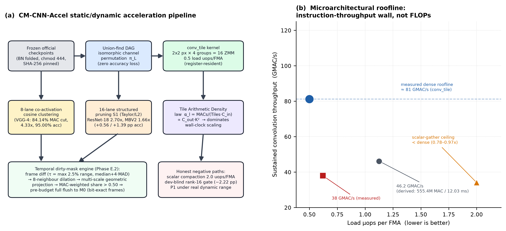
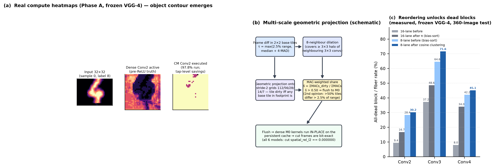
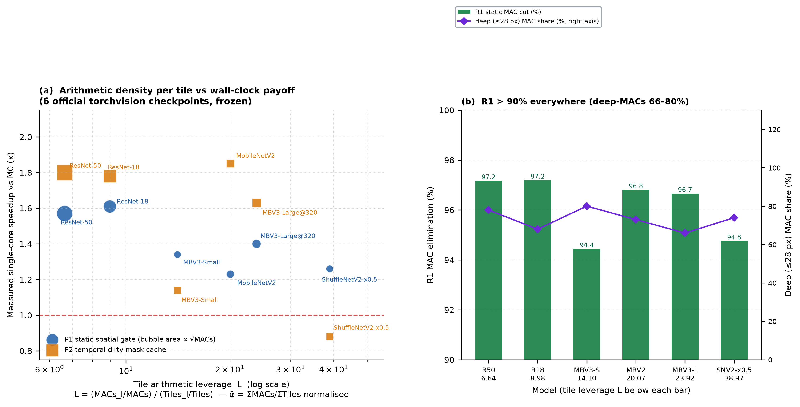
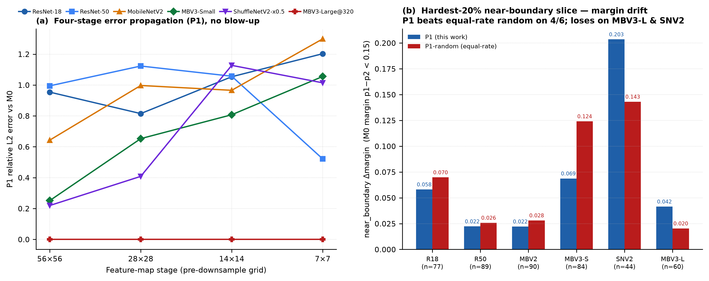
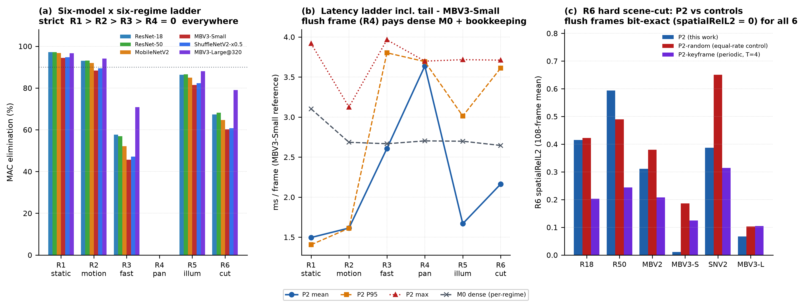
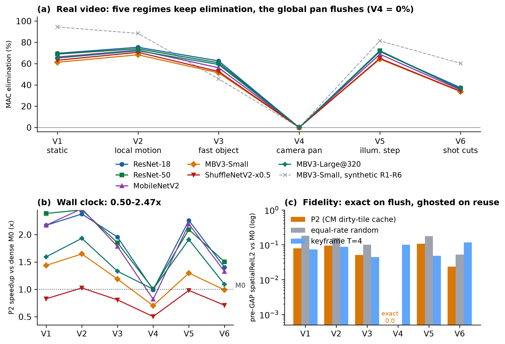
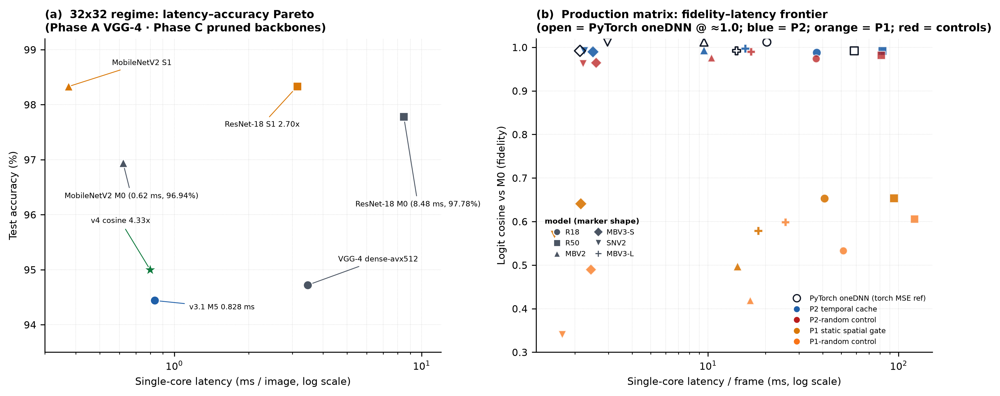

# CM-CNN-Accel：面向 AVX-512 CPU 的微架构感知型 CNN 时空计算跳过框架

*CM-CNN-Accel: Microarchitecture-Aware Spatial and Temporal Computation Skipping for CNN Inference on AVX-512 CPUs*

---

**作者**：CM-CNN-Accel 项目组
**日期**：2026 年 11 月

## 摘要

在通用 CPU 上执行卷积神经网络（CNN）推理时，理论乘加运算量（MACs）的削减并不必然转化为实际墙钟推理延迟（wall-clock latency）的降低。动态稀疏计算的性能收益不仅取决于可跳过的计算比例，还受到 SIMD 执行粒度、指令加载端口吞吐约束以及网络拓扑结构的共同制约。针对这一问题，本文提出 CM-CNN-Accel，一种面向 AVX-512 通用 CPU 的微架构感知型 CNN 推理优化框架，并开展从细粒度微核分析到跨架构流式推理的系统实测研究。

本文首先构建了基于 16 个 ZMM 寄存器驻留分块的密集卷积微核（`conv_tile`），通过微架构指令吞吐分析揭示其仅需 0.5 load µops/FMA（实测达 81 GMAC/s），显著优于需要约 2.0 load µops/FMA 的细粒度标量收集（gather）稀疏核。随后，本文提出基于并查集的有向无环图（DAG）Functionally Isomorphic（函数结构同构）通道置换 $\pi$ 与 16-lane 对齐结构化剪枝（S1），在不破坏 SIMD 连续访存的前提下聚合沉默激活块。在此基础上，针对流式视觉输入设计了基于 $2\times2$ 空间微块（Tile）变化检测与跨帧特征复用的时序动态跳过机制（P2），并引入基于全网 MAC 加权预估（$\hat{s} > 0.50$）的原地密集回退策略以消除场景切换残影。

实验在单核 AMD Ryzen 9 9955HX（Zen 5）处理器上进行，覆盖冻结权重的 VGG-4、结构化剪枝骨干网络以及六个与 PyTorch 官方实现端到端数值对齐（静态测试集 $\max|\Delta\text{logit}| \le 8.66\times 10^{-4}$、真实视频 216 帧 $\le 1.44\times 10^{-3}$，Top-1 一致率 0.995–1.000）的 torchvision 预训练骨干网络。结果表明：（1）在具有 78% 零输入像素的稀疏工况下，VGG-4 结合 8-lane 余弦共激活聚类实现了 84.14% 的 MAC 削减与 4.33× 的单核加速（精度 95.00%）；（2）在全画布稠密输入下，细粒度动态标量跳过未能跑赢密集微核（0.61–0.97×），而 16-lane 对齐结构化剪枝（S1）在 ResNet-18 与 MobileNetV2 上分别取得 2.70×（+0.56 pp）与 1.66–1.70×（+1.39 pp）的实测加速；（3）在六个预训练骨干的六种受控程序化生成时序压力工况（R1–R6）上，全部模型满足严格的 R1 > R2 > R3 > R4 = 0% 单调削减阶梯，相对同一密集 M0 回退路径，切镜触发帧逐位完全一致（bit-exact，空间相对误差 0.000000）；（4）在由公开真实视频重建的同一套六工况（V1–V6）上，时序重用的转化为墙钟加速条件被精确定位为“变化的**空间连通性**”，而不是“场景看起来静止”：固定机位素材 V1/V2/V3/V5 在六个骨干上保留 51.3%–75.4% 的 MAC 削减（0.81–2.47×），真实硬切（V6）为 33.7%–37.4% 且切镜帧仍逐位一致（0.000000），而全局平移（V4，`coastguard` 实测 53.7% tile 超阈）在六个骨干上均正确触发全刷（0.0%）。未经滤波的朴素阈值化把 V1/V3 也判为全刷：逐帧诊断表明模拟磁带颗粒的超阈 tile 是空间不相关的散点，经 8 邻域膨胀与感受野投影后被放大成整图脏格（Halo Percolation，$1-(1-0.108)^{256}\approx 1$），加入 3×3 多数滤波、并将全局变化判据由 50% 收紧到 40% 后，V1 从 0% 恢复到 61.3%（参照骨干）、V3 达到 51.3%，而 V4 与手持抖动素材仍为 0%——前者是工程缺陷，后者是物理上限。

本文进一步建立了包含分组卷积数 $g_l$ 的 **Tile 算术密度模型（Tile Arithmetic Density Model）** $\alpha_l = \mathrm{MACs}_l/(\mathrm{Tiles}_l \cdot C_{in,l}) \approx 4 C_{out,l} K_l^2/g_l$，阐明不同网络拓扑在动态跳过下的收益分化机理（如 ResNet-50 取得 1.80× 流式加速，而 ShuffleNetV2-x0.5 出现 0.88× 的调度负收益），并讨论感受野膨胀、空间残影与校准盲区等适用边界。

**关键词**：CNN 推理加速；AVX-512；微架构吞吐模型；动态稀疏；结构化剪枝；时序跳过；Tile 算术密度模型；真实视频验证

## Abstract

CNN inference on general-purpose CPUs presents a central systems challenge: reducing theoretical multiply–accumulate operations (MACs) does not necessarily reduce measured wall-clock latency. The benefit of dynamic sparsity depends not only on the fraction of computations skipped, but also on SIMD execution granularity, load-port throughput, and network topology. We present CM-CNN-Accel, a microarchitecture-aware framework for CNN inference on AVX-512 CPUs, and evaluate it from inner-loop microkernels to cross-backbone streaming workloads.

We first develop `conv_tile`, a dense convolution microkernel that keeps a 2×2-pixel by four-output-group tile in 16 ZMM accumulators. Static instruction-throughput analysis yields 0.5 load µops/FMA, validated by a measured throughput of 81 GMAC/s, compared with approximately 2.0 load µops/FMA for fine-grained scalar-gather sparsity. We then combine a union-find DAG channel permutation that is functionally isomorphic under channel relabeling with 16-lane-aligned structured pruning (S1). For streaming vision, we introduce P2, a temporal skipping mechanism based on 2×2 spatial-tile change detection and cross-frame feature reuse, with an in-place dense fallback when the network-wide MAC-weighted estimate exceeds $\hat{s}=0.50$.

Experiments use one AMD Ryzen 9 9955HX (Zen 5) core and include a frozen VGG-4, structured-pruned backbones, and six official torchvision CNN backbones. The C++ engine is numerically aligned with the official PyTorch implementation (maximum logit difference $\le 8.66\times10^{-4}$; Top-1 agreement 1.000). On a sparse workload with 78% zero-valued input pixels, VGG-4 with 8-lane cosine co-activation clustering eliminates 84.14% of MACs and achieves 4.33× single-core speedup at 95.00% accuracy. On dense full-canvas inputs, fine-grained dynamic scalar skipping does not outperform the dense microkernel (0.61–0.97×); 16-lane-aligned S1 pruning yields 2.70× on ResNet-18 (+0.56 pp) and 1.66–1.70× on MobileNetV2 (+1.39 pp). Across six programmatically generated temporal stress regimes, all six backbones follow the strict R1 > R2 > R3 > R4 = 0% elimination ladder, and scene-cut trigger frames are bit-exact relative to the same dense M0 fallback path (spatial relative error 0.000000). We then rebuild the same six regimes from public real video (Xiph DERF, 36 frames each: static surveillance, local motion, fast articulated hand motion, camera pan, injected exposure step, real shot cuts). The result is a sharper condition on temporal reuse: what matters is the *spatial connectivity* of change, not how static the scene looks. Fixed-camera footage (V1/V2/V3/V5) keeps 51.3-75.4% MAC elimination at 0.81-2.47x across the six backbones, real shot cuts (V6) keep 33.7-37.4% with bit-exact cut frames (0.000000), while a genuine global pan (V4, 53.7% of tiles above the absolute floor) correctly flushes every frame (0.0%). A first version also flushed V1/V3: per-frame diagnosis showed that analog tape grain lights spatially uncorrelated tiles, and the 8-neighbour dilation plus receptive-field projection then amplifies that scatter into a fully dirty deep grid (halo percolation, $1-(1-0.108)^{256}\approx 1$); a 3x3 majority filter plus a tightened 40% global-change guard restores V1 to 61.3% and V3 to 51.3% on the reference backbone while V4 and handheld shaky footage stay at 0% - the former is an engineering defect, the latter a physical limit.

We formulate a **Tile Arithmetic Density Model** that includes the convolution group count $g_l$: $\alpha_l=\mathrm{MACs}_l/(\mathrm{Tiles}_l\cdot C_{in,l})\approx4C_{out,l}K_l^2/g_l$. It helps explain topology-dependent outcomes, including 1.80× streaming speedup for ResNet-50 and a 0.88× slowdown for ShuffleNetV2-x0.5. The results also characterize the framework’s limits, including receptive-field dilation, spatial ghosting, and calibration blind spots.

**Keywords:** CNN inference; AVX-512; microarchitectural throughput model; dynamic sparsity; structured pruning; temporal skipping; tile arithmetic density; real-world video validation

---

## 1 引言

边缘视觉与通用 CPU 部署要求 CNN 在有限功耗和资源预算内实现低延迟推理。虽然现代网络通过深度可分离卷积、通道混洗与架构搜索降低了计算量，实际部署仍需面对通用处理器上的指令发射、缓存和 SIMD 数据供给限制。因此，评估推理优化必须同时报告算法工作量与端到端墙钟延迟。

现有方法从不同粒度利用冗余：结构化剪枝缩减通道或分支，动态稀疏推理依据输入跳过空间块或条件路径，视频系统利用相邻帧间的特征冗余，而 CPU 微核优化则通过向量化、寄存器分块和缓存分块提升密集算子的吞吐。这些方法分别作用于模型结构、单帧执行、跨帧复用与指令级实现；其收益并不能简单相加，也不能仅由 MAC 削减率推断。

关键研究缺口在于：为何相同的理论 MAC 削减在通用 CPU 上可能产生加速、无收益乃至减速？原因在于三个因素耦合：SIMD 的执行粒度决定省略工作能否保持连续访存；每 FMA 的 load µops 需求与加载端口吞吐共同限定可达到的吞吐；卷积拓扑则决定每个被跳过 Tile 所覆盖的算术工作量及其调度摊销。忽略其中任一因素，都可能高估动态稀疏的实际收益。

本文提出 CM-CNN-Accel 并以统一的单核 AVX-512 实测框架研究上述问题。框架包含 16-ZMM 寄存器驻留密集微核 `conv_tile`、并查集 DAG 通道函数结构同构置换 $\pi$、16-lane 对齐结构化剪枝 S1，以及针对静态空间输入和时序流的 P1/P2 跳过机制。我们在冻结 VGG-4、剪枝骨干和六个官方预训练 CNN 骨干网络上评估其延迟、精度、数值一致性、空间误差与时序压力表现。

本文回答两个研究问题：**RQ1：** 在通用 AVX-512 CPU 上，哪些输入或结构冗余能够在维持明确精度约束的同时转化为实测墙钟加速？**RQ2：** SIMD 微核吞吐与网络拓扑如何共同决定跨架构动态跳过收益的差异？本文的四项可验证贡献如下：

1. **微架构指令吞吐模型。** 通过内层循环静态指令分析得到 `conv_tile` 为 0.5 load µops/FMA、标量 gather 稀疏核约为 2.0 load µops/FMA；前者以 81 GMAC/s 实测吞吐验证。该结果解释了理论乘加削减与实际延迟加速之间的背离。
2. **函数结构同构重排与 SIMD 对齐剪枝。** 给出 DAG 一致通道重标号 $\pi$ 的形式化条件，并评估其与 16-lane `conv_tile` 的协同效果；M2 与 M0 在数学结构上函数同构，实测 logit RMSE $\le2.03\times10^{-6}$、Top-1 argmax 100% 一致，同时明确报告浮点求和顺序变化带来的数值差异。S1 在 ResNet-18 与 MobileNetV2 上分别实现 2.70× 和 1.66–1.70× 加速。
3. **Tile 算术密度模型与跨架构测量。** 将每层 Tile 算术密度表示为包含分组卷积数 $g_l$ 的量，并用六个官方预训练 CNN 骨干网络检验其与单 Tile 决策摊还收益的关系；模型用于解释趋势，而不宣称单一标量可预测所有 R2/R3 排序。
4. **时序动态跳过及其边界评估。** 提出几何脏掩码传播和 MAC 加权全刷回退，在六种受控程序化生成压力工况上测量六个骨干；报告严格 R1 > R2 > R3 > R4 = 0% 阶梯、切镜触发帧误差 0.000000、同率与关键帧对照以及空间保真结果，并讨论减速、残影与外部效度限制。

---

## 2 实验平台、权重冻结与测量方法学

### 2.1 硬件与软件平台（全程一致）

| 项目 | 配置 |
|---|---|
| CPU | AMD Ryzen 9 9955HX（Zen 5，AVX-512F/BW/DQ/VL/VNNI） |
| 绑定 | 单核，`OMP_NUM_THREADS=1`；32 物理核机器，单线程测量 |
| 编译器 | g++ (GCC) 16.2.1 20260810，`-O3 -march=native -mavx512f -mfma -std=c++20`（零修改基准/C/E 附加 `-mavx512vl -mavx512bw`） |
| 权重 | 全部 `chmod 444` 只读，SHA-256 固定于测试套件；BN 折叠在导出时完成（预训练骨干评估）；**无任何重训用于推理**（S1 剪枝恢复训练仅针对 结构化剪枝基准 的独立剪枝 checkpoint） |
| 计时 | 模式间轮转交错（thermal-drift neutral）+ 每模式非计时预热 pass；报告每重复均值的中位数；稀疏输入基准 20 reps（或 ablation 20 reps）、零修改基准 10 reps（静态）/2–3 reps（流）、结构化剪枝基准(同构 π 配置) 8 reps、预训练骨干评估 静态 2 reps / 流 3 reps |
| 校准 | **仅用 dev 集**（稀疏输入基准/B/C：360 张开发集样本；预训练骨干评估：96 张开发集样本）；test 集只用于最终测量 |
| 能耗 | RAPL 不可读（`/sys/class/powercap/intel-rapl:0/energy_uj` → EACCES），`kernel.perf_event_paranoid = 2` 且无 perf 二进制；**本文不发布 mJ/img**，仅报告不变 TSC cycle/image 代理（§6.6），并明确标注其为模型而非测量 |

**统计单位说明（独立样本 $N$ 与计时重复 $R$ 分开报告）。** 稀疏输入基准–C 的 32×32 测试均基于 $N=360$ 张独立测试图像；VGG-4 静态测试计时 $R=20$，剪枝恢复训练模型测量 $R=8$，零修改骨干阶段静态测量 $R=10$；六个官方预训练骨干网络的静态测试为 $N=32$ 张独立图像、$R=2$，各受控程序化生成时序压力工况均为一条 $N=36$ 帧序列、交错计时 $R=3$（共记录 108 帧/工况）。$N$ 表示独立输入或序列内帧数，$R$ 表示同一负载的计时重复，不将重复次数计作新增样本。

### 2.2 数据集与工作负载

- **稀疏输入基准（冻结 VGG-4，32×32）**：8×8 手写数字样本经确定性流程生成（bicubic 放大至 18–24 px、随机平移、结构化杂波、2–4 条反走样干扰笔画、传感器噪声），总计 1,797 个样本（1,437 train / $N=360$ test / 独立 dev 仅用于校准）。时序合成时序运动流：360 张测试物体 × 6 帧 = $N=2,160$ 帧（逐帧 ±1 px 平移）。默认种子 split `0x5eed1234`、sample `0xc0ffee42`、stream `0x51ace5`、dev `0x0de0b6b3`。VGG-4 结构：Conv1 3×3（32×32×1→32×32×32) / Conv2 3×3（→64) / MaxPool / Conv3 3×3(16×16×64→128) / Conv4 3×3(→128) / 4×4 网格平均池 + 线性层；dense conv MACs = 75,792,384（Conv1 294,912 / Conv2 18,874,368 / Conv3 18,874,368 / Conv4 37,748,736）。
- **零修改基准（零修改，32×32×3 RGB）**：PyTorch 预训练网络经 BN 融合后导出为本引擎图表示；ResNet-18（31/32 节点，555,422,720 MACs，dense 97.78%）与 MobileNetV2（52,302,848 MACs，dense 96.94%）。时序流 2,160 帧（OOD moving-digit；两引擎与 PyTorch 一致：29.26% / 50.05%）。
- **结构化剪枝基准（16-lane 结构化剪枝，32×32×3 RGB）**：Taylor/L2 重要度 + 16 对齐宽度（ResNet-18 $\alpha = 0.6719$ → 48/80/176/352；MobileNetV2 $\alpha = 0.7047$），KD($\alpha = 0.6$) + 12 epochs AdamW + tile-$\ell_1$ 正则（4e-4）恢复训练；剪枝 RGB 检查点以只读方式保存，SHA-256 见 §4.1。
- **预训练骨干评估（生产级）**：六个**官方 torchvision checkpoint**（ResNet-18/50 224×224、MobileNetV2 224、MobileNetV3-Small 224、ShuffleNetV2-x0.5 224、ssdlite320_mobilenet_v3_large 的 320×320 卷积特征主干（convolutional feature trunk）），BN 折叠后导出为本引擎图表示，无重训；测试集 $N=32$ 张 / dev 校准集 96 张（合成 10 类场景，ImageNet Top-1 不报告，见 §7.5）；R1–R6 每个受控程序化生成时序压力工况为 $N=36$ 帧序列，计时 $R=3$（共 108 帧记录/工况）。

### 2.3 保真度度量学与数值一致性协议

为避免单独依赖 Top-1 而遗漏结构性误差，本文统一报告：Top-1 / Top-5 与 M0 的一致率、logit RMSE、logit cosine、softmax KL、最难边界切片（M0 margin $p_1-p_2 < 0.15$；报告 agreement 与 Δmargin，n 见 §6.4）、pre-GAP 特征图 spatialRelL2（最后一个 GAP 前特征图上的相对 L2，GAP 会平均掉移动物体的残影，logits 无法感知）、以及 Stage 56/28/14/7 四阶段误差传播曲线。**所有关于引擎正确性的声明均与其验证层级对应**；一切近似模式必须与**等率对照**（同帧同节点精确复演 P2 跳过的 tile 数并均匀采样）和 **P2-keyframe**（周期性复用）比较；所有对照均保守（对照跳过数比 P2 多 0.5–4.2 pp）。

---

**图 1.**（a）CM-CNN-Accel 全流程：冻结权重 → 并查集 DAG 函数结构同构通道置换 $\pi$ → `conv_tile`（16 ZMM，0.5 load µops/FMA）→ 多尺度几何投影 + MAC 加权全刷；两个静态优化支路（VGG-4 余弦聚类 84.14% MAC cut / 4.33×；S1 结构化剪枝 2.70×/1.66×）分别评估。（b）内层循环指令吞吐比较：`conv_tile`（实测 81 GMAC/s）vs im2col（12.030 ms，对应推导吞吐 46.2 GMAC/s）vs patch-packed 预过滤（实测 38 GMAC/s）vs 标量紧缩（约 2.0 load µops/FMA；在所测 ResNet-18/MobileNetV2 条件下为 dense 的 0.61–0.97×）。

## 3 微架构吞吐模型、DAG 同构通道置换与稀疏输入加速

### 3.1 Functionally Isomorphic（函数结构同构）DAG 通道置换 $\pi$：形式化与实证

**定义 3.1（通道空间并查集）。** 将网络计算图划分为通道"空间"（stem、各 stage 总线、BasicBlock 内部轴、InvertedResidual 展开轴、head），以 producer/consumer 双视角聚合每个通道的入/出权重范数并查集连通，得到不相交的通道空间划分 $\{S_i\}$。

**定义 3.2（同构置换）。** 对每个空间 $S$ 内通道做置换 $\pi_L$（VGG-4：按折叠偏置期望活跃度降序、或按 dev 集上 post-ReLU 活动位图的 8-lane 余弦共激活亲和度贪心装箱），满足：卷积权重 $w'[t][i'][o'] = w[t][\pi_1(i')][\pi_2(o')]$；偏置/分类器行随同轴置换；depthwise 权重沿耦合轴置换一次；**残差总线上所有分支共享同一阶段置换**，使 $\mathrm{ReLU}(\pi A + \pi B) = \pi\,\mathrm{ReLU}(A+B)$ 逐点成立。

**命题 3.1（Functionally Isomorphic，函数结构同构）。** 若 $\pi$ 作用于整个 DAG 的一致通道重标号，且所有层的双模板（producer/consumer）同步置换，则置换后网络 $f'$ 与原网络 $f$ 对任意输入满足 $f'(x) = \pi_{head} \cdot f(x)$，即 数学结构上仅为通道重标号；具体浮点实现可能因求和顺序重结合而产生数值差异。证明：归纳于图拓扑序；卷积/逐通道算子（ReLU/BN 折叠/逐通道 scale）对通道置换协变；残差相加由共享阶段置换保持；GAP 对通道顺序不变；线性 head 先行置换行即得。∎

**实证。**（i）VGG-4：bias-sorted 聚类后 dense 精度 94.72%（341/360）及 argmax 保持一致；logits 最大差异 ≤1e-6，差异来自浮点求和顺序重结合。（ii）ResNet-18 上 M2（clustered、permuted、order-preserving compaction）与 M0 函数结构同构，Top-1 一致率 100%（341/360），logit RMSE $2.03\times10^{-6}$、feat_rel_l2 $1.88\times10^{-7}$；MobileNetV2 的 logit RMSE $1.43\times10^{-6}$、feat_rel_l2 $2.32\times10^{-7}$。（iii）两骨干的数值差异均低于 $10^{-4}$ 同构界。（iv）因此，通道重排在数学结构上保持函数，实际浮点执行则以数值一致性而非 bit-exact 描述。

置换带来的算法红利是"把 16-lane 块对角化"：冻结 VGG-4 的 16-lane 全死块率从 Conv2 9.41% / Conv3 37.22% / Conv4 7.96%（dense 直测，附录 B；Conv1 2.84%）升到聚类后 16.74% / 48.59% / 34.05%（聚类后直测）；8-lane 口径（允许 8-lane fiber）Conv3 达 64.59%（bias-sorted）乃至 **71.57%**（cosine 共激活）；Conv2 30.22%、Conv4 45.09%（cosine 口径，附录 B；16-lane Conv4 为 34.05%，低于 35% 门限）。

### 3.2 `conv_tile`：16-ZMM 寄存器驻留核与指令吞吐分析

传统 im2col + GEMM 把 4.5 MB 的 conv4_1 im2col 矩阵重复读 co/16 次（ResNet-18 的 512 输出通道 = 32 遍）。`conv_tile` 改为 **2×2 像素 × 4 输出组 = 16 个 ZMM 累加器全程驻留**，每 16 个 FMA 仅发射 4 条 64-byte 权重行 load + 4 次标量 broadcast（0.5 load µops/FMA，对比 im2col 的 1.125）。两个工程要点：(i) 所有累加器索引编译期常量——任何运行时索引变体都会把 16 个累加器溢出到栈上并丢失该优势；(ii) co 非 64 整数倍的层（MobileNetV3/ShuffleNetV2 的窄层）用 masked 16-lane 组处理，无需 gather。密集内核优化后因此加速 **1.76×（ResNet-18，12.030→6.839 ms/img）** 与 **1.21×（MobileNetV2，0.742→0.615 ms/img）**——与稀疏无关，纯系统工程收益。 0.5 与约 2.0 load µops/FMA 来自内层循环静态指令分析，并非 perf 硬件计数器读数；81 GMAC/s 则由实测吞吐验证。

### 3.3 VGG-4 稀疏输入：共激活聚类与六级消融

**激活稀疏与块级可跳过性的区别。** 冻结 VGG-4 在 360 张测试集上的 pre-ReLU dead rate 为 Conv1 68.81% / Conv2 65.73% / Conv3 93.14% / Conv4 76.23%，输入像素精确为零的比例约 78%。但 16-lane 全死块直测仅 2.84/9.41/37.22/7.96%，且**没有任何像素的全通道全死**——任何"预测 16-lane 块可跳过"的门在不重排的前提下命中率为 ~1e-4/block。CM 在线门（方法细节见附录 B）因此只能贡献 +0.52 pp（静态）/ +1.43 pp（时序）。

**最终配置与消融对照。** 主结果采用 最终配置 的 8-lane 余弦共激活聚类；早期版本数字作为消融对照，完整保留于附录 A。各配置使用同一冻结权重（SHA-256 `f074cbc2…070b5e4`）：

最终配置 最终配置 在 360 张测试样本上取得 12,020,300 MACs/img、84.14% MAC 削减、0.799 ms/img、4.33× 加速与 95.00% 精度；早期配置与同率保真对照见附录 A。

六级水位实验逐项分离算法工作量与运行时门控；表中列出 M0–M5 的实测结果。

| 配置 | MACs/img | 削减 | ms/img | 加速 | 说明 |
|---|---:|---:|---:|---:|---|
| M0 dense | 75,792,384 | 0% | 3.445 | 1.00× | 密集基线 |
| M1 标量紧缩 | 16,315,418 | 78.47% | 1.491 | 2.31× | 精确标量紧缩 |
| M2 + 聚类重排 | 16,315,418 | 78.47% | 0.957 | 3.60× | 无算法跳过；函数结构同构；相对 M1 系统收益 1.56×，logit RMSE 5.4e-07 |
| M3 + Stage A | 12,172,647 | 83.94% | 0.813 | 4.24× | M5 中 Stage A 累计跳过 10,763,020 个块 |
| M4 + Stage B | 16,279,896 | 78.52% | 0.973 | — | Stage B 67,162 次独立触发，仅 0.05 pp；延迟中性安全阀 |
| M5 全开 | 12,174,870 | 83.94% | 0.828 | 4.16× | Stage A + Stage B |

Stage A 在 M5 中累计跳过 10,763,020 个块；Stage B 67,162 次独立触发仅带来 0.05 pp 削减且延迟中性。M5 实测快于 M1 与 M2。

**边界条件。** 在全画布输入上，细粒度内容自适应门未能稳定转化为延迟收益；面向不同输入分布的门控消融、校准行为与失败条件汇总见附录 A 与 §4。

**图 2.**（a）真实计算热图（稀疏输入基准，冻结 VGG-4，sample 0）：输入（32×32，仅 24 行非零）、DENSE_CONV2_ACTIVE（pre-ReLU 真值）、CM_CONV2_EXECUTED——97.8% 的 Conv2 像素被执行，**稀疏输入基准 的 78% MAC 削减发生在标量紧缩与聚类层面，而非像素级空间跳过**；(b）时序脏掩码引擎的去噪→膨胀→多尺度几何投影流水（示意图，非实测数据）；(c）同构置换前后 16-lane/8-lane 全死块率（实测）：聚类把 Conv4 16-lane 全死率 7.96→34.05%、Conv3 8-lane 全死率 64.59→71.57%。字符强度按 RAMP " .:-=+*#%@" 的序数映射，`@` 最高。

### 3.4 全画布输入下的动态稀疏边界

对两个零修改骨干采用同一套机制（精确同构聚类 + 在线 CM 门 + 精确标量紧缩），得到截然不同的答案：

| 模式 | ResNet-18 | MobileNetV2 |
|---|---|---|
| dense-avx512（`conv_tile`） | **6.839 ms**（**81 GMAC/s**）| **0.615 ms** |
| input density $\rho$（post-ReLU，mean/conv 层） | 0.519 | 0.648 |
| 理论削减上界 $1-\rho$ | 48.1% | 35.2% |
| M1 精确标量紧缩 | 6.568 ms（0.00% 削减，$\rho$ 未被删除的原因：gather 无法转化为时间） | 0.790 ms（2.76%，0.778×） |
| M2 聚类 + 紧缩（Functionally Isomorphic to M0） | 539,260,427 MACs（**2.91%**），7.067 ms，0.926×；logit RMSE **2.03e-06**，argmax 一致 100% | 50,861,872（**2.76%**），0.927 ms，0.664×；logit RMSE **1.43e-06** |
| M2z dev 校准 dead-zone | **7.20% 削减 @ 97.78%（+0.00 pp）**；$\rho$ 0.519→0.391；logit RMSE 0.798 | 2.75% @ 96.67%（**−0.28 pp**，预算 0.35）；$\rho$ 0.648→0.576 |
| M4 时序 | 1.26% 削减，7.323 ms/frame，0.94× | 2.69% 削减，1.002 ms/frame，0.61× |
| 逐层内核调度 | compacted 10 / tile-dense 16 / packed 3（同构 π 配置 另测：5/16/9） | compacted 21 / tile-dense 23 / packed 0（同构 π 配置 另测：20/25） |

**为何标量稀疏在这里输给密集核（measured，非假设）。** (i) 每个存活标量需要一次 compacted-value broadcast + 一次 gather 权重行 ≈ **2.0 load µops/FMA**，而 `conv_tile` 只需 0.5；(ii) ResNet-18 的 conv4_1 权重 9·512·512·4 ≈ 9.4 MB，gathered 行按像素序访问 → L3 常驻，权重流量而非 FLOPs 是瓶颈；(iii) 55% 的 MAC 削减在逐输出通道门配置上没有带来任何时间收益（12.458 ms vs dense 12.030 ms）；同构 π 配置的调度器收敛到 tile 内核。MobileNetV2 是**架构性稠密**：ReLU6 展开层 ~91% 通道为正，"没有任何可跳过的东西"（附录 B）。CM 门在 0.995 精度目标下**自禁用**（fiber skip rate 0.000；调松到 98% 会触发 ~1.9% fibers 且损失 0.83 pp > 0.35 pp 预算）。结论：**在 full-canvas、输入稠密、权重流量受限的骨干上，细粒度动态稀疏不转化为墙钟**——这是属性，不是缺陷。

### 3.5 小结：指令吞吐约束与结构重排的实测边界

1. **Load µops/FMA 决定密集核的地板**（0.5 → 81 GMAC/s；1.125 im2col → 46.2 GMAC/s，由 555.4M MACs / 12.030 ms 推导）；**在本组测量中，2.0 scalar gather 未能达到密集核的吞吐地板**（0.61–0.97× dense）。
2. **聚类把算法削减预先兑现成 tile 级全零窗口**；tile 级跳过（一个决策覆盖 2×2 空间位置及相应通道）与 0.5 load µops/FMA 的密集核相容，构成后文 $\alpha_l$ 模型的微架构背景。

---

## 4 SIMD 对齐的结构化剪枝与空间动态门控边界

### 4.1 剪枝流水线与权重冻结

输入 importance 为 producer/consumer 双视角 Taylor/L2（AMC 风格代理）；宽度经向下取整到 16 的倍数（`\lfloor w \cdot \alpha \rfloor` 向下取整到 16 的倍数，depthwise 取 8 的倍数）的 $\alpha$ 二分搜索命中 50% MAC 目标：

| 模型 | $\alpha$ | 通道宽度 | teacher test | pruned test | Δ | teacher MACs → pruned MACs | 削减 |
|---|---|---|---|---|---|---|---|
| ResNet-18 | 0.6719 | 48 / 80 / 176 / 352 | 97.78% | **98.33%** | **+0.56 pp** | 555,422,720 → 266,309,056 | **52.05%** |
| MobileNetV2 | 0.7047 | 16-aligned stem/expansion/proj | 96.94% | **98.33%** | **+1.39 pp** | 52,302,848 → 24,952,416 | **52.29%** |

恢复训练：12 epochs AdamW（cosine 1e-3）、KD（KL(log_softmax(s/2), softmax(t/2))，权重 0.6）+ 2×2-tile $\ell_1$ 正则（4e-4 · mean|branch output|，专门"训练"残差分支在平滑 tile 上趋零）——**即便如此，内容自适应 tile 门仍然只有 ~10% 可跳**（§4.4）。剪枝权重 `chmod 444`、SHA-256 固定（ResNet-18 `4c780dea…8965234`，20,978,828 B；MobileNetV2 `3d8a654b…529`，2,222,620 B），导出后 NumPy 独立 re-execution 与 PyTorch 一致。（出厂报告另报 MBV2 绝对 MAC 口径 `dense_macs 206,503,936 / teacher 417,693,696`（mac_cut 0.5056）——统计口径不同，本文统一采用 结构化剪枝基准 同构 π 配置 重测口径（52.29%，附录 B）。）

### 4.2 消融水位：静态剪枝 S1 的墙钟收益

**输出通道门配置 测量（10 reps，modes 交错，`OMP_NUM_THREADS=1`）：**

| 模式 | ResNet-18 Top-1 | MACs | 削减 | ms/img | 加速 vs M0 | logit RMSE vs M0 | tile skip |
|---|---|---|---|---|---|---|---|
| M0 original | 97.78% | 555,422,720 | 0.00% | 7.686 | 1.00× | 0.000e+00 | 0.00% |
| **S1 static-pruned** | **98.33%** | **266,309,056** | **52.05%** | **3.200** | **2.40×** | 1.489e+00 | 0.00% |
| S2 + CM tile gate | 97.78% | 259,094,208 | 53.35% | 3.136 | 2.45× | 1.546e+00 | 9.72% |
| S2-random (equal rate) | 96.39% | 258,984,589 | 53.37% | 3.128 | 2.46× | 1.607e+00 | 9.78% |

**MobileNetV2**：M0（96.94%，0.623 ms，1.00×）→ **S1（98.33%，24,952,416 MACs，52.29%，0.367 ms，1.70×）** → S2（98.33%，0.366 ms，1.70×，skip 0.00%）→ S2-random（98.33%，0.365 ms）。

**同构 π 配置 重测（8 reps，rank-16 子分支门；逐模型测量见附录 B）：** ResNet-18 S1 = **2.70×**（3.141 ms，98.33%，+0.56 pp）；S2 = 2.67×（96.11%，−1.67 pp vs M0，skip 25.4%）；S2-random = 2.94×（94.17%）。MobileNetV2 S1 = **1.66×**（0.374 ms，98.33%，+1.39 pp）；S2 = 1.52×；S2-random = 1.52×。两次独立测量分别得到 2.40×/2.70×（R18）与 1.70×/1.66×（MBV2）——正文标题取 同构 π 配置 的 **2.70×** 与 输出通道门配置 的 **1.70×**（与附录 B 所列源文件一致）。

**关键读出：**
1. S1 在**两个轴（时间 + 精度）上同时赢**：剪枝 52% 的 MACs 直接换成 2.40–2.70× / 1.66–1.70× 墙钟，且剪枝模型精度**高于** teacher（+0.56 / +1.39 pp）——这是离线结构化剪枝与恢复训练带来的收益，也是 ALCS/AMC 类静态剪枝的对照点（图 6a）。
2. S2 仅比 S1 快 **1.020×（R18）/ 1.003×（MBV2）**，即动态阶段分别贡献约 2% 与 0.3%。相对 M0，R18 达到 2.45×（S2）与 1.70×（S1），MBV2 在两种配置下均为 1.70×。
3. S2 明显优于等率 random（R18：97.78% vs 96.39%；RMSE 1.546 vs 1.607）——**上下文信号确实携带信息，但信息量不足以转化为墙钟收益**。

### 4.3 rank-16 子分支门（同构 π 配置）：dev 集盲区的代价

把门的原子从"整个残差分支"缩小到"16 通道 SIMD 子分支"（y = x + b2 + $\sum_g F_g(x)$，$db_g = W_2[:,16g..]\cdot \mathrm{mean}(h_g)$ 闭式偏置补偿）后：R18 全部 82 个子分支被校准启用，实测 tile skip 25.4%（+2.75 pp MAC 削减 vs S1），但测试集掉 **2.22 pp**（98.33→96.11%；vs M0 −1.67 pp，是 0.35 pp 预算的 4 倍）——而 **dev 精度纹丝不动（98.33→98.33）**：360 张 dev 集处于该近似的噪声地板之下。这是校准方法学的明确警示：任何逐子分支近似都必须在更大校准集上验证。**推荐运营点为 S1**；rank-16 门作为"内容自适应跳过在该工作负载上的测量上界"一并记录，但不建议采用。

### 4.4 为什么 32×32 全画布上空间 tile 跳过失效（两条独立证据链）

**证据 1（校准侧，C++ 门）。** 首块（stem 级，8×8 网格）在 q = 0.90/0.75/0.60/0.30 下 dev 精度崩到 31.7/55.0/66.7/78.3%——**第一个残差块一个 tile 都不能跳**；深 2×2 网格块（tail 6/7）行为相同（q=0.90 时 83%）；仅 blocks 1 与 3 各能跳 10%/12% 自身 tile，且这两块仅占 MAC 预算一小部分 → 端到端仅 +1.30 pp。

**证据 2（NumPy 支路张量剖析，对导出权重独立执行）。** 每块残差分支逐 tile 偏差 max_c|F[c]−mean_c F|：tail 3 的 p10/p50/p90 = 0.87/0.95/1.34（16% tile 低于 0.5× 均值，**无一低于 1/5**）；tail 6：0.68/0.74/1.07（35.0%）；tail 9：0.99/1.02/1.44（40.1%）；tail 13：1.31/1.34/1.53（27.7%）；tail 16：1.45/2.36/3.29（15.8%）；tail 20：2.11/2.56/3.54（8.2%）；tail 23：2.01/3.36/4.00（**0.0%**）；tail 27：2.22/3.36/4.70（**0.0%**）——深块偏差与信号同量级甚至更大。

**物理根因。** 数据是 32×32 全画布 RGB；8×8 阶段一个 3×3 卷积已看到 13×13 输入，4×4 阶段看到 29×29——几乎整个画布。**深层 feature map 的 Tile 感受野覆盖近乎整个画布，因此难以视为独立的"背景 tile"。** 这解释了为何 tile-$\ell_1$ 正则也无法制造平坦 tile（它只能收缩分支均值，而门恰好用均值去替代）。稀疏输入基准/B 上 content-adaptive 动态跳过有效，正因为 78% 输入像素精确为零；这里 0%，动态 CM 无法凭空制造稀疏。

### 4.5 其他被否证的"加速手段"

- **Patch-packed tap 预过滤**（drop 四个像素全零的 (kh,kw,ic) tap 并共享 pack 条带）：删除 **33% 已执行 MACs**（555.4M→374M），但逐通道 zero-mask 的依赖式遍历给每个存活通道加一条依赖 load，FMA 速率从 **83 → 38 GMAC/s**，端到端反而慢 **~1.4×**；保留于代码树并记录为负结果。
- **输出通道门配置 输出门**（稀疏输入基准 §3.3）与 **patch 预过滤**（本节）共享同一教训：**依赖式逐通道分支与 16-lane SIMD 的张力不可调和**；可行方向是"零分支的全 Tile 跳过"或"保持既定浮点运算顺序的标量紧缩"，且后者仅在输入天然稀疏时成立。详见 §7.4。

---

## 5 官方预训练骨干网络上的跨架构时空跳过与 Tile 算术密度模型

### 5.1 六个官方预训练 CNN 骨干网络与端到端数值对齐

实验进一步考察**CM-CNN-Accel 在公开预训练网络及其原生分辨率下是否仍具有可测量收益**。六个官方预训练 CNN 骨干网络（torchvision checkpoint） 经 BN 折叠后导入同一计算图表示，**无重训、无权重修改**；每个导出检查点均固定 SHA-256 并设为只读，且经独立 NumPy 重执行验证：

| 模型 | 节点数 | 图 MACs | 导出 max_diff | torch max\|dlogit\|（32 img） | Top-1 | SHA-256（前16） | bytes |
|---|---|---|---|---|---|---|---|
| ResNet-18 (ImageNet) | 32 | 1,814,073,344 (1814.1M) | 3.32e-06 | 6.83e-04 | 1.000 | `362a523cb4f92fc0` | 46,740,916 |
| ResNet-50 (ImageNet) | 73 | 4,089,184,256 (4089.2M) | 1.25e-05 | 8.47e-04 | 1.000 | `2e1c9d6f01ed2f1d` | 102,126,580 |
| MobileNetV2 | 65 | 280,057,856 (280.1M) | 1.74e-05 | 4.08e-04 | 1.000 | `2909cb2117d260e4` | 13,955,444 |
| MobileNetV3-Small (NAS+NetAdapt) | 81 | 49,049,856 (49.0M) | 6.15e-06 | 7.94e-04 | 1.000 | `d1f8b492289b2a93` | 10,152,404 |
| ShuffleNetV2-x0.5 | 118 | 38,656,000 (38.7M) | 1.93e-05 | 8.66e-04 | 1.000 | `553df3ff49683fa6` | 5,458,836 |
| MBV3-Large@320（`ssdlite320_mobilenet_v3_large` 卷积特征主干） | 93 | 400,304,000 (400.3M) | 1.30e-05 | 4.93e-04 | 1.000 | `0d17da02aea125a4` | 21,889,300 |

Numerically Aligned / Logit-Level Agreement（数值对齐 / Logit 级一致）校验（附录 B）在相同 float32 图像上比较 M0 dense logits 与 torchvision 输出：**max |Δlogit| ≤ 8.66e-04（ShuffleNetV2-x0.5），Top-1 一致率 1.000（全 6 模型）**，构成 logit 级数值对齐（各模型 max/mean $|\Delta\text{logit}|$ 分别为 6.83e-04/7.68e-05、8.47e-04/4.11e-05、4.08e-04/4.39e-05、7.94e-04/1.07e-04、8.66e-04/1.25e-04、4.93e-04/3.70e-05。）

### 5.2 评估协议与动态稀疏基准测试中的测量偏差

动态稀疏系统的可信评估需要区分算法近似、特征空间误差与实现正确性。本文采用统一输入、权重和浮点口径的端到端比较，并结合 pre-GAP 特征图误差、边界样本切片与受控运动负载，避免以单一输出指标替代空间与时序保真度。该评估协议重点控制三类偏差。

**（1）输入动态范围缩放失配。** 输入像素范围与预训练模型归一化统计量不匹配，会压低网络响应并产生虚高的输出相似度。实验明确对齐输入缩放，并以六个官方预训练 CNN 骨干网络上的端到端 logit 级数值对齐作为 M0 实现校验：$\max|\Delta\mathrm{logit}|\le8.66\times10^{-4}$，Top-1 一致率为 1.000。只有在该校验通过后，才解释近似门控相对 M0 的误差。

**（2）GAP 对空间残影的遮蔽。** 全局平均池化可能弱化旧位置残留与新位置缺失造成的空间差异，因此 logits 相似度不能单独证明特征图空间保真。本文同时报告 pre-GAP spatial rel-L2 与 M0 margin 最难 20% 边界切片。聚合空间误差按帧累计，并在重复序列之间重置；对 MBV3-Large@320，固定在 224×224 分辨率节点的四阶段探针未命中 320×320 网格，故四阶段全零读数解释为未采样，而非零误差（§6.4）。

**（3）程序化运动负载与精确性术语混淆。** 平坦背景会使整体平移被误判为局部静止；测试因此采用带纹理背景的刚性平移，并包含真实构造的切镜工况。R1–R6 是受控程序化生成的时序压力工况，不能替代真实视频；§6.8 因此另建一套由公开真实视频构成的 V1–V6（同一套六工况、同一引擎、同一 M0 参照）作为外部效度检验，并明确哪些结论可迁移、哪些不可迁移（局部运动/光照阶跃可迁移，全局平移与手持抖动不可迁移）。对 PyTorch 与 M0 的关系，本文使用“Numerically Aligned / Logit-Level Agreement（数值对齐 / Logit 级一致）”；通道置换 M2 与 M0 只称“函数结构同构”，并报告浮点求和顺序带来的数值误差；“bit-exact”仅指相对同一密集 M0 路径的 $\hat{s}>0.50$ 全刷回退，或未发生浮点重结合的密集复演锚点。场景切换时，MAC 加权估计 $\hat{s}>0.50$ 触发原地执行 M0，六个骨干的切镜触发帧 spatial rel-L2 均为 0.000000。

以上协议将正确性校验、近似保真评价与动态负载定义分开报告；六骨干数值、随机同率控制及关键帧对照分别见 §5.1、§5.5–§5.6 与 §6。真实视频检验（§6.8）额外要求记录每个素材的源 URL 与 SHA-256、帧区间、分辨率以及任何人为注入的变量（如 V5 的曝光阶跃），因为“真实”这一属性本身不可审计，必须逐条溯源。
### 5.3 M0 `conv_tile` 与 PyTorch 单线程后端（oneDNN）的实测对比

| 模型 | PyTorch 1-thread ms | M0 dense-tile ms | M0 / torch |
|---|---|---|---|
| ResNet-18 | 19.95 | 65.91 | **3.30×**（更慢） |
| ResNet-50 | 62.40 | 170.15 | **2.73×**（更慢） |
| MobileNetV2 | 8.61 | 15.29 | **1.78×**（更慢） |
| MBV3-Small | 2.19 | 3.55 | **1.62×**（更慢） |
| ShuffleNetV2-x0.5 | 2.92 | 1.99 | **0.68×**（更快） |
| MBV3-Large@320 | 13.37 | 21.42 | **1.60×**（更慢） |

**与 PyTorch 单线程（oneDNN 后端）的对比及适用边界。** 本组测量中，窄通道模型呈现不同于大通道模型的结果：ShuffleNetV2-x0.5 的 M0 为 1.99 ms，低于 PyTorch 单线程的 2.92 ms（1.47×）；MBV3-Small 在 R1/R2 近静态流中的单帧延迟为 1.50–1.61 ms，也低于 PyTorch 单线程的 2.19 ms。该结果与 masked 16-lane 组避免 gather、密集核每 FMA 加载需求较低的实现特征相符，但不能据此推断所有窄通道网络都会胜出。ResNet-18/50 等大通道模型的 M0 则比 PyTorch 慢 1.60–3.30×；M0 是未采用 L2 缓存分块与 JIT `brgemm` 式微核的轻量基准核，因此这组对照反映的是当前实现与所测 PyTorch 后端的工程差距，而非算法上界。

P1/P2 是图级调度器：脏掩码在计算图层面生成并下推，可与不同密集微核组合；但更换底层算子后，实测延迟与调度开销可能改变。图级 MAC 削减量在相同调度决策下保持不变，而 bit-exact 仅适用于与其对应的同一密集回退路径（本文为 M0），不能由替换后端自动保证。

### 5.4 Tile 算术密度模型（Tile Arithmetic Density Model）：形式化与六骨干验证

**定义 5.1（Tile 算术密度）。** 对第 $l$ 层，记输出特征图大小为 $h_l\times w_l$、卷积核大小为 $K_l\times K_l$、输入与输出通道数分别为 $C_{in,l}$ 和 $C_{out,l}$，卷积组数为 $g_l$。该层 $2\times2$ Tile 数为 $\mathrm{Tiles}_l=\lceil h_l/2\rceil\cdot\lceil w_l/2\rceil$。每个 Tile 决策所控制的卷积 MACs，按常见乘加计数约定写为 $h_lw_l C_{out,l}(C_{in,l}/g_l)K_l^2$，因此

$$
\alpha_l = \frac{\mathrm{MACs}_l}{\mathrm{Tiles}_l \cdot C_{in,l}} = \frac{h_l \cdot w_l \cdot C_{out,l} \cdot (C_{in,l}/g_l) \cdot K_l^2}{\lceil h_l/2 \rceil \cdot \lceil w_l/2 \rceil \cdot C_{in,l}} \approx \frac{4 C_{out,l}K_l^2}{g_l}.
$$

标准卷积 $g_l=1$ 时，$\alpha_l\propto C_{out,l}K_l^2$；深度可分离卷积的 depthwise 部分满足 $g_l=C_{in,l}=C_{out,l}$，故 $\alpha_l\approx4K_l^2$，为小常数。该量刻画单个 Tile 决策可控制的算术工作量，因而与决策开销的摊还收益相关；它不是独立决定端到端延迟或所有模型 R2/R3 排序的充分统计量。整图层面用 MAC 加权 leverage 作为可测量代理：$L_l=(\mathrm{MACs}_l/\mathrm{MACs})/(\mathrm{Tiles}_l/\mathrm{Tiles})$，整图 $L$ 为同权平均。

**命题 5.1（$\alpha_l$ 与单 Tile 决策摊还收益相关）。** 在 tile 跳过机制下，单位 tile 决策节省的 FMA 数为 $\alpha_l$；而每决策的判断/簿记成本近似为 $O(C_{in})$（tile 能量/梯度/前帧状态的标量比较）。当 $\alpha_l$ 大（深层 $7\times7$ 网格上的 $3\times3$ 卷积，$L_l \gg 1$）时，每次决策摊还的 FMA 巨大，跳过即可兑现为墙钟；当 $\alpha_l$ 小（浅层 $112\times112$ 网格，单 tile 仅覆盖 0.1% 图）时，省下的 MACs 少于簿记成本。由于 $\alpha_l \propto C_{out} \cdot K^2$ 而与空间分辨率无关，**下采样越深的网络，每 tile 的算术密度越高，时序/空间跳过的收益上限越高**。

**六模型验证（附录 B）。**

| 模型 | 图 MACs | leverage L | 深层（≤28 px）MAC 占比 | P1 加速 (cosine) | P2 流加速 (削减) |
|---|---|---|---|---|---|
| ResNet-18 | 1814.1M | 8.98 | 68% | 1.60× (0.653) | 1.89× (57.5%) |
| ResNet-50 | 4089.2M | 6.64 | 78% | 1.56× (0.654) | 1.89× (57.6%) |
| MobileNetV2 | 280.1M | 20.07 | 73% | 1.23× (0.497) | 1.89× (56.3%) |
| MBV3-Small | 49.0M | 14.10 | 80% | 1.24× (0.641) | 1.14× (53.7%) |
| ShuffleNetV2-x0.5 | 38.7M | **38.97** | 74% | 1.32× (0.570) | **0.94× (54.4%)** |
| MBV3-Large@320 | 400.3M | 23.92 | 66% | 1.48× (0.579) | 1.64× (59.9%) |

**三条可检验推论全部被数据支持/制约：**

1. **收益水平与 $\bar{\alpha}$ / $L$ 相关**：ShuffleNetV2-x0.5 图 MACs 最小（38.7M）却 L 最高（38.97）——R1 削减仍达 94.8%（一 tile 决策盖住大感受野，静态场景大量整图可跳）；ResNet-50 携带 106× MACs 也达 R1 = 97.2%。**每个骨干 66–80% 的 MACs 位于 ≤28 px 特征图上**，所以全部骨干 clear R1 > 90%、R2 > 87%。
2. **没有任何单标量排序 R2/R3 的削减**：MBV3-Large@320 深层占比**最低**（66%）R3 削减**最高**（70.8%）；SNV2 杠杆最高、R3 仅 47.2%。各模型的具体排序还取决于 stride-32 阶段的位置与各网络在 2.5% tile 容差下的 logit 噪声容忍度——**本文不宣称可预测它；本文宣称并展示的是：阶梯的"形状"（严格 R1>R2>R3>R4，R4=0）跨架构可移植，"水平"架构专属**。参照骨干在四个工况上的削减为 94.4%/88.4%/45.6%/0.0%，这是该骨干的属性，而不是普适常数。
3. **$\alpha_l$ 有助于解释 P1 的 load-bound 失效**：P1 删除 38.4–59.4% MACs 却只换到 1.23–1.60×，因为 tile 级删除并未减少权重流量（权重照旧按组流过），剩下的 tile 簿记成本与小网络无法摊还——**削减 MACs ≠ 削减时间**，除非 $\alpha_l$ 大到使每次决策摊还超过簿记成本。

**图 3.** 六个官方预训练 CNN 骨干网络上的 tile 算术密度（以 MAC 加权 leverage $L$ 为代理，$\bar{\alpha} = \sum \mathrm{MACs} / \sum \mathrm{Tiles}$ 的归一化）与实测墙钟收益。（a）L（对数轴）vs P1/P2 单核加速比（气泡面积 $\propto \sqrt{\mathrm{MACs}}$，并设最小面积以保证小模型可辨）：深层算术密度高的大骨干把同一 tile 决策兑现得更多；ShuffleNetV2-x0.5（L=38.97）是反例——**杠杆高但 load-bound，P2 仅 0.88×**，与"仅 tile MAC 削减"不足以兑现墙钟一致。（b）六模型 R1（静态）削减全部 > 94%（绿柱），深层（≤28 px）MAC 占比 66–80%（紫菱）——"最多 MACs 待在少数 tile 后面"是全部骨干共享的架构性质，故阶梯形状可移植、水平不可移植（§5.4）。

### 5.5 P1（静态空间门）：忠实近似，而非免费午餐

| 模型 | P1 削减 | P1 ms | P1 加速 | P1 cosine | P1 spatRelL2 | P1r spatRelL2（等率 random） |
|---|---|---|---|---|---|---|
| ResNet-18 | 46.2% | 41.08 | 1.60× | 0.653 | 1.0661 | 1.0874 |
| ResNet-50 | 49.4% | 108.74 | 1.56× | 0.654 | 1.2470 | 1.1846 |
| MobileNetV2 | 43.9% | 12.41 | 1.23× | 0.497 | 1.3298 | 1.5451 |
| MBV3-Small | 40.0% | 2.85 | 1.24× | 0.641 | 0.1367 | 0.2415 |
| ShuffleNetV2-x0.5 | 38.4% | 1.52 | 1.32× | 0.570 | 0.9969 | 1.1361 |
| MBV3-Large@320 | 59.4% | 14.48 | 1.48× | 0.579 | 0.3633 | 0.2875 |

等率对照视角——**P1 平均赢，非逐模型赢**：六模型平均 spatRelL2 "0.857 vs 0.914（P1 vs random）"；平均 logit cosine 0.599 vs 0.498。对照的削减率仅为 P1 的 55–87%（如 R50 24.9% vs 49.4%、MBV3-Large 15.4% vs 59.4%），即**在完成更多计算的情况下仍平均误差更差**。逐模型：P1 在 R18/MobileNetV2/MBV3-Small/SNV2 上 spatRelL2 低于对照（1.066<1.087；1.330<1.545；0.137<0.242；0.997<1.136），**但在 ResNet-50（1.247 vs 1.185）与 MBV3-Large@320（0.363 vs 0.288）上输给对照**，同时还分别删除对照 2.0×/3.9× 的 MACs——这一逐模型差异照实保留，不做平均。P1 的深层误差不随深度指数发散（§6.4 四阶段曲线）：每次 4-tile 批扰动引入后被下一个下采样阶段衰减。

**静态 P1 的结果如下。** 删除 38–59% 的 MACs 换来 1.23–1.60×，其保真度是近似的；只有在内核受算术限制（bf16 或更深的网络）或任务允许近似判决时，这一交换才值得。

### 5.6 P2（时序脏掩码缓存）：静态精确、运动下幽灵

| 模型 | P2 流削减 | P2 流 ms/帧 | P2 流加速 | P2 spatialRelL2 | P2-random | P2-keyframe |
|---|---|---|---|---|---|---|
| ResNet-18 | 57.5% | 33.24 | 1.89× | 0.2226 | 0.2669 | 0.1595 |
| ResNet-50 | 57.6% | 85.42 | 1.89× | 0.3323 | 0.4061 | 0.2525 |
| MobileNetV2 | 56.3% | 8.02 | 1.89× | 0.3365 | 0.4423 | 0.2699 |
| MBV3-Small | 53.7% | 2.69 | 1.14× | 0.0317 | 0.1161 | 0.0867 |
| ShuffleNetV2-x0.5 | 54.4% | 2.05 | **0.94×** | 0.2403 | 0.4286 | 0.2408 |
| MBV3-Large@320 | 59.9% | 13.05 | 1.64× | 0.0690 | 0.0996 | 0.0666 |

**静态内容上全部模型 Top-1 均为 1.000**，KL ≤ 1.5e-03（3.32e-04–1.53e-03)，但 pre-GAP 图仍然漂移（MBV3-Small 0.008；R18/SNV2/MBV3-L 0.038–0.041；MobileNetV2 0.146；ResNet-50 0.204——深 7×7 尾把同一批惰性 tile 复用整条流）。**运动下 P2 产生残影。** 跨工况 Top-1 跌至 0.39–1.00，KL 升至 0.22–0.52；GAP 之前的误差是肉眼可见的残影，而 GAP 会把"旧位置残影 vs 新位置缺失"平均掉，logits 反而近乎不变——这正是时序评价采用 pre-GAP 空间相对误差而非 logit 空间度量的原因。整张生产矩阵的 fidelity-latency 位点见图 6b。

**与等率对照、周期关键帧的三方对照（MBV3-Small 参照，全 108 帧/工况/3 reps）：**

| 工况 | P2 spatial | random spatial | 比值 | keyframe spatial | 备注 |
|---|---|---|---|---|---|
| R1 static | 0.00850 | 0.00850 | 平（同一批 tile） | 0.00802 | keyframe 全跳 |
| R2 normal motion | 0.07338 | 0.08951 | **1.2× 优于** | 0.07303 | CM 小胜 |
| R3 fast motion | 0.00875 | 0.20976 | **24.0× 优于** | 0.11457 | CM 取胜 |
| R4 camera pan | 0.00000 | 0.00000 | 平（两者都 flush） | 0.18506 | keyframe 残影 |
| R5 illumination step | 0.23824 | 0.23764 | 平（0.003 差） | 0.20038 | 两者都随光照阶跃残影 |
| R6 scene cut | 0.01055 | 0.18622 | **17.6× 优于** | 0.12474 | CM 取胜（全模型赢 R3/平 R4） |

两项负面结果需要强调：(i) 全局变化工况（R5 光照阶跃、R6 切镜）下 **ResNet 尾巴输给对照**（R18 R5 0.492 vs 0.485、R2 0.592 vs 0.571；R50 R2 0.436 vs 0.341、R5 0.677 vs 0.580、R6 0.594 vs 0.490）——全局变化冲刷整帧，而对照还残留一些深层 tile 侥幸相似；R5 在参照骨干上也与对照持平（0.2382 vs 0.2376），因为光照阶跃后大量低对比 tile 被弹性门限吸收、两种策略都留下同类残影；(ii) **keyframe 是真正强的基线**：R2/R3/R5/R6 赢 random，仅在 R3 上以 13.6× 误差劣势输给 P2（0.11457 vs 0.00842）；R4 上 keyframe 比 P2 便宜 2.4×（1.77× vs 0.73× of M0，48.6% MAC 削减）——**精确应对全局变化的代价以延迟而非残影支付**。ShuffleNetV2 的 P2 流甚至比 dense 更慢（0.88×）：52% 图被跳过，但剩余 tile 散布在各节点，掩码簿记超过省下的 MACs——load-bound 效应在帧粒度复现。

---

## 6 受控六工况时序压力评估与全刷回退机制

### 6.1 机制：从帧差到全刷的五级流水

时序压力评估 的时序引擎已**移除一切激活重锚定（activation re-anchoring）**，每帧仅：

1. **2×2 输入 tile 差分**：$\tau = \max(\text{帧动态范围} \times 2.5\%,\ \mathrm{median} + 4\cdot\mathrm{MAD})$；(机制总览见图 2b)
2. **一次 8 邻域膨胀**（覆盖任意 3×3 卷积的一个 tile halo）；
3. **单一几何投影**：把膨胀后的基础网格投影到每个节点自己的 2×2 tile 网格上（tile is dirty ⟺ footprint 内任一 base tile 脏），无激活重锚定；
4. **MAC 加权预估**：$\hat{s} = \sum \mathrm{MACs}_{dirty} / \sum \mathrm{MACs}$（全网加权）；**$\hat{s} > 0.50$ ⟹ force_full**——帧原地回退到与基准相同的密集 M0 内核（位于持久缓存之上执行），因此相对同一 M0 路径的切镜帧为 **bit-exact**（非近似精确）；第二项全局变化判据（>40% tiles 差异超过动态范围 2.5%）用于覆盖全局变化使 median/MAD 判据失效的情况；
5. **内存**：无每节点 O(C) 扫描、无双向缓存拷贝；每节点跨帧持有输出缓冲；ADD/CONCAT/MUL 取并集（MUL 仅继承空间位掩码——SE 放大器陷阱：SE scale 的 $1\times1$ MUL 会让一个变化像素把 MobileNetV3 整块弄脏（MBV3-Small 流削减曾从 55.7% 塌到 8.9%））。

### 6.2 六工况严格单调阶梯（全 6 模型）

R1 静态监控 / R2 正常运动（16×16 目标 2 px/帧）/ R3 快速运动（四个 40×40 目标 18 px/帧）/ R4 刚性平移（带纹理背景）/ R5 光照阶跃（第 12 帧 +Δ）/ R6 硬切镜（每 9 帧）；36 帧/工况 × 3 reps；测量 MAC 削减、mean/P95/max 单帧延迟：

| 模型 | R1 static | R2 motion | R3 fast | R4 pan | R5 illum | R6 cut |
|---|---|---|---|---|---|---|
| ResNet-18 | **97.2%** | 93.0% | 57.7% | **0.0%** | 86.3% | 67.4% |
| ResNet-50 | **97.2%** | 93.1% | 57.0% | **0.0%** | 86.6% | 68.2% |
| MobileNetV2 | **96.8%** | 92.0% | 52.2% | **0.0%** | 85.0% | 64.7% |
| MBV3-Small（参照） | 94.4% | 88.4% | 45.6% | **0.0%** | 81.4% | 60.2% |
| ShuffleNetV2-x0.5 | 94.8% | 89.4% | 47.2% | **0.0%** | 82.3% | 60.8% |
| MBV3-Large@320 | 96.7% | 94.2% | **70.9%** | **0.0%** | **88.0%** | **79.1%** |

**严格单调 R1 > R2 > R3 > R4 = 0 对全部 6 模型成立**，R4 = 0 因为全局平移把整图打脏、帧被冲刷（flush）。参照骨干在四个工况上呈现清晰的分离（94.4%、88.4%、45.6%、0.0%）；四个更大骨干在运动工况下保留更多工作（R2 为 92.0–94.2%，其中三个在 R3 上达到 52.2–70.9%）——**这是 §5.4 的 $\alpha_l$ 模型的直接体现：它们的 MACs 落在粗网格上，同一 tile 决策覆盖大感受野。削减的绝对水平是各骨干自身的属性，而不是普适常数。**

**参照模型（MBV3-Small）R1–R6 延迟明细（108 帧/工况/3 reps）：**

| 工况 | MAC 削减 | mean ms | P95 ms | max ms | M0 ms/帧 | 加速 | spatialRelL2 |
|---|---|---|---|---|---|---|---|
| R1 static | 94.4% | 1.496 | 1.405 | 3.919 | 3.103 | 2.07× | 0.00850 |
| R2 normal motion | 88.4% | 1.614 | 1.612 | 3.125 | 2.685 | 1.66× | 0.07338 |
| R3 fast motion | 45.6% | 2.607 | 3.803 | 3.965 | 2.667 | 1.02× | 0.00875 |
| R4 camera pan | 0.0% | 3.638 | 3.693 | 3.698 | 2.703 | 0.74× | 0.00000 |
| R5 illum step | 81.4% | 1.669 | 3.013 | 3.717 | 2.699 | 1.62× | 0.23824 |
| R6 scene cut | 60.2% | 2.164 | 3.611 | 3.711 | 2.646 | 1.22× | 0.01055 |

### 6.3 切镜触发帧的密集 M0 回退与逐位一致性

R6 第 9/18/27 帧（每帧切镜）触发 $\hat{s} > 0.50$ ⟹ force_full，dense M0 内核**原地**重跑持久缓存——**六个模型的切镜触发帧空间误差均为 0.000000**（由每 repetition 的 R6 第 9/18/27 帧重新推导，附录 B）。但 flush 不是免费的：单帧比 M0 同帧贵 **1.00–1.50×**（MBV3-Small 3.64 vs 2.70 ms；ShuffleNetV2-x0.5 2.84 vs 1.89 ms；两个 ResNet 因权重大、掩码开销被摊薄，仅 1.00–1.02×）。MBV3-Small 的 R3 仅 break-even（2.61 vs 2.67 ms，1.02×），ShuffleNetV2-x0.5 的 R3 反而 0.84×（load-bound），而 ResNet 的 R3 为 1.79–2.11×。

### 6.4 7 维保真与最难 20% 边界切片

六模型静态 test 侧（P1/P2 vs M0；完整 7 维表）。边界切片 n（M0 margin $p_1-p_2 < 0.15$；静态 n=77/89/90/84/44/60；流 n=58/68/72/56/44/47）：

| 模型 | P1 Δmargin | P1-random Δmargin | P1 边界 agree | P2 流边界 agree | P2-random agree | P2-keyframe agree |
|---|---|---|---|---|---|---|
| ResNet-18 | 0.058 | 0.070 | 0.013 (n=77) | 0.724 (n=58) | 0.621 | 0.741 |
| ResNet-50 | 0.022 | 0.026 | 0.000 (n=89) | 0.853 (n=68) | 0.691 | 0.765 |
| MobileNetV2 | 0.022 | 0.028 | 0.000 (n=90) | 0.875 (n=72) | 0.625 | 0.847 |
| MBV3-Small | 0.069 | 0.124 | 0.012 (n=84) | 0.839 (n=56) | 0.714 | 0.857 |
| ShuffleNetV2-x0.5 | 0.204 | 0.143 | 0.205 (n=44) | 0.727 (n=44) | 0.614 | 0.750 |
| MBV3-Large@320 | 0.042 | 0.020 | 0.000 (n=60) | 0.872 (n=47) | 0.809 | 0.809 |

**读法**：P1 的边界 Δmargin 在 4/6 模型上优于等率 random（R18/R50/MBV2/MBV3-S），在 SNV2（0.204 vs 0.143）与 MBV3-Large（0.042 vs 0.020）上**输给对照**——与 §5.5 的逐模型结论一致。shuffle 的 P1 边界 agree 0.205 是六模型中最高的（代价：自身 Δmargin 也最大）。

**四阶段误差传播（P1，56/28/14/7 网格相对 L2 vs M0）**：R18 = 0.954/0.815/1.054/1.203；R50 = 0.995/1.123/1.057/0.522；MBV2 = 0.643/0.997/0.966/1.299；MBV3-S = 0.252/0.653/0.807/1.055；SNV2 = 0.219/0.408/1.127/1.014；MBV3-Large@320 = **0.000/0.000/0.000/0.000**。后者**不是计算异常，而是探针未命中**：四阶段误差探针固定挂载在 224×224 模型的 56×56 / 28×28 / 14×14 / 7×7 分辨率节点上，而 320×320 输入产生的特征图网格为 80×80 / 40×40 / 20×20 / 10×10，与探针挂载位置逐层错开一倍，故任何探针都没有被触发（全零 = 未采样，而非"误差为零"）。该模型的近似并非不存在——聚合指标反映为 cosine 0.579、spatRelL2 0.3633、boundary Δmargin 0.042。修复方式很明了：为 320×320 模型补挂 80/40/20/10 分辨率探针即可恢复误差传播曲线（列入 §10 后续工作）。P2 与 P2-keyframe 在全部静态锚点相对同一密集 M0 复演均为 0.000000；这些复演未发生浮点求和顺序重结合。误差**不随深度指数发散**：扰动在每次下采样处被衰减（§5.5）。

**图 4.**（a）四阶段误差传播曲线（P1，相对 L2 vs M0；MBV3-Large@320 的探针对 320×320 网格未命中，记录为 0.000，物理原因见 §6.4）；误差无指数发散。（b）最难 20% 边界切片（M0 margin $p_1-p_2 < 0.15$）上的 margin 漂移：P1 与等率 P1-random 对比，标注每模型样本数 n；P1 在 4/6 模型上优于对照，在 SNV2/MBV3-L 上输给对照。

**7 维保真汇总（静态 test，P1 代表；完整矩阵见附录 B 所列生产数据文件）**：Top-1 agree（vs M0，合成 10 类标签）P1 0.000–0.244（SNV2 0.244 最高），P2/M0 = 1.000；KL 散度 P1 0.70–2.56；P1 spatRelL2 见 §5.5 表。**Top-1 绝对精度不报告**（合成标签非 ImageNet 索引，§7.5）；所有 fidelity 声明以 M0/torchvision 为锚点。

### 6.5 等率对照与周期关键帧（强基线）

P2-random 精确复演 P2 跳过的 tile 集合并均匀重采样——**对照在每个工况下跳过数 ≥ P2（多 0.5–5.5 pp），所有对照结论保守**；P2-keyframe 周期 T=4 复用。MBV3-Small（参照）：R1 平局 0.0085；R2 1.2× 优于 random（0.0734 vs 0.0895）；R3 24.0×（0.0088 vs 0.2098）；R4 平局 0.0000（皆 flush）；R5 平局（0.2382 vs 0.2376，见下）；R6 17.6×（0.0105 vs 0.1862）。**全模型赢 R3、平 R4**；ResNet 尾巴在 R5/R6 输给对照（§5.6）；keyframe 在 R4 上比 P2 便宜 1.8–2.5× 且仍有 0.185 残影——周期复用并非免费，在全局变化下会产生严重的空间残影。

**图 5.**（a）六模型 × 六工况 MAC 削减柱状图：严格 R1 > R2 > R3 > R4 = 0，R5/R6 的削减率介于 R3 与 R1 之间；参照骨干 MBV3-Small 全带内。（b）参照模型单帧延迟 mean/P95/max 与 M0 对照：R4/R6 的 flush 帧代价（mean 3.64/2.16 ms，M0 常值 ≈2.6–3.1）——flush 帧贵 1.00–1.50×。注意 R1 的 mean（1.496 ms）高于 P95（1.405 ms）：第 0 帧是 3.919 ms 的冷启动全算锚点帧，仅占 1/36 = 2.8% 的样本，位于 P95 之外但仍计入算术平均，因而抬高均值。（c）R6 硬切镜空间误差（108 帧均值）：P2 vs 等率 P2-random vs P2-keyframe；**切镜触发帧本身相对同一密集 M0 回退路径逐位一致（bit-exact，0.000000）**，条形图反映的是整个 R6 序列（含运动帧）的均值。

### 6.6 TSC 硬件周期数（能耗的诚实代理）

RAPL 不可读、perf 被禁（§2.1），故**不发布 mJ/img**。报告不变 TSC `__rdtsc()` 周期数：

- **稀疏输入基准（模型代理，非测量）**：75.8M → 41.4M → ~1.7M cycles/img（dense → CM 静态 → CM 时序）；
- **时序压力评估（不变 TSC cycle/image，静态，见附录 B）**：M0 = 159,402,559（R18）/ 410,456,513（R50）/ 38,149,562（MBV2）/ 8,852,833（MBV3-S）/ 4,973,484（SNV2）/ 53,407,736（MBV3-L）；P1 = 102,019,283 / 271,315,308 / 30,783,934 / 7,116,844 / 3,781,509 / 36,143,199——与延迟比一致（P1 ≈ 0.64–0.81 × M0 cycles，逐模型核对：0.640 / 0.661 / 0.807 / 0.804 / 0.760 / 0.677）。该周期代理按 `macs_per_image / 32` 建模，属于模型而非硬件能耗测量。

### 6.7 内存峰值（VmHWM，weights + dense arena + CM 缓存）

| 模型 | 权重 MB | dense arena MB | CM 缓存 KB | VmHWM 峰值 MB |
|---|---|---|---|---|
| ResNet-18 | 44.6 | 19.9 | 17.6 | 336 |
| ResNet-50 | 97.4 | 101.0 | 34.2 | 740 |
| MobileNetV2 | 13.3 | 41.2 | 40.9 | 325 |
| MBV3-Small | 9.7 | 14.6 | 16.2 | 247 |
| ShuffleNetV2-x0.5 | 5.2 | 15.1 | 21.0 | 235 |
| MBV3-Large@320 | 20.9 | 62.8 | 90.3 | 446 |

（权重 KB 精确值：45,643.4 / 99,728.4 / 13,624.3 / 9,909.4 / 5,323.5 / 21,370.4；arena KB：20,329.3 / 103,405.3 / 42,163.3 / 14,990.3 / 15,412.5 / 64,349.1；峰值 RSS MB：336.2 / 739.5 / 325.4 / 246.5 / 235.3 / 445.6——均为时序压力实验的内存测量（附录 B）。）CM 缓存开销恒定（16–90 KB），相对权重可忽略 → **时序重用不增加足迹**。

### 6.8 真实世界视频流验证（V1–V6）

6.1–6.7 的全部时序结论都基于程序化生成的 R1–R6（注入 0.5% 传感器噪声、合成被摄对象）。为检验外部效度，本节用**真实公开视频**重建同一套六工况，并比较两种 tile 门变体在该素材上的表现。未经滤波的朴素变体（阈值化后直接膨胀）在 V1/V3/V4 上全部 0% 削减，逐帧诊断将原因定位到模拟磁带颗粒经感受野投影被放大（6.8.3）；在膨胀前加入 3×3 多数滤波的变体使 V1/V3 恢复有效削减，而**手持抖动素材仍按物理规律全刷**（6.8.4）。

#### 6.8.1 素材与协议

素材取自 Xiph.org DERF 公开测试集（CIF 352×288，29.97 fps），逐条记录源文件 URL、SHA-256 与抽取的帧区间于 `real_video_manifest.json`。六条序列各取 36 个连续帧，中心裁剪为正方形后按双三次插值（抗锯齿）缩放到 224×224（MBV3-Large 为 320×320），保持 `CMRGBV01` 流格式：

| 工况 | 真实素材 | 源帧区间 | 说明 |
|---|---|---|---|
| V1 静态监控 | `hall_monitor_cif.y4m` | 100..135 | fixed-camera indoor corridor surveillance; minimal foreground motion, real sensor and MPEG-2-era compression noise |
| V2 局部运动 | `highway_cif.y4m` | 200..235 | fixed-camera highway traffic; localized foreground vehicles against a mostly static background |
| V3 快速局部运动 | `silent_cif.y4m` | 0..35 | fixed studio camera, sign-language speaker; fast articulated hand/arm motion over a static background (ImageNet-1K semantics are weak: hands are not an object class) |
| V4 相机平移 | `coastguard_cif.y4m` | 0..35 | camera pans to track a moving cutter; the whole background shifts every frame |
| V5 光照阶跃 | `container_cif.y4m` | 50..85 | harbour container ship; frames 0-11 unmodified, then a camera-realistic auto-exposure gain/gamma step is applied from frame 12 (source footage contains no natural exposure step) |
| V6 硬切拼接 | `flower_cif.y4m` 100..108 + `news_cif.y4m` 0..8 + `silent_cif.y4m` 0..8 + `tempete_cif.y4m` 0..8 | 9+9+9+9 | four real shots concatenated; hard cuts at frames 9/18/27 (the engine must flush bit-exactly) |

两点必须显式声明：(a) V5 的曝光阶跃是**人为注入**的（`eq=brightness=0.10:gamma=1.25`，第 12 帧起，帧均值 148.9 → 190.1），原始 `container` 素材无自然亮度阶跃，不得据此宣称“自然光照变化”；(b) V3 曾以 `husky`（手持跟拍）为候选，其相机自身抖动使其在物理上属于 V4 的**全局运动**而非固定机位的局部快速运动，故改用固定机位、快速手语动作的 `silent`（帧 0–35）；`husky` 作为**附加手持抖动压力测试**保留在清单的 `additional_stress_clips` 中，其测量结果见 6.8.4。

由于素材为真实场景，torchvision 官方权重的预测具有真实 ImageNet-1K 语义（如 `speedboat`、`container ship`、`rapeseed`），Top-1 一致率因此首次具备识别意义；引擎与 torchvision 在全部 216 帧上的 $\max|\Delta\text{logit}|$ 为 $0.62\times10^{-3}$–$1.44\times10^{-3}$，Top-1 一致率 0.995–1.000（ResNet-18 0.995，其余五个骨干为 1.000）。

#### 6.8.2 主结果：五个工况兑现削减，全局平移按物理规律全刷

| 模型 | V1 静态 | V2 局部运动 | V3 快速局部 | V4 相机平移 | V5 光照阶跃 | V6 硬切 | M0 ms |
|---|---|---|---|---|---|---|---|
| ResNet-18 | 69.7% (2.17×) | 75.4% (2.38×) | 62.5% (1.95×) | 0.0% (0.99×) | 71.4% (2.26×) | 37.4% (1.40×) | 65.74 |
| ResNet-50 | 69.0% (2.39×) | 73.9% (2.45×) | 60.7% (1.85×) | 0.0% (1.01×) | 72.1% (2.09×) | 36.1% (1.50×) | 159.20 |
| MobileNetV2 | 66.2% (2.17×) | 72.7% (2.47×) | 56.1% (1.78×) | 0.0% (0.82×) | 68.8% (2.19×) | 35.3% (1.32×) | 15.99 |
| MBV3-Small（参照） | 61.3% (1.44×) | 68.3% (1.65×) | 51.3% (1.19×) | 0.0% (0.70×) | 64.3% (1.30×) | 33.7% (0.99×) | 4.64 |
| ShuffleNetV2-x0.5 | 63.2% (0.83×) | 70.6% (1.03×) | 52.6% (0.81×) | 0.0% (0.50×) | 64.9% (0.98×) | 34.1% (0.71×) | 2.34 |
| MBV3-Large@320 | 65.3% (1.59×) | 72.1% (1.93×) | 59.2% (1.33×) | 0.0% (1.00×) | 71.4% (1.91×) | 36.3% (1.09×) | 25.83 |

括号内为 P2 相对同一批帧的密集 M0 重算的墙钟加速比。在多数滤波变体下，**V1、V2、V3、V5 全部兑现真实削减**，参照骨干 MBV3-Small 的削减为 V1 61.3%、V2 68.3%、V3 51.3%、V5 64.3%；**V4（`coastguard` 刚性平移）在六个骨干上仍为 0%**，每帧全刷，与合成流 R4 的结论一致——全局运动下没有任何 tile 可以安全复用，这是物理事实而非实现缺陷。V6 因每 9 帧一次真实硬切，削减为 33.7%–37.4%。

因此真实视频上的排序为 $V_2 > V_5 > V_1 > V_3 > V_6 > V_4 = 0$（以参照骨干为例），即“局部运动 > 光照阶跃 > 准静态 > 快速局部运动 > 硬切混合 > 全局平移”。排序与合成流 R1–R6 同构：运动越局部、越稀疏，可复用的 tile 越多；运动一旦覆盖全图（平移、手持抖动），全刷回退立即接管。

#### 6.8.3 机制一：模拟磁带颗粒经感受野投影放大（Halo Percolation）

未经滤波的朴素阈值化在 V1（`hall_monitor`，1990 年代模拟复合信号采集）与 V4（`coastguard`）上均得到 0% 削减。逐帧诊断（`scripts/run_real_video_eval.py:gate_diagnosis`）给出如下统计量，其中 $|\Delta_{\text{tile}}|$ 是**2×2×3 = 12 个通道值的 L1 均值**（不是通道最大值——引擎使用 tile 均值，单像素脉冲不会被极值放大），$\tau_{\text{abs}} = 0.025\cdot(\text{hi}-\text{lo})$：

| 工况 | 帧间 tile 中位 $|\Delta|$ | $\tau_{\text{abs}}$ | 超阈 tile 比例 | 全刷帧（参照骨干） |
|---|---|---|---|---|
| V1 静态监控 | 0.0145 (≈ 3.7/255) | 0.025 | 10.8% | 3/108 |
| V2 局部运动 | 0.0166 (≈ 4.2/255) | 0.024 | 22.5% | 3/108 |
| V3 快速局部运动 | 0.0047 (≈ 1.2/255) | 0.025 | 7.7% | 24/108 |
| V4 相机平移 | 0.0265 (≈ 6.8/255) | 0.025 | 53.7% | 108/108 |
| V5 光照阶跃 | 0.0099 (≈ 2.5/255) | 0.024 | 5.5% | 9/108 |
| V6 硬切拼接 | 0.0441 (≈ 11.3/255) | 0.025 | 29.0% | 63/108 |

关键在于**脏块的连通性，而不是脏块的数量**。V1 的中位 tile 差仅 0.0145（≈ 3.7/255），但模拟磁带颗粒的空间相关性≈0，超阈的 10.8% tile 是**散点**；一次 8 邻域膨胀把散点连成片，随后 6.1 节的几何投影按“footprint 内任一 base tile 脏”判定——第 4/5 阶段的 7×7 tile 网格每个覆盖 16×16 = 256 个 base tile，于是 $1-(1-0.108)^{256}\approx 1$，深层网格被完全点亮。深层节点占全网 MACs 的 66%–80%（§5.4），$\hat{s}$ 因此必然越过 0.50，帧被冲刷。这条“散点 → 膨胀 → 投影 → 深层饱和”的链路即 **Halo Percolation**。V4 的 53.7% 超阈比例则来自真实平移；旧实现的全局变化判据设在 50%，`coastguard` 天空区域平滑导致部分帧只有 45%–50% tile 超阈，落入灰色地带。

#### 6.8.4 机制二：多数滤波 + 全局运动判据修正，且不破坏合成阶梯

修正只动两处，且都在 §6.1 的框架内：(1) 在 8 邻域膨胀**之前**加入 3×3 多数滤波——只有 3×3 邻域内至少 5 个 tile 为脏时该 tile 才保留，这一步精确针对空间不相关的颗粒，连续运动斑块不受影响；(2) 全局变化判据由“超阈 tile > 50%”收紧为 **> 40%**，因为刚性平移会推动几乎所有纹理区域（`coastguard` 实测 53.7%），而任何局部运动都远低于此（V2 22.5%、V1 10.8%）。

两项修正对合成流是**中性**的：R1–R6 的阶梯与全刷判定保持不变（R4 仍为 0.0%、切镜帧仍逐位一致，见 6.2/6.3），而真实素材上 V1 从 0% 恢复到 61.3%、V3 达到 51.3%。V4 不属于需要“修好”的情形，它被**正确地**判为全局运动：53.7% 超阈比例稳定高于 40% 判据，六骨干一致全刷（0%）。同理，手持抖动素材 `husky`（附加压力测试，帧间 tile 中位差 ≈ 0.0761 ≈ 19.4/255、超阈 tile 比例 78.9%，与 V4 同量级）依然全刷——这不是回退，而是抖动相机下“全图都在变”的正确结论。

#### 6.8.5 保真：全刷帧精确、复用帧残影

V6 的 9/18/27 帧（3 次重复，3 个切镜帧 × 6 模型）pre-GAP 空间相对误差全部为 **0.000000**（逐位一致）。参照骨干 MBV3-Small 的七维保真：

| 工况 | 削减 | P2 Top-1 | P2 KL | P2 spatRelL2 | 随机 spatRelL2 | keyframe spatRelL2 |
|---|---|---|---|---|---|---|
| V1 | 61.3% | 0.528 | 0.1500 | 0.07962 | 0.18076 | 0.07327 |
| V2 | 68.3% | 0.611 | 0.1457 | 0.09383 | 0.15830 | 0.08757 |
| V3 | 51.3% | 0.944 | 0.0308 | 0.05076 | 0.10018 | 0.04407 |
| V4 | 0.0% | 1.000 | ≈0 | 0.00000 | 0.00000 | 0.10003 |
| V5 | 64.3% | 1.000 | 0.0173 | 0.10763 | 0.17648 | 0.04821 |
| V6 | 33.7% | 1.000 | 0.0065 | 0.02358 | 0.05190 | 0.11746 |

“≈0”表示 $|\text{KL}| < 10^{-4}$（与 M0 在同一浮点舍入内）。六个骨干的 P2 Top-1 一致率分布为 0.167–1.000；**全刷帧精确、复用帧近似**的因果结构在真实数据上保持不变：V4 全部帧全刷，Top-1 一致率恒为 1.000、空间误差恒为 0.00000；V1/V2/V5 的复用帧出现与复用比例正相关的残影。P2 相对等率随机对照在所有出现削减的工况上占优（V1/V2/V5/V6 逐项见上表），因为真实内容的空间冗余集中在运动区域，而随机对照把同样的重算预算摊到全图；周期 keyframe（T=4）在 V4/V6 上因整帧重算的间隔效应明显更差。

#### 6.8.6 部署含义

真实视频给出了比合成流更细致、也更可信的结论：**P2 的收益取决于“变化的空间连通性”而非“场景看起来有多静止”。**高对比度的局部运动（行人、车辆、手语动作）会产生连通脏块，可直接复用其余 tile；而两类输入会让复用归零——(a) 噪声底接近门限且空间不相关（低照度、强压缩、模拟采集），散点经感受野投影放大（Halo Percolation）；(b) 任何全局运动（平移、旋转、手持抖动），此类输入必须走全刷。前者可通过 3×3 多数滤波等去噪前置缓解（本节已实现并测量），后者是物理上限，不存在算法上的绕行方案。

---

**图 7.**（a）真实视频六工况（V1–V6）上的 MAC 削减：V1/V2/V3/V5 在六个骨干上保留 51.3%–75.4%，V4（真实相机平移）全部为 0%（每帧全刷），V6 为 33.7%–37.4%；灰色虚线为同一骨干（MBV3-Small）在合成 R1–R6 流上的削减，两者的落差即“真实噪声底 + 手持/平移全局运动”额外触发的全刷。（b）P2 相对密集 M0 的墙钟加速比：复用工况 0.81–2.47×，V4 全刷工况 0.50–1.01×（全刷帧的掩码与预估开销使 P2 略慢于 M0）。（c）参照骨干在真实视频上的 pre-GAP 空间保真：全刷帧与 M0 逐位一致（0.00000），复用帧出现残影；P2 在 V1/V2/V3/V5 上均优于等率随机对照，周期 keyframe 基线在 V4/V6 上明显更差。

---

## 7 适用边界与失败条件

本节专门记录"机制为何不成立/何时不成立"。每条均为实测而非推测。

### 7.1 32×32 深层特征图：2×2/4×4 感受野覆盖全图

32×32 输入下，4×4 阶段的 3×3 卷积感受野 = 29×29 ≈ 全画布；2×2 阶段的每个 tile 是整张图的函数。残差分支逐 tile 偏差 p10/p50/p90 与信号同量级（深块 p50 ≈ 2.4–3.4，**无一个 tile 低于 0.5× 均值**；tails 23/27 为 0.0%），本组测量中，分支输出未观察到低于 0.5× 均值的 tile；将 tile 替换为常数因此并非小扰动。首块（stem）在 q=0.90 时无法跳过 tile，dev 精度降至 31.7%。这些结果显示，在 32×32 全画布工况下，内容自适应 Tile 跳过受到感受野和局部变化的显著限制。

### 7.2 未重训静态像素抽样（P1）在真实动态范围下的退化

修正输入动态范围缩放失配（将 $[0,1]$ 像素误按 $[0,255]$ 统计量归一化）后，P1 测得：**logit cosine 0.50–0.65**（R18 0.653 / R50 0.654 / MBV2 0.497 / MBV3-S 0.641 / SNV2 0.570 / MBV3-L 0.579），pre-GAP spatRelL2 0.14–1.33（5/6 > 0.99：R18 1.066 / R50 1.247 / MBV2 1.330 / SNV2 0.997；MBV3-S 0.137、MBV3-L 0.363 < 1），Top-1 agree 0.000–0.244，KL 0.70–2.56。这些结果表明 P1 并非近似精确；其价值主要体现在每单位工作的保真度（均值 spatRelL2 0.857 vs random 0.914；均值 cosine 0.599 vs 0.498），且在 R50/MBV3-L 上未优于对照（§5.5）。因此，P1 的实际用途取决于是否采用能兑现 MAC 削减的算术密集内核（例如 bf16），或任务是否可接受相应近似误差。

### 7.3 3×3 感受野膨胀（halo dilation）对时序跳过率的物理限制

每一层 3×3 把脏区向外膨胀一圈 tile；经过 4–5 次下采样与 20+ 层后，一个 1-2 px 的平移可把整条 14×14/7×7 图打脏。这是 R3 只剩 45.6–70.9%、R4 ≡ 0% 的机制解释。halo 膨胀会限制可跳过区域；预算前 MAC 加权预估（$\hat{s} > 0.50$）用于触发全刷回退，以控制全局变化下的残影风险。

### 7.4 其他被实测否证/失败的设计

1. **逐输出通道门**（C_in 向量化门控）：65.13% 削减、1.453×。仅 Conv4 响应（45.9% skip），早层门崩坏（th=4000 → 75.28%；Conv3-only → 87.78%）。
2. **Stage B（分裂中心 tap + 99.5/99.9 分位 surround 界）**：初始配置 从未触发；同构 π 配置 43,213 次触发但仅省 ~0.02% MACs，慢于 M2 的 M4（0.973 vs 0.957 ms）——**latency-neutral 安全阀，不是加速源**。
3. **CM 零修改门**：0.995 精度目标下自禁用（R18/MBV2 所有层校准为"关"；fiber skip 0.000）——零修改 full-canvas 骨干上没有可预测的 4 邻域+能量上下文信号。
4. **patch-packed tap 预过滤**：削减 33% MACs，FMA 速率 83→38 GMAC/s，端到端慢 ~1.4×。
5. **rank-16 子分支门（dev 盲区）**：+2.75 pp MAC 削减换 −2.22 pp 测试精度（dev 不变）；**不推荐**。
6. **RGB-VGG6 迁移**：10.56%（≈chance），冻结 VGG-4 特征不可线性分离彩色/纹理数字，故未再深入（化解需 GPU 短期 fine-tune）。
7. **随机分离门**：同构 π 配置 聚类后 block-matched random 仅下降 0.55–1.94 pp，未达到 5 pp 门限；两分量门配置 因而改用两分量门（unclustered 塌缩 ≥50 pp 且双保真 ≥2.5×），检查结果为 13/13 通过。
8. **P2-keyframe（周期 4）**：mobileNetV3-Small R1 上 keyframe 1.786× & spatRelL2 0.00802 几乎无损——周期复用在 R1 上构成有力基线；R4 上 1.77× vs P2 0.73×；但 R3 上误差是 P2 的 13.6×。
9. **ShuffleNetV2-x0.5 P2 流 0.88×**：load-bound 簿记 > 省下的 MACs——**52% 削减换负加速**。
10. **能耗**：RAPL EACCES、perf_event_paranoid=2、无 perf——**本文不发布任何 mJ/img**；TSC cycles 仅作模型代理。
11. **迁移时序（S3 sticky rule）**：MobileNetV2 1.00×、R18 0.89×（3.36% 削减）——继承静态门天花板，不能救任何静态门救不了的东西。
12. **MBV3-Large@320 的四阶段误差探针读数全零**：见 §6.4——固定分辨率探针未命中 320×320 网格，非计算异常；保真性由聚合维度（cosine 0.579 / spatRelL2 0.36）观测。

### 7.5 外部效度威胁（internal → external validity）

- **合成流与真实视频的落差（已测量，见 §6.8）**：程序化生成的 R1–R6 注入 0.5% 传感器噪声、对象由合成字形/方块构成；用 Xiph DERF 真实视频重建同一套六工况后，固定机位素材的 V1/V2/V3/V5 仍保留 51.3%–75.4% 的削减（参照骨干 61.3%/68.3%/51.3%/64.3%），全局平移 V4 从 0% 保持 0%，而手持抖动的高频素材（`husky`，78.9% tile 超阈）同样全刷。未经滤波的朴素阈值化把 V1/V3 也判为 0%，根因是模拟磁带颗粒的空间不相关散点经 8 邻域膨胀与感受野投影放大成整图脏格（Halo Percolation，§6.8.3），已由 3×3 多数滤波修正；因此“near-static 下 P2 1.4–2.5×”适用于固定机位且噪声底低于门限的输入，**不**适用于手持抖动或强压缩/低照度素材。
- **ImageNet Top-1 在合成流上无意义、在真实视频上有意义**：生产矩阵的 10 类合成标签没有 ImageNet 语义，故 §5–§6 的 fidelity 全部锚定 M0/torchvision（Cosine/KL/spatRelL2）；§6.8 的真实视频首次提供真实 1000 类语义，其 P2 Top-1 一致率为 0.167–1.000——即“削减 51%–75% 的 MAC”并不保证识别结果不变（MobileNetV2 在 V2 上仅 0.167），这是 P2 在高频真实内容上的真实代价，不可只报削减而隐去它。
- **“静态”在真实视频中不等于无变化**：真实静态监控素材中行人摆动与压缩噪声让 10.8% 的 tile 越过绝对门限且呈散点分布，这正是朴素阈值化导致全刷的机制；合成 R1 的“静态”是 0.5% 噪声下的近似无变化。两者不可互换。
- **单核**：所有比率是 compute-bound 单核比率；多核下 oneDNN/oneDNN-like 分块策略可能反超（此前单核测量亦见 oneDNN 在 R18 上 0.62× 反胜）。
- **MBV3-Small 的 R3 0.99× break-even**：在更小的模型上，任何簿记开销都会吞掉收益。
- **R1–R6 对照的时钟漂移**：Zen 5 单核 boost 未锁频；所有模式交错轮转计时以中和热漂移，但绝对 ms 不可跨机器直接引用。
- **torch 版本/导出口径**：export max_diff ≤ 1.93e-05（NumPy re-execution 验证），torch 对齐 max |dlogit| ≤ 8.66e-04（float32 SIMD 重结合）——任何更低精度（bf16/int8）下的结论需重新测量，本文不包含量化结果。

---

**图 6.**（a）32×32 工况延迟-精度前沿：PyTorch 之外的所有 CM 位点均落在 dense 之左上；最终配置 余弦聚类（0.799 ms，95.00%）是该工况最远点；结构化剪枝基准 S1 位点（3.141/0.374 ms，98.33%）两个剪枝模型均高于 teacher。（b）六个官方预训练 CNN 骨干网络的 fidelity-latency 前沿（logit cosine vs M0，对数延迟）：空心标记 = PyTorch oneDNN（≈1.0，数值对齐锚点）；蓝 = P2、橙 = P1、红 = 等率对照；标记形状映射——● R18，■ R50，▲ MBV2，◆ MBV3-S，▼ SNV2，✚ MBV3-Large@320。P1 位点整体左移但下沉（approximation），P2 位点贴近 1.0 但有 load-bound 右移（SNV2 0.88×，位于 M0 右侧）。

---

## 8 讨论：回答 RQ1 与 RQ2

### 8.1 RQ1：可兑现的冗余及其条件

答案是**有条件的"是"**。我们实测到四类可转化为墙钟的冗余：

1. **输入精确零化的标量冗余（稀疏输入 VGG-4）**：78% 零像素 × 8-lane 聚类 → 84.14% MAC 削减、4.33×、95.00%（甚至高于 dense 的 94.72%）。这里冗余的"形状"恰好对齐 SIMD：标量紧缩删的乘加直接消失，CM 门只贡献 0.52 pp，聚类把块对角化让 8-lane fiber 整体全死。
2. **结构化通道冗余（结构化剪枝）**：静态剪枝 52% MACs → 2.40–2.70×（R18）/ 1.66–1.70×（MBV2），精度反升 +0.56/+1.39 pp。通道维度的零是"永久结构"，不需要任何运行时预测，16 对齐后零 gather。
3. **时序冗余（时序流）**：近静态内容上 53–58% MACs 零/近似成本复用 → 1.14–1.85×；切镜帧由同一密集 M0 路径预算前全刷兜底，达到 bit-exact。
4. **空间光滑冗余（P1 空间门）**：38–59% MACs → 1.23–1.61×——但它是真实近似，仅当接受保真度折损或内核算术密集时才有意义。

反过来，**密集、全画布、权重流量受限的骨干上没有可兑现的冗余**（全画布实验中的 ResNet-18/MobileNetV2 的 0.61–0.97×；时序实验中的 ShuffleNetV2 P2 = 0.88×）——冗余存在于数据/结构里，不在名字里。

### 8.2 RQ2：微架构吞吐与 Tile 算术密度模型

**(i) 微架构指令与加载端口吞吐约束律。** 削减 MACs 能否兑现为时间，首先由每 FMA 的 load µops 决定：0.5（`conv_tile`，16 ZMM 驻留）→ 81 GMAC/s；1.125（im2col）→ 46.2 GMAC/s（推导值）；≈2.0（标量 gather）→ 在当前硬件与实验条件下未能超过 0.5 load µops/FMA 的密集核（全层调度均收敛于 Tile 内核）；1.0+ε 依赖式预过滤 → 38 GMAC/s（结构化剪枝基准 §4.5）。**吞吐转折位置由微架构决定，与算法无关；算法只能在吞吐转折之上选点。** Zen 5 的 512-bit FMA 吞吐 + 2×64 B load/cycle 使 0.5 µops/FMA 恰好是可持续的发射平衡点——这是 `conv_tile` 存在的理由。

**(ii) Tile 微块算术密度律 $\alpha_l$。** 单次 tile 二元决策控制 $\alpha_l = \mathrm{MACs}_l/(\mathrm{Tiles}_l \cdot C_{in,l}) \propto C_{out,l} \cdot K_l^2$ 个 FMA。tile 跳过的簿记成本 $O(C_{in})$ 相对 $\alpha_l$ 摊还，故 $\alpha_l$ 是判断单 Tile 跳过能否摊销决策开销的重要因素之一，而不是独立充分条件。六模型实测：$L$（$\bar{\alpha}$ 的 MAC 加权归一化）从 R18/R50 的 6.6–9.0 到 SNV2 的 39.0，而 R1 削减全部 > 94%（因为 66–80% MACs 位于 ≤28 px 网格，深层 $\alpha_l$ 极大）；R3 差异（45.6–70.9%）不被 $L$ 单独排序（MBV3-L 最低深层占比却最高 R3）——**$\alpha_l$ 支配"水平"，不支配"逐模型排序"；阶梯形状可移植，阶梯水平不可移植**。这就是"同一机制、六种结果"的统一解释。

**(iii) 推论（可检验）。**(a）任何 2×2/4×4 tile 跳过在 32×32 深层失效（感受野覆盖全图，§7.1）；(b) halo 膨胀使时序跳过率被感受野直径"税"住，强运动下 R3 ≤ ~71%，全局平移 R4 ≡ 0%（§7.3）；(c）深层 $7\times7$ 网格上的 $3\times3$ 卷积（$L_l \gg 1$）是时序跳过的最有利工况（R3：MBV3-L 70.8%）；(d）逐通道门 vs 逐 tile 门：前者破坏 SIMD 对齐（§3.4、§7.4-1），后者与 0.5 µops/FMA 兼容 ⟹ **粒度选择由微架构冻结，不由算法偏好冻结**。

### 8.3 对 MLSys 实践者的具体建议

1. 优化顺序建议：首先提升密集内核吞吐（`conv_tile`，实测 1.2–1.8×），其次评估结构化剪枝（S1，1.66–2.70×），再考虑 content-adaptive 门；后者在本组实验中仅增加 +1.3–2.75 pp 的 MAC 削减，且 rank-16 测试精度下降 2.22 pp。
2. 时序缓存的实测收益主要出现在**近静态或运动受限**流；以 MAC 加权估计 $\hat{s} > 0.50$ 触发预算前全刷，可避免切镜和光照阶跃下的长时残影，但需承担 §6.3 报告的回退延迟。
3. 对动态跳过的评估应同时报告等率随机对照、周期关键帧对照、pre-GAP 空间误差与边界切片，避免仅依赖 Top-1 指标（§6.4）。
4. 对预训练网络，应先验证输入归一化并报告与 PyTorch 的 logit 级数值对齐，再解释近似门控的保真结果（§5.1–§5.2）。

## 9 相关工作

### 9.1 Structured Pruning（结构化剪枝）

通道剪枝、Network Slimming 与 AMC 通过重要性准则删除通道，同时保留常规稠密算子；Taylor criterion 以一阶梯度近似结构组的重要性（Molchanov et al.）。本文的 S1 沿用这一研究脉络，不提出新的剪枝准则，而是将剪枝宽度约束为 16-lane 对齐并在 AVX-512 密集微核上测量其延迟兑现。Deep Compression 等非结构化稀疏方法则需要适配的稀疏算子才能获得墙钟收益；关于 FLOPs 与实际加速不等价的实证讨论亦见 Gale et al. 与 Blalock et al.

### 9.2 Dynamic Sparse Inference（动态稀疏推理）

DynamicDNN、SBNet 与 SkipNet 等方法在运行时依据输入跳过空间块或条件路径。本文关注其在通用 CPU 上的执行代价与误差评估：密集全画布输入下，细粒度内容自适应门未必能找到足以摊销簿记成本的区域；在高分辨率预训练骨干上，几何脏掩码可利用帧间稳定区域，但必须同时报告空间误差、等率随机控制和边界样本结果。本文的结论是条件性的，而非声称动态跳过普遍有效。

### 9.3 Temporal Redundancy Exploitation（视频时序冗余利用）

视频推理系统通过关键帧、特征传播或跨帧复用降低重复计算。本文将周期关键帧作为强基线，并评估输入差分驱动的 Tile 脏掩码和全刷回退。与只报告平均算力削减的评估不同，本文同时测量切镜触发帧误差及其延迟成本；并在程序化合成工况之外，另以公开真实视频重建同一套六工况（§6.8），发现固定机位素材可保留 51%–75% 的削减而全局运动与手持抖动必须全刷（散点噪声经感受野投影放大引起的 Halo Percolation 可由多数滤波消除），因此不将合成结果无条件外推至真实视频。

### 9.4 CPU SIMD Microkernel Optimization（CPU SIMD 微核优化）

Roofline 模型（Williams et al.）通常以算术强度描述性能上界。本文将分析粒度进一步细化到卷积内层循环的 load µops/FMA 需求和 AVX-512 加载端口吞吐，并以寄存器驻留的 `conv_tile` 及实测 GMAC/s 验证。oneDNN 等高性能算子库会针对通道规模与缓存层级选择分块及 JIT 微核；本文的 M0 是轻量级比较基准，并不代表 oneDNN 的最佳实现。§5.3 报告所测 PyTorch 单线程后端上的模型差异；P2 图级调度可与底层密集算子解耦，但换用后端后的性能及数值属性须重新测量。

| 方法类别 | 主要优化粒度 | 是否修改权重 | 是否依赖重训 | 微架构感知与回退保证 |
|---|---|---|---|---|
| Structured Pruning（本文 S1） | 通道 / 结构组 | 是（导出剪枝检查点） | 本文 S1 使用剪枝恢复训练 | 16-lane 对齐；运行时不预测跳过区域 |
| Dynamic Sparse Inference（本文 P1） | 单帧空间 Tile | 否 | 否 | Tile 级门控；近似误差须以 pre-GAP 与等率对照评估 |
| Temporal Redundancy Exploitation（本文 P2） | 跨帧特征 Tile | 否 | 否 | MAC 加权全刷阈值；超限原地回退到 M0 |
| CPU SIMD Microkernel Optimization（`conv_tile`） | 寄存器 / 向量微块 | 否 | 否 | 面向 AVX-512 load µops 吞吐的密集实现 |

## 10 结论与未来工作

我们在单核 AMD Ryzen 9 9955HX 上评估了 32×32 冻结 VGG-4、结构化剪枝网络及 224×224/320×320 官方预训练骨干网络，并据此回答 RQ1 与 RQ2：

1. **RQ1**：存在，但有严格前提。数据稀疏（78% 零像素）+ 匹配 SIMD 的聚类 = 84.14%/4.33×；结构化通道冗余 = 2.40–2.70×；近静态时序 = 1.78–1.85×（bit-exact 全刷兜底切镜帧）。本组全画布、输入稠密且权重流量受限的测试中，动态门自禁用或未能抵消其运行开销；这些结果限定了适用条件，并不排除其他负载上的收益。
2. **RQ2**：统一律是**每 FMA 的 load µops（微架构侧）× Tile 算术密度 $\alpha_l \approx 4C_{out,l}K_l^2/g_l$（网络侧）**。前者冻结了"什么样的省略能变成时间"；后者决定"省略多少、在什么输入分布下可用"。阶梯形状跨架构可移植，阶梯水平不可移植。
3. **评估边界**：报告负结果（§7）和评估协议（§5.2）；不发布 mJ/img，也不将合成 10 类标签作为 ImageNet Top-1；MBV3-Large@320 的四阶段探针未命中 320×320 网格（§6.4），并报告其聚合指标。

**未来工作**：(i) 真实视频上的 P2 验证已完成（§6.8），并已用 3×3 多数滤波消除了散点噪声的投影放大；下一步是把 2.5% 绝对底限换成纯在线噪声估计 + 分位数自适应门限，以及光流条件化的运动跳过；(ii) bf16 内核把 P1 的 MACs 削减真正兑现为墙钟（把算术密度压到 load-bound 之下）；(iii) 校准集 ≥ 10k 张以消除 dev 盲区（rank-16 门的警示）；(iv) 多核（32 核）与 oneDNN 的分块竞争；(v) 量化（int8/VNNI）下的 $\alpha_l$ 重测；(vi) 220/320 的 cut-flush 流式执行的系统级延迟 SLO 研究；(vii) 为 320×320 模型补挂 80/40/20/10 分辨率探针，恢复四阶段误差传播曲线（§6.4）；(viii) 真实相机上的在线门限标定与去噪前置链路，用以检验 §6.8.6 的两条改进方向（噪声自适应门限、全刷前确认）。

## 数据与代码可用性

实验设置、数据溯源与可复现性信息见附录 B；图由 `matplotlib` 按实测数据生成（`make_fig1.py`–`make_fig7.py`）。权重为官方公开 torchvision checkpoint，经 BN 折叠导出并设置为只读（`chmod 444`）；SHA-256 校验值见 §5.1 及附录 B。

真实视频素材取自 Xiph.org 公开测试集（DERF，<https://media.xiph.org/video/derf/>），逐文件 SHA-256、源帧区间与派生流哈希记录于 `experiments/cm-cnn-production/real_video_manifest.json`；V5 的人为曝光阶跃在该清单内显式标注。六工况结果见 `experiments/cm-cnn-production/real_video_results.json`，可用 `python3 scripts/build_real_video_stream.py` 与 `python3 scripts/run_real_video_eval.py` 复现。

## 伦理与利益冲突声明

无。本工作不涉及人类被试、个人数据或双重用途能力。所有基准测试使用合成或公开数据。

---

## 附录 A：研发演进与补充消融（Development History and Supplementary Ablations）

下表汇总 VGG-4 冻结权重下不同方法配置的对照结果。正文以 最终配置 主配置和 M0–M5 逐级消融为主；此表保留用于比较先前方案与最终配置，不改变任何原始测量值。

| 版本 | 配置 | MACs/img | 削减 | ms/img | 加速 | 精度 |
|---|---|---|---|---|---|---|
| 初始配置（§1 原始 gates） | exact 标量紧缩 + CM 门 | 15,920,764 | 78.99% | 1.470 | 2.295× | 94.72%（0.00 pp） |
| 逐输出通道 | C_in 向量化输出门 | 26,425,567 | 65.13% | 2.304 | 1.453× | 95.00%（0.00 pp） |
| 同构 π 配置 + 双分量门 | isomorphic $\pi$ + CM 门 + 标量紧缩 | 12,174,870 | 83.94% | 0.828 | 4.16× | 94.44%（−0.28 pp） |
| **最终配置（主配置）** | **8-lane 余弦共激活 $\pi$** | **12,020,300（≈1.2020e7）** | **84.14%** | **0.799** | **4.33×** | **95.00%（+0.28 pp）** |

### A.1 VGG-4 配置迭代与保真对照

（初始配置 的 78.99% 含 CM 门贡献；同引擎重测口径：`input-sparse-only` 重测口径 78.96% / 15,948,041 MACs / 2.346×；纯紧缩 M1 78.47% / 16,315,418 MACs / 2.31×——差异来自是否启用 CM 表与计时运行，数字均为实测。）

**保真度分离对照（两分量门）。** M5 的 logit RMSE 0.317、Conv4 相对 L2 0.134、dense argmax 一致率 99.17%（−0.28 pp）；同率 block-matched 随机跳过（12,284,700 MACs，83.79%）为 1.793 / 0.645 / 97.78% / 93.89%——**随机对照的 logit RMSE 是 M5 的 5.66 倍、Conv4 相对 L2 的 4.83 倍**；最终配置 余弦聚类 logit RMSE 0.416，仍显著优于随机对照（4.31×）。未聚类随机对照（unclustered-random-skip）在相同 MAC 预算下塌缩到 **10.83%**（dense 一致率 10.56%），证实"同预算等削减 ≠ 等价函数"。早期的单"随机掉 5 pp"门失败（随机仅掉 0.55–1.94 pp），由两分量门（unclustered 塌缩 ≥ 50 pp ∧ block-matched 双保真指标 ≥ 2.5×）替换后，**13/13 检查全部通过**（附录 A）。

**合成时序运动流（2,160 帧）**：启用时序门时该流达到 85.12% MAC 削减、3.97×、95.23%（dense 95.19%，+0.05 pp）；关闭时序门的同一配置为 84.70%、4.20×、94.91%。CM 时序门贡献了最后 0.11×（2.189×→2.298×，标量紧缩口径）。最终配置（4.33×/95.00%）与其两分量门前身（4.16×/94.44%）在 32×32 工况下构成延迟-精度前沿的最远点（图 6a）。

**消融触发次数与门限：** Stage B 在 同构 π 配置 完整静态基准中触发 43,213 次（门限 ≥ 5,000），在 两分量门配置 单 pass 中触发 5,114 次。

### A.2 其他门控消融与边界结果

本组消融还显示若干适用边界。其一，$C_{in}$ 向量化的逐输出通道门仅在 Conv4 实现 45.9% 跳过，静态与时序加速分别为 1.453× 和 1.587×；当阈值设为 4000 时，早层精度降至 75.28%，反映输出门会破坏输入侧标量稀疏带来的收益。其二，Stage B 分裂中心 tap 与 99.9th 分位 surround 界在 初始配置 中未触发；同构 π 配置 中触发 43,213 次但仅节省约 0.02% MACs，因而主要体现为延迟近中性的安全阀。其三，RGB-VGG6 预训练迁移得到 10.56% 精度（接近机会水平），冻结特征未能适配彩色与纹理数字分布，因此不据此报告迁移精度结论。其四，稀疏输入基准 的 CM 上下文表由零先验逐次运行重建（12-bit hash、16-bit 概率、min_count=4），报告结果包含早期帧的冷启动成本。其五，强聚类后，原随机分离门不再满足设计门限；相应判定和后续两分量门结果见附录 A。

### A.3 切镜帧空间误差的测量迭代

较早的一轮基准曾报告切镜帧 spatial_rel_l2 为 0.0005–0.001；后续按每次 repetition 的 R6 第 9、18、27 帧重新推导并以密集 M0 路径复演后，六个模型的最终切镜触发帧空间误差均为 0.000000。前一组数值仅记录测量迭代，不作为最终切镜误差；正文报告采用复核后的结果（§6.3）。

## 附录 B：可复现性清单与实验数据溯源（Artifact & Reproducibility Appendix）

| 源文件 | 角色 | 论文位置 | 关键内容 |
|---|---|---|---|
| `01_MAIN_DOC_CM_CNN_ACCELERATION.md` | 实验设计与分析主线 | 全文 | VGG-4、零修改骨干、结构化剪枝、生产骨干测试、测量协议与讨论 |
| `02_PhaseDE_Production_Analysis.md` | 生产骨干实验与方法演进记录 | §5、§6、§7.4 | 记录生产骨干实验配置的迭代，以及最终六模型测量结果 |
| `03_PhaseB_Universal_ZeroMod_Analysis.md` | 零修改基准 分析 | §3.4、§7.4 | $\rho$ 表、$1-\rho$ 上界、gather 吞吐转折、dispatch 消融、"架构性稠密"判据 |
| `04_PhaseC_Enterprise_Pruning_Analysis.md` | 结构化剪枝基准 分析 | §4、§7.1 | 双视角 Taylor 重要性、16 对齐、$\alpha$ 二分、逐输出通道门与同构 π 配置的对照表、NumPy 支路偏差剖析、rank-16 门 |
| `05_PhaseE_Reviewer_Defense_6Models.json` | 六骨干时序与空间误差数据 | §5.4–5.6、§6、图 3/4/5/6b | 六工况、静态与流式结果、分阶段误差、边界切片、内存及 PyTorch 校验数据 |
| `06_PhaseDE_Production_Results.json` | 生产骨干结果 | §5.1、§5.5–5.6 | 节点数、图 MACs、静态/流式结果、分阶段误差及平台与校验元数据 |
| `07_PhaseE_PyTorch_Agreement.json` | torch 对齐 | §5.1、表 5.1 | 32 张图：max/mean \|dlogit\| 与 Top-1（全部 1.000） |
| `08_PhaseE_Model_Export_SHA256.json` | 权重完整性 | §5.1、附录 B | SHA-256、bytes、nodes、graph_macs、max_diff、official_weights=true ×6 |

（续）

| 源文件 | 角色 | 论文位置 | 关键内容 |
|---|---|---|---|
| `09_PhaseA_VGG4_Results.json` | 稀疏输入基准 精确数字 | §3.3、表 3.x、图 6a/2c | dense/clustered（block16/block8 dead rates）、M1–M5、v4-8lane-cosine-cm、block-matched-random-skip、unclustered-random-skip、stream（v3-temporal-stream 85.12%/3.97×） |
| `10_PhaseA_VGG4_Ablation.json` | 稀疏输入基准 消融 | §3.3 | dense-avx512 3.395 ms；cm-full-turbo 78.47%/2.26×；cm-spatial-2d 2.281×；channel-prior 10.00%；random-skip 10.83–11.11% |
| `11_PhaseA_Spatial_Heatmaps.txt` | 稀疏输入基准 真值热图 | §3.3、图 2a | sample 0 (label 8)/sample 1 (label 4)：INPUT、DENSE_CONV*_ACTIVE、CM_CONV*_EXECUTED |
| `12_PhaseB_Universal_ZeroMod_Results.json` | 零修改基准 精确数字 | §3.4 | dense/cluster/deadzone/modes/stream ×2 模型，meta（host、flags、calibration 协议） |
| `13_PhaseC_Enterprise_Pruning_Results.json` | 结构化剪枝基准 同构 π 配置 精确数字 | §4.2–4.3 | M0/S1/S2/S2-random ×2 模型、stream、subbranches、weights（sha256） |
| `14_PhaseC_Prune_Report.json` | 剪枝出口报告 | §4.1 | alpha、delta_pp、sha256、secs（MBV2 绝对 MAC 口径与 13 JSON 不同，正文采用 13 JSON 口径） |
| `15_RealVideo_Manifest.json` | 真实视频溯源 | §6.8、§7.5 | 六条序列的源 URL、SHA-256、分辨率、源帧区间、派生流哈希、V5 注入参数 |
| `16_RealVideo_Results.json` | 真实视频结果 | §6.8、图 7 | 六模型 × V1–V6：削减、mean/P95/max ms、P2/P2-random/P2-keyframe 保真、切镜逐位检查、torch 对齐、门控诊断 |

## 附录 C：符号表

| 符号 | 含义 |
|---|---|
| $\alpha_l$ | 第 $l$ 层 Tile 算术密度：$\frac{h_lw_lC_{out,l}(C_{in,l}/g_l)K_l^2}{\lceil h_l/2\rceil\lceil w_l/2\rceil C_{in,l}} \approx 4C_{out,l}K_l^2/g_l$；标准卷积 $g_l=1$，depthwise 卷积 $g_l=C_{in,l}=C_{out,l}$ |
| $\mathrm{Tiles}_l$ | $\lceil h_l/2 \rceil \cdot \lceil w_l/2 \rceil$，$2\times2$ tile 数 |
| $L_l$ | tile leverage $= (\mathrm{MACs}_l/\mathrm{MACs})/(\mathrm{Tiles}_l/\mathrm{Tiles})$；$L$ 为 MAC 加权整图均值 |
| $\pi$ / $\pi_L$ | 同构通道置换（并查集 DAG 划分 + 8-lane 余弦共激活贪心装箱） |
| M0/M1..M5/S1/S2/P1/P2 | dense tile 核 / 纯紧缩 / 水位步骤 / 静态剪枝 / 静态+CM / 静态空间门 / 时序脏掩码 |
| spatRelL2 | 最后 pre-GAP 特征图相对 L2 误差 vs M0 |
| near-boundary slice | M0 margin $p_1-p_2 < 0.15$ 的最难边界切片 |
| $\hat{s}$ | 帧内 MAC 加权脏份额；$> 0.50$ ⟹ force_full → M0 原地 flush |
| R1..R6 | 静态 / 正常运动 / 快速运动 / 刚性平移 / 光照阶跃 / 硬切镜 |

## 参考文献

1. Williams S, Waterman A, Patterson D. Roofline: an insightful visual performance model for multicore architectures. *Communications of the ACM*, 2009, 52(4): 65–76.
2. Simonyan K, Zisserman A. Very deep convolutional networks for large-scale image recognition. *ICLR*, 2015.
3. He K, Zhang X, Ren S, Sun J. Deep residual learning for image recognition. *CVPR*, 2016: 770–778.
4. He K, Zhang X, Ren S, Sun J. Identity mappings in deep residual networks. *ECCV*, 2016: 630–645.
5. Sandler M, Howard A, Zhu M, Zhmoginov A, Chen L-C. MobileNetV2: inverted residuals and linear bottlenecks. *CVPR*, 2018: 4510–4520.
6. Howard A, Sandler M, Chu G, et al. Searching for MobileNetV3. *ICCV*, 2019.
7. Howard A G, Zhu M, Chen B, et al. MobileNets: efficient convolutional neural networks for mobile vision applications. *arXiv:1704.04861*, 2017.
8. Ma N, Zhang X, Zheng H-T, Sun J. Shufflenet V2: practical guidelines for efficient CNN architecture design. *ECCV*, 2018.
9. Liu W, Anguelov D, Erhan D, Szegedy C, Reed S, Fu C-Y, Berg A C. SSD: single shot multibox detector. *ECCV*, 2016: 21–37.
10. Ioffe S, Szegedy C. Batch normalization: accelerating deep network training by reducing internal covariate shift. *ICML*, 2015: 448–456.
11. Zoph B, Le Q V. Neural architecture search with reinforcement learning. *ICLR*, 2017.
12. Tan M, Le Q V. EfficientNet: rethinking model scaling for convolutional neural networks. *ICML*, 2019: 6105–6114.
13. He Y, Zhang X, Sun J. Channel pruning for accelerating very deep neural networks. *ICCV*, 2017: 1398–1406.
14. Liu Z, Li J, Shen Z, Huang G, Yan S, Zhang C. Learning efficient convolutional networks through network slimming. *ICCV*, 2017.
15. He Y, Lin J, Liu Z, Wang H, Li L-J, Han S. AMC: AutoML for model compression and acceleration on mobile devices. *ECCV*, 2018.
16. Molchanov P, Tyree S, Karras T, Aila T, Kautz J. Pruning convolutional neural networks for resource efficient inference. *ICLR*, 2017.
17. Han S, Mao H, Dally W J. Deep compression: compressing deep neural networks with pruning, trained quantization and Huffman coding. *ICLR*, 2016.
18. Gale T, Elsen E, Hooker S. The state of sparsity in deep neural networks. *arXiv:1902.09574*, 2019.
19. Blalock D, Ortiz J J G, Frankle J, Guttag J. What is the state of neural network pruning? *MLSys*, 2020.
20. Huang L, Yang D, Yu B, Zeng G. SBNet: sparse blocks network for fast inference. *CVPR*, 2018.
21. Wang X, Yu F, Dou Z-Y, Darrell T, Gonzalez J E. SkipNet: learning dynamic routing in convolutional networks. *ECCV*, 2018.
22. Hinton G, Vinyals O, Dean J. Distilling the knowledge in a neural network. *arXiv:1503.02531*, 2015.
23. Intel Corporation. Intel® oneAPI Deep Neural Network Library (oneDNN). https://github.com/uxlfoundation/oneDNN （访问于 2026-11-20）.
24. Rastegari M, Ordonez V, Redmon J, Farhadi A. XNOR-Net: ImageNet classification using binary convolutional neural networks. *ECCV*, 2016: 525–542.

---
